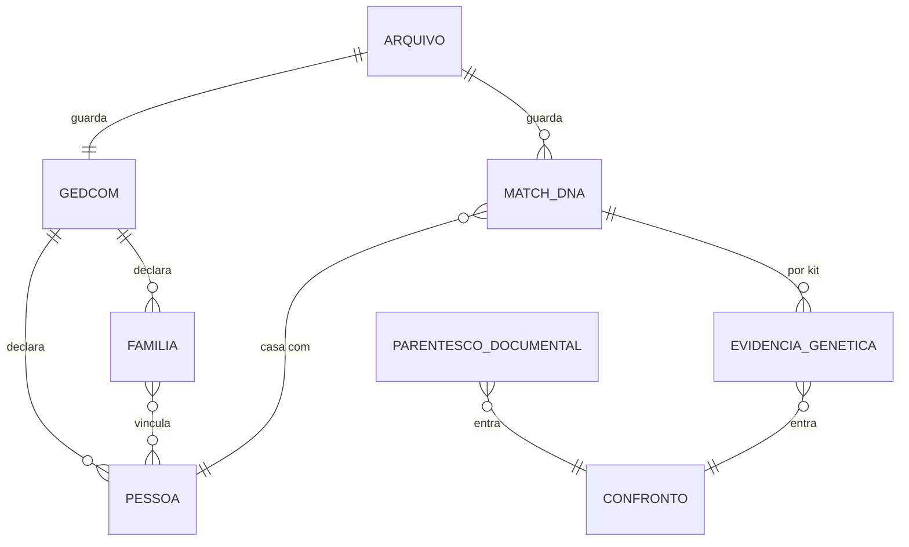

# Alma do Sistema

> Síntese executiva do projeto **analisador-genealogico** (Genetic Genealogy Path Analyzer).
> Regerada por **reversa-extract-soul** em **2026-10-20**, nível `completo`, idioma Português.
> Substitui a versão de **2026-10-08**, preservada em `.reversa/soul.20261008-1253.md`.
> Fontes, na ordem de autoridade: `_reversa_sdd/architecture.md` e `c4-components.md`
> (2026-10-17); `domain.md`, `state-machines.md`, `permissions.md`, `data-dictionary.md`,
> `erd-complete.md` e `inventory.md` (2026-10-10); os **36** ADRs de `_reversa_sdd/adrs/`;
> `gaps.md` (2026-10-13), `confidence-report.md` e `questions.md` (2026-10-10); os
> `requirements.md` das cinco units; os adendos `013` a `038` de `_reversa_sdd/addenda/`;
> e o código de `src/`.
> Escala: 🟢 CONFIRMADO | 🟡 INFERIDO | 🔴 LACUNA. Toda afirmação leva uma marca.
> 🔴 **Aviso de leitura:** a SDD é de 2026-10-17 e os últimos commits são de 2026-10-20
> (features 028 a 038). Onde a fonte documental não alcança, este documento cita o código e
> marca o ponto como inferência ou lacuna.

---

## 1. Propósito

**analisador-genealogico** é uma **aplicação web Flask**, monolítica e de um único processo,
para **genealogistas genéticos**: recebe uma **árvore GEDCOM** e um **relatório de matches de
DNA em CSV** do próprio operador e responde "como eu me conecto a essa pessoa?". 🟢

O produto **não** afirma parentesco a partir de DNA. Separa **três eixos que não se
contaminam** (o que o GEDCOM afirma, o que o CSV informa, o confronto) e publica o confronto
como **um de quatro estados**, sempre dizendo por quê. 🟢 Em volta desse núcleo, o sistema de
2026-10-20 acrescentou verificações que **rotulam sem reescrever** (identidade do match, janela
de vida, profundidade do caminho, validador de dados e endogamia), a **árvore sugerida** quando
a linha se prova quebrada, e os **descartes com motivo em português comum e exportação em
CSV**. 🟢

A persona é **uma só**, o operador, sem login, sem sessão e sem papéis; a defesa de borda é uma
**lista de `Host` confiáveis** (`TRUSTED_HOSTS`, padrão `127.0.0.1` e `localhost`), que não é
autenticação (`src/app.py`). 🟢 A dor atacada é a armadilha da genealogia genética: **cM
compatível não prova caminho**, e **caminho documental plausível não é confirmado por DNA**;
o sistema troca a afirmação silenciosa por leituras declaradas e um veredito auditável. 🟡

---

## 2. Entidades centrais

Oito entidades sustentam o esqueleto, na ordem da travessia do dado: do arquivo guardado até o
veredito. As quatro primeiras vêm do mundo do operador; as quatro seguintes são os **três eixos
independentes e o único ponto onde eles se encontram**.

| # | Entidade | O que representa | Relações diretas | Conf. |
| --- | --- | --- | --- | --- |
| E1 | **ARQUIVO ARMAZENADO** | O que a aplicação guarda: **chave de conteúdo** de 16 hexadecimais no nome, nome visível preservado e **posição** (pasta de upload ou `_aposentados/`). É o único estado que sobrevive ao processo | 1:1 com GEDCOM quando é árvore; 1:N com MATCH_DNA quando é CSV | 🟢 |
| E2 | **GEDCOM** (árvore) | A árvore enviada, validada por conteúdo (`0 HEAD`), reparseada a cada `POST` e tratada como **valor de quatro posições** `(people, families, graph, child_to_family)` | 1:N com PESSOA e FAMILIA | 🟢 |
| E3 | **PESSOA** (`INDI`) | Indivíduo identificado por `xref_id`; `FAMC` e `FAMS` são os vínculos | N:M com FAMILIA (filho, cônjuge ou genitor) | 🟢 |
| E4 | **FAMILIA** (`FAM`) | Unidade com `HUSB`, `WIFE` e `CHIL`, chave da navegação e do grafo bipartido pessoa-família | N:M com PESSOA | 🟢 |
| E5 | **MATCH_DNA** | Linha do CSV: nome, cM, kit e, desde 2026-10-14, a coluna `MRCA` que antes era lida e descartada. A chave é o par **(nome, kit)**, nunca só o nome | 1:N com EVIDENCIA_GENETICA (uma por kit); casa com PESSOA por matching difuso | 🟢 |
| E6 | **EVIDENCIA_GENETICA** | O que o CSV informa: kit, cM total e mitigado, segmentos, maior bloco, SNPs e estimativa de MRCA. **Não conhece o GEDCOM** e nunca soma kits diferentes | N:1 com MATCH_DNA; alimenta POSSIBILIDADES | 🟢 |
| E7 | **PARENTESCO_DOCUMENTAL** | O que a árvore sustenta: caminho, MRCA, distância geracional, status (`not_found`, `found`, `ambiguous`, `affinity`) e evidência por salto. **Nunca lê cM** | 1:1 com o par analisado (pessoa raiz mais match) | 🟢 |
| E8 | **CONFRONTO** | O veredito do confronto: `COMPATIVEL`, `POSSIVEL`, `CONFLITANTE` ou `INCONCLUSIVO`, por kit, com junção pelo mais conservador | 1:1 com o par; recebe E7 e POSSIBILIDADES | 🟢 |

> **Leitura:** os três eixos chegam ao `CONFRONTO` por caminhos independentes, e ele é o único
> ponto onde se encontram. A evidência chega pelo par `MATCH_DNA` + `EVIDENCIA`; o documento,
> pelo `PARENTESCO_DOCUMENTAL`; o confronto não reescreve nenhum dos dois. 🟢

**Entidades de apoio, fora do diagrama para não poluí-lo.** **POSSIBILIDADES** é o cM traduzido
em lista pela tabela do **Shared cM Project 4.0** (27 relações publicadas, 6 não publicadas,
justamente as mais distantes). O **VEREDITO** é a checagem por cartão, em três estados:
`VALIDADO`, `INCONCLUSIVO` e `ERRO CRONICO / QUEBRA DE LINHA`. A **ARVORE SUGERIDA** é a cópia
do grafo com a junção provada cortada e gerações virtuais injetadas. A **ANALISE_REGISTRADA** é
o retrato do que morreria ao fim da requisição. O **AVISO**, par `{code, message}`, carrega a
granularidade que o status perde de propósito. O **CACHE_DE_NOMES** é o único estado de módulo
do núcleo. 🟢

**Arquitetura de dependência, que é o esqueleto.** Medido por AST em 2026-10-20: **oito pacotes**
(`app`, `application`, `core`, `parsers`, `ports`, `reporting`, `utils`, `tests`), **23 arestas**
de importação e **zero ciclos**. 🟢 Entre os sete pacotes de `src/`, são **16 arestas**:
`core → utils`; `parsers → core, utils`; `ports → parsers, utils`; `reporting → utils`;
`application → core, parsers, ports, utils`; `app →` os seis. 🟢 `utils/` é o único pacote
folha real; `reporting/` não importa `core` desde o resolvedor de diagrama (`ADR-34`). 🟢
🟡 A aresta **`application → parsers`** é nova em relação ao grafo que a SDD declara
(`application → core, ports`) e nasce em `src/application/validacao.py`: não cria ciclo, mas
afrouxa a fronteira que o `ADR-25` descreve, e a SDD ainda não a registra.

**A superfície e as cinco unidades.** A aplicação tem **cinco rotas** (`/`, `/app.css`,
`/banner.png`, `/apple-touch-icon.png`, `/descartes.csv`) e **cinco ações de `POST` em `/`**
(`upload_gedcom`, `dna_analysis`, `path_search`, `selecionar_arvore`, `aposentar_arquivo`), todas
despachadas por `request.form["action"]` em `src/app.py`. 🟢 As unidades são `upload-gedcom`
(envio, validação de conteúdo e reenvio), `tela-de-entrada` (as duas abas de arquivos, a escolha
da árvore e o aposentar), `analise-dna` (a análise, o confronto e os cartões), `busca-caminho`
(a busca entre duas pessoas) e `recursos-da-tela` (as duas artes e a folha de estilo servidas por
rota). 🟢 A tela é uma só, em **três fases** (árvores GEDCOM, busca no GEDCOM, analisador de
DNA); a fase ativa é derivada no servidor da presença de `gedcom_filename`, porque não há sessão
para lembrar escolha. 🟢

---

## 3. Decisões fundadoras

Sete escolhas sustentam o esqueleto. As seis de 2026-10-08 continuam válidas no princípio e
aparecem com o que a extração de **2026-10-10** corrigiu; a sétima é o eixo que as features
028 a 038 acrescentaram e que nenhuma decisão anterior cobria.

### D1. Separar parentesco documental, evidência genética e confronto, com quatro estados

- **Evidência:** `src/core/dna_analysis.py` (a "Regra absoluta (nao regredir)" do cabeçalho),
  `src/core/evidence_comparison.py`, `src/core/documentary_relationship.py`,
  `tests/test_confrontacao_gedcom_dna.py`, `_reversa_sdd/adrs/14-separar-documental-genetica-e-confronto.md`,
  `_reversa_sdd/adrs/15-confronto-por-sobreposicao-de-faixas.md` e `_reversa_sdd/state-machines.md` §3. 🟢
- **Implicação:** o DNA **não** altera o parentesco documental; conflito vira aviso e rol de
  causas, nunca reescrita de vínculo, e o cM nunca afirma parentesco sozinho. O veredito é
  decidido por **sobreposição de faixas** e não por meioses, o estado inicial é `INCONCLUSIVO`
  (o caminho de falha é o padrão) e, com vários kits, vence sempre o mais conservador. 🟢
- **Confiança:** 🟢 CONFIRMADO. É a decisão que o sistema inteiro serve, e nenhuma das features
  005 a 038 a tocou.

### D2. Núcleo puro em `src/core/`, com a árvore como valor passado por parâmetro

- **Evidência:** `src/core/` (22 módulos, 5.622 linhas não vazias), `tests/test_dependencias_nucleo.py`
  (guardas por AST, com prova negativa), `tests/test_arvore_devolvida.py`,
  `_reversa_sdd/adrs/24-nucleo-puro-arvore-por-parametro.md` e a ausência de
  `src/core/gedcom_state.py`. 🟢
- **Implicação:** a árvore deixou de ser estado global e é **valor** que entra por primeiro
  parâmetro em toda função pública do núcleo; `core/` importa **só `utils/`**, não faz I/O e não
  conhece framework. Ler CSV e emitir diagrama são dependências de borda, montadas uma vez e
  injetadas (`Dependencias`), e é isso que fechou a lacuna crítica de corrida entre threads. 🟢
- **Confiança:** 🟢 CONFIRMADO, com dois limites declarados: existe **um** estado de módulo, o
  cache de nomes de `documentary_relationship.py`, e a guarda procura nomes fixos, então um cache
  com outro nome passaria; e `Dependencias` continua classe concreta do núcleo, não interface da
  fronteira. 🔴

### D3. Casos de uso em `src/application/`, mundo externo por `src/ports/` e desfecho em três valores

- **Evidência:** `src/application/` (8 módulos, 919 linhas), `src/ports/` (2 módulos, 697 linhas,
  quatro `Protocol` e três adaptadores), `_reversa_sdd/adrs/25-fronteira-de-aplicacao-portas.md`,
  `adrs/26-dono-no-port-como-costura.md` e `adrs/33-desfecho-em-tres-valores-e-projecao-pura.md`. 🟢
- **Implicação:** a rota **adapta**, o caso de uso **orquestra** e o núcleo **decide**; erros de
  domínio são exceções tipadas com raiz `ErroDeDominio` e voltam ao literal exato da tela por
  `src/application/traducao.py`. O modo de renderização vem de um **`Desfecho` de três valores**
  (`RESULTADO`, `SEM_RESULTADO`, `ERRO_DE_ENTRADA`), nunca do texto da mensagem, e o payload da
  porta é dado **plano**, produzido por projeção pura no caso de uso. 🟢
- **Confiança:** 🟢 CONFIRMADO. 🔴 O `dono` é **costura de assinatura, não funcionalidade**:
  parâmetro obrigatório em todos os métodos das portas, coluna `owner_id` no banco, e **nenhum
  `WHERE`, `CHECK` ou índice começa por ele**.

### D4. Guardar o upload por chave de conteúdo e dar ciclo de vida ao arquivo

- **Evidência:** `src/utils/validate.py`, `src/application/reenvio.py`, `src/ports/adaptadores.py`
  (`ArmazenamentoEmDisco`, `PASTA_DE_APOSENTADOS`), `.gitignore` (`**/uploads/*` com exceção de
  `src/uploads/.gitkeep`), `_reversa_sdd/adrs/17`, `adrs/30-aposentar-em-vez-de-apagar.md`,
  `adrs/31-reenvio-com-substituicao.md`, `adrs/32-elegibilidade-por-forma-de-nome.md` e
  `adrs/35-pasta-de-uploads-dentro-do-repositorio.md`. 🟢
- **Implicação:** a referência é o **sha256 do conteúdo truncado em 16 hexadecimais** mais o nome
  visível, e é ela que circula no campo `gedcom_filename` entre requisições; a elegibilidade é
  por **forma de nome** (sem barra, sem NUL, sem `.` ou `..`, basename de si mesma), não por
  alfabeto fechado, porque o gravador preserva acento e espaço. **Nada é apagado**: `aposentar`
  move para `<pasta>/_aposentados/`, e reenviar um conteúdo novo **substitui** a versão anterior
  (desfechos `identico`, `substituido`, `novo`), aposentando a antiga. 🟢
- **Confiança:** 🟢 CONFIRMADO. Medido hoje: 8 arquivos na pasta e 26 em `_aposentados/`. 🔴 O
  estado "aposentado" **não é consultável** pela aplicação (não há coluna nem índice: quem sabe é
  o sistema de arquivos), e a corrida sobre o disco permanece, porque `guardar` e `aposentar`
  verificam e depois agem.

### D5. Persistir o histórico em PostgreSQL como camada de saída opcional

- **Evidência:** `init.sql` (6 tabelas idempotentes), `src/ports/adaptadores.py`
  (`RegistroDeAnalisesPostgres`), `src/app.py` (regra dos três estados e `DATABASE_URL`),
  `docker/Dockerfile`, `docker-compose.yml`,
  `_reversa_sdd/adrs/27-persistencia-postgres-opcional.md` e `adrs/28`. 🟢
- **Implicação:** a persistência entra **depois** do processamento e **fora** da decisão, em
  três estados: sem `DATABASE_URL` o registrador é nulo e a tela não muda um byte; com banco
  respondendo, grava em uma transação por análise; com gravação falhando, a análise **conclui e é
  exibida** e o operador recebe só um aviso. O driver é importado de forma preguiçosa, a árvore
  não é duplicada (grava-se o retrato das pessoas) e **nada é lido do banco** para decidir. 🟢
- **Confiança:** 🟢 para o mecanismo. 🔴 Medido hoje: `import psycopg2` **falha** no `.venv/`
  oficial, então a persistência fica desligada no interpretador da suíte e da paridade, e o
  caminho de gravação só foi provado dentro do contêiner. Também é 🔴 que o banco guarda nome,
  sexo, datas e local de nascimento de **pessoas vivas** sem retenção, expurgo nem consentimento.

### D6. Servir arte derivada, com receita única em `tests/` e rota própria

- **Evidência:** `src/assets/apple-touch-icon.png` (180x180, opaco), `src/assets/banner-da-tela.png`,
  `tests/icone_de_atalho.py`, `tests/banner_da_tela.py`, `tests/test_deriva_da_arte.py`,
  as rotas `GET /apple-touch-icon.png`, `GET /banner.png` e `GET /app.css` em `src/app.py`,
  `_reversa_sdd/adrs/29-arte-derivada-com-receita-unica.md` e o adendo `013`. 🟢
- **Implicação:** a arte canônica mora em `docs/` e a **derivada é commitada** em `src/assets/`,
  porque o `.dockerignore` é lista de permissão e fonte canônica não existe dentro da imagem; a
  receita tem **fonte única** em `tests/`, e o teste de deriva regenera e compara **pixel a
  pixel**, nunca por `sha256` (o mesmo desenho existe em disco com dois tamanhos e diferença zero).
  A biblioteca de imagem fica fora de `requirements.txt`, `src/static/` continua proibida, e o
  que o navegador recebe não é o arquivo do designer, é a **renderização derivada**. 🟢
- **Confiança:** 🟢 CONFIRMADO. 🔴 A derivação do CSS não existe: `GET /app.css` serve
  `src/assets/app.css` (985 linhas não vazias) **escrito à mão**, e este é o terceiro recurso de
  runtime servido por rota, além das duas artes.

### D7. Verificar sem reescrever: diagnóstico aditivo e rastro exportável

- **Evidência:** `src/core/validator.py` (três estados), `src/core/janela_de_vida.py`,
  `src/core/identidade_do_match.py`, `src/core/profundidade_do_caminho.py`,
  `src/core/endogamia.py`, `src/core/cirurgia_do_grafo.py`, `src/core/motivos_do_descarte.py`,
  `src/reporting/csv_de_descartes.py`, a rota `POST /descartes.csv` e os adendos `015`, `016`,
  `028` a `038`. 🟢
- **Implicação:** cada verificação devolve **rótulo**, e nenhuma mexe em limiar, peso, ramo de
  aceitação ou desempate do matching: a janela de vida diz que o registro não pode ser o doador,
  a identidade diz se o nome do CSV é o da pessoa escolhida, a profundidade compara a árvore com
  o `MRCA` do próprio kit, e o validador resume em `VALIDADO`, `INCONCLUSIVO` ou
  `ERRO CRONICO / QUEBRA DE LINHA`, com o pior status vencendo. Quando a linha se prova quebrada,
  a resposta é uma **cópia** do grafo com gerações virtuais (`cirurgia_do_grafo`), nunca mutação
  da árvore recebida; o descarte ganha **frase por causa**, em ordem de precedência, e a lista de
  trabalho sai em CSV de 9 colunas, com BOM, ponto e vírgula e guarda contra fórmula. 🟢
- **Confiança:** 🟢 para o mecanismo, provado no código e nos adendos. 🟡 para tratá-lo como
  eixo fundador: é a leitura desta síntese, porque a SDD de 2026-10-17 não o nomeia e a onda 028
  a 038 não foi absorvida pela extração.

---

## 4. Lacunas

O `gaps.md` de 2026-10-13 **não registra lacuna crítica**: a única das duas rodadas anteriores
(corrida entre requisições concorrentes sobre o estado do GEDCOM) fechou em 2026-10-07 pelo
`ADR-24`, e a verificação é por execução, não por leitura. 🟢 O que segue aberto é de custo, de
escopo e de cobertura. As oito abaixo são 🔴.

| # | Lacuna | Pergunta sugerida ao humano |
| --- | --- | --- |
| L1 | **Sem identidade e sem isolamento.** Não há `session`, `login`, `auth`, `role` ou `permission` em `src/`; a chave de conteúdo é identificador, não segredo, e a lista completa de nomes vai em toda resposta. O `owner_id` existe e não filtra nada. | "O aceite de risco single-tenant continua válido, e a lista de `Host` confiáveis basta como defesa até a Onda 3?" |
| L2 | **Colisão da chave do cache de nomes** (`L-24` / `E-05`). `_chave_de` é `(len(people), primeira chave, última chave)`, e duas árvores do mesmo tamanho com os mesmos xrefs extremos compartilham o índice; o dossiê de homônimos passa a citar xrefs de outra árvore e degrada para "Sem Nome". Foi **confirmado por execução** em 2026-10-10, e a correção estava agendada, mas o código de 2026-10-20 mantém a chave. | "A correção da chave do cache entra antes de qualquer uso com duas árvores na mesma sessão?" |
| L3 | **Dado pessoal persistido sem retenção.** `analysis_person` grava nome, sexo, nascimento, local e falecimento, inclusive de pessoas vivas, sem expurgo nem consentimento (`L-29` / `P-07`). O uso do legado com dado de terceiros está **declarado proibido** enquanto isso não existir. | "A retenção entra no alvo, ou o histórico em Postgres fica restrito ao operador até a Onda 5?" |
| L4 | **O histórico só grava.** Nada é lido do banco para decidir, completar ou corrigir a tela, não há interface de histórico, o estado "aposentado" não é consultável e o veredito do operador por conexão continua sem lugar (`gaps.md` §6, requisito 2). | "Histórico e veredito do operador entram na próxima feature?" |
| L5 | **O CSV de DNA não tem validação de conteúdo**, só a forma do nome, e a cobertura de exportadores é declarada: o alvo é o GEDmatch (`gaps.md` §6, requisito 4; dívida #11). | "Outros exportadores entram no escopo, e a validação de conteúdo do CSV pertence ao alvo?" |
| L6 | **A SDD de 2026-10-17 é anterior ao código de 2026-10-18 a 2026-10-20.** `inventory.md` e `c4-context.md` registram **4 rotas** e o código tem **5** (`/`, `/app.css`, `/banner.png`, `/apple-touch-icon.png`, `/descartes.csv`); `recursos-da-tela` ainda descreve duas artes e não o CSS; e **12 módulos** de 028 a 038 (`validator`, `endogamia`, `janela_de_vida`, `identidade_do_match`, `profundidade_do_caminho`, `cirurgia_do_grafo`, `motivos_do_descarte`, `validacao`, `correcao`, `csv_de_descartes`, `visualizer`, `segmentos_gedmatch`) não estão no C4 nem nas units. | "A próxima extração absorve os adendos 028 a 038, ou o registro por adendo é o formato definitivo?" |
| L7 | **A ordem de inserção das arestas do grafo não está sob teste** (`X-04`), embora determine qual caminho o `shortest_path` devolve: é a última lacuna de ordem do projeto. | "Vale um teste que congele a ordem de inserção, como o `matching` fez com o desempate?" |
| L8 | **Endogamia e colapso de pedigree são avisados, não corrigidos.** O colapso é detectado por mais de um caminho mais curto e aparece em bloco próprio, mas não altera o veredito, e no caso de população isolada o cM lido é teto otimista (`ADR-21`, `L-17`). | "Detectar endogamia populacional também, ou o aviso atual é o contrato definitivo?" |

**Não são lacunas, são decisões vigentes:** o teto de 20 iterações do BFS que corta em silêncio,
a varredura condicional de `get_spouses`, a endogamia apenas avisada, o `cm_estimator.py` fora do
fluxo, o `RepositorioDeArvores` declarado sem implementação, a aresta do grafo sem tipo (filiação
e casamento contam o mesmo salto) e a lista de uploads sem filtro nenhum. 🟢

---

## 5. Como ler esse documento

Esta é uma **síntese**, e não substitui:

- `_reversa_sdd/inventory.md` para superfície, rotas e contagens, **lendo junto os adendos 013 a 038**
- `_reversa_sdd/code-analysis.md` e `flowcharts/` para o detalhe módulo a módulo (233 regras)
- `_reversa_sdd/domain.md` para as regras de negócio, o glossário e as mensagens de contrato
- `_reversa_sdd/state-machines.md` e `permissions.md` para as máquinas de decisão e a ausência de RBAC
- `_reversa_sdd/architecture.md`, `c4-*.md` e `erd-complete.md` para C4 e estruturas de dados
- `_reversa_sdd/adrs/` para as 36 decisões, com `ADR-36` como quadro de revalidação das 23 herdadas
- `_reversa_sdd/gaps.md`, `confidence-report.md` e `questions.md` para o passivo e os números
- os `requirements.md`, `design.md`, `tasks.md` e `contracts.md` das cinco units, para o contrato fino

**Números medidos em 2026-10-20, com o método junto.** Contando só linhas **não vazias**:
**142 arquivos** de código e **30.965 linhas**, sendo **140 arquivos `.py` com 28.156 linhas**
(47 em `src/` com 9.906, 93 em `tests/` com 18.250), mais `src/templates/index.html` com **1.824**
e `src/assets/app.css` com **985**. 🟢 `src/app.py` tem **789** linhas não vazias (881 cruas). 🟢
Por pacote de `src/`: `core` 22 arquivos e **5.622** linhas; `application` 8 e **919**;
`reporting` 5 e **981**; `ports` 2 e **697**; `parsers` 4 e **484**; `utils` 5 e **414**. 🟢

**SDD:** 5 units, **150 requisitos funcionais** (24 + 34 + 43 + 24 + 25), **154 tarefas**,
**39 histórias de usuário**, **36 ADRs** e **3.420 marcadores** de confiança, com **90,4 %**
globais no `confidence-report.md` de 2026-10-10 (eram 1.922 marcadores em 2026-10-05). 🟢

**Base de prova:** suíte **1.381 aprovados e 9 pulados**, sem `DATABASE_URL`, em 3 min 54 s, e
cobertura de `src/` de **92 %** (**3.859** instruções, **313** descobertas). 🟢 Medido com
`.venv/Scripts/python.exe -m pytest --cov=src`. Os 9 pulos são, na maioria, do adaptador de
persistência, que não executa no host porque o driver não está no `.venv/`. 🟢
