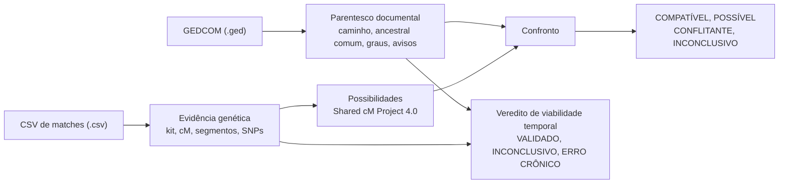
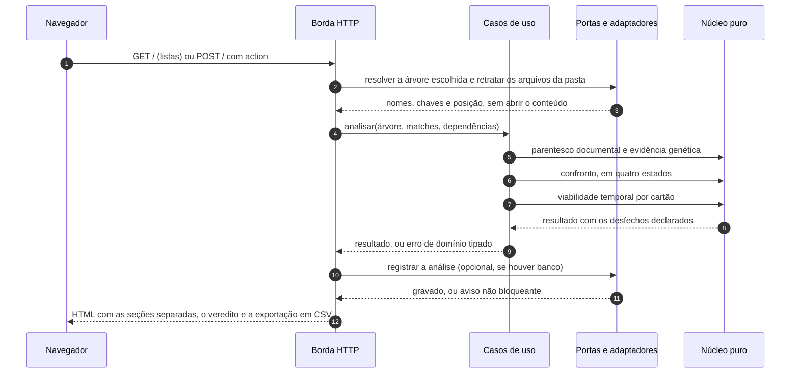
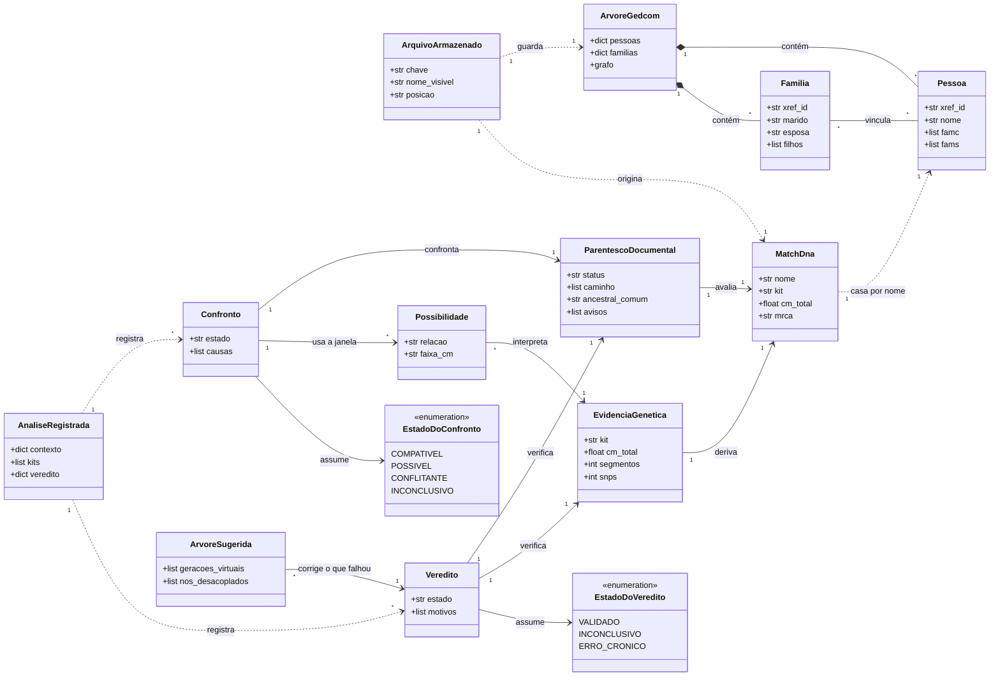
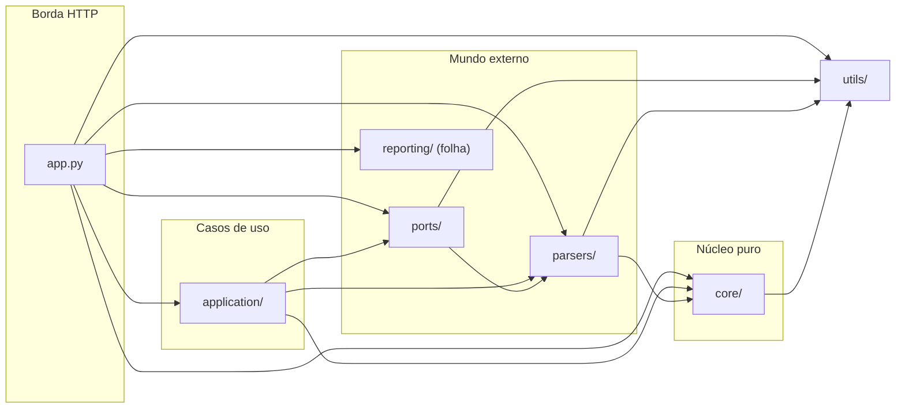

# Analisador Genealógico

<p align="center">
  
</p>


Aplicação web para genealogia genética. Cruza uma árvore GEDCOM (`.ged`) com uma lista de matches de DNA
(`.csv`) e apresenta caminhos documentais, evidências genéticas e possibilidades de parentesco sem tratar o
cM como confirmação genealógica.

## Regra de análise (GEDCOM, DNA e confronto)

A aplicação separa rigorosamente três coisas, e nunca deixa uma contaminar a outra:

1. **Parentesco documental** — o que o GEDCOM afirma: caminho, ancestral comum, distância geracional,
   homônimos, caminhos múltiplos, colapso de pedigree e a evidência de cada salto (registro de família e datas).
2. **Evidência genética** — o que o arquivo de DNA informa: kit, fonte, cM total, segmentos, maior segmento,
   SNPs, cromossomo e posições.
3. **Possibilidades e confronto** — o cM vira uma **lista** de relacionamentos compatíveis pela tabela
   publicada do Shared cM Project 4.0, e o confronto devolve um dos quatro estados:

| Estado | Significado |
| --- | --- |
| **COMPATÍVEL** | o parentesco documental não entra em conflito evidente com o cM observado |
| **POSSÍVEL** | a evidência permite o relacionamento, mas não confirma o caminho documental |
| **CONFLITANTE** | a incompatibilidade é significativa; verifique as causas listadas |
| **INCONCLUSIVO** | os dados não permitem avaliar (sem DNA, sem caminho, homônimo ou sem faixa publicada) |

Três invariantes que o código e a interface respeitam:

- **O GEDCOM determina o parentesco documental.** O DNA não altera, não corrige e não cria caminho
  genealógico.
- **O cM não é usado sozinho para afirmar parentesco.** `cM → conjunto de possibilidades`, nunca `cM → parentesco único`.
- **DNA compartilhado não confirma o caminho.** O máximo que a tela afirma é que existe compartilhamento; o
  parentesco documental é apresentado em seção própria, com fonte declarada.

### O veredito de viabilidade, que também não prova nada

Além do confronto, cada comparação entre um kit e uma pessoa recebe um **veredito temporal**, calculado no
núcleo por `src/core/validator.py`:

| Veredito | Significado |
| --- | --- |
| **VALIDADO** | a linha documental é temporalmente viável, o cM é compatível e não há contradição detectável |
| **INCONCLUSIVO** | falta dado, a data é estimada, o cM não tem faixa publicada, a identidade é ambígua ou há afinidade no caminho |
| **ERRO CRÔNICO** | há contradição demonstrável: salto impossível, ancestral comum posterior ao descendente, idade por lado fora de 12 a 70, cM incompatível com a profundidade ou doador vivo em linha incompatível |

**VALIDADO não é prova de parentesco**: é a ausência de contradição com os dados disponíveis. O veredito é
uma checagem a mais no cartão, ao lado do confronto, e não altera o que o GEDCOM afirma.

## Stack Tecnológica

O projeto usa Python 3.14. O interpretador oficial é o ambiente virtual `.venv`; as dependências de runtime
estão fixadas em [`requirements.txt`](./requirements.txt).

| Tecnologia | Versão | Uso |
| --- | --- | --- |
| Flask | 3.1.3 | Aplicação web e renderização Jinja2 |
| waitress | 3.0.2 | Servidor WSGI |
| ged4py | 0.5.5 | Leitura de arquivos GEDCOM |
| NetworkX | 3.7 | Grafo e busca de caminhos |
| pandas | 3.0.6 | Ingestão e processamento de CSV |
| thefuzz | 0.22.1 | Comparação aproximada de nomes |
| RapidFuzz | 3.14.6 | Backend de matching, fixado para manter resultados reprodutíveis |
| python-Levenshtein | 0.27.5 | Backend de distância de edição |
| psycopg2-binary | 2.9.13 | Driver do PostgreSQL, importado só quando há `DATABASE_URL` |
| graphviz | 0.21 | Desenho da árvore sugerida, servido em SVG |
| Bootstrap | 5.3.3 | Componentes da interface, por CDN |
| Mermaid | 10 | Diagramas de caminhos, por CDN |
| Cormorant Garamond e Manrope | — | Tipografia da tela, por CDN |
| `src/assets/app.css` | — | Folha própria de 985 linhas, servida em `/app.css` |

## Arquitetura do Projeto

O Flask recebe os arquivos e renderiza HTML no servidor. O código tem quatro camadas com papéis
distintos: `src/app.py` é a borda HTTP, `src/application/` orquestra os casos de uso, `src/core/` decide
sem conhecer HTTP nem disco, e o mundo externo entra por `src/ports/`, onde ficam os `Protocol` das portas
e os adaptadores concretos, que por sua vez usam `src/parsers/`, `src/reporting/` e `src/utils/`.

- Os arquivos enviados são gravados na **pasta canônica de dados**, `src/uploads/`, sob nomes derivados do
  conteúdo. O destino é resolvido por `_pasta_uploads()` e pode ser sobreposto por `ANALISADOR_UPLOAD_FOLDER`
  — sobreposição que a suíte e o invólucro de paridade usam para não escreverem na pasta real; ver "Onde ficam
  os arquivos enviados". O diretório é armazenamento local persistente, não um diretório temporário.
- O histórico das análises é **opcional**: sem `DATABASE_URL` nada é gravado e a tela não muda; com a
  variável e o banco respondendo, a análise é registrada em uma transação única; se a gravação falhar, a
  análise **conclui e é exibida** e o operador recebe apenas um aviso não bloqueante. Nada é lido do banco
  para decidir o que a tela mostra: o banco é histórico, não fonte de decisão.
- O GEDCOM é reprocessado em cada `POST` que usa a árvore. A árvore existe **por requisição**: cada `POST`
  faz o parse do arquivo e passa o resultado como parâmetro para o núcleo, que é composto de funções puras.
  Não há estado de domínio compartilhado entre requisições nem entre threads — a aplicação impede outra
  instância na mesma porta, mas nenhuma requisição depende disso para estar correta.
- A lista completa de nomes da árvore, inclusive nomes de pessoas vivas, é incluída no HTML para preencher
  campos de sugestão. A aplicação não tem autenticação; não a exponha a uma rede compartilhada sem controles
  adicionais.

### Os três eixos da análise

O núcleo do produto é a separação. O GEDCOM alimenta um eixo, o CSV alimenta outro, e só no fim os dois se
encontram, em um veredito que nunca reescreve o parentesco documental. Há **duas saídas** nesse encontro: o
confronto, em quatro estados, e a viabilidade temporal, em três.



### O ciclo de uma requisição

O caminho do dado, da borda até a tela, com o registro opcional no fim. A rota adapta, o caso de uso
orquestra e o núcleo decide. São **cinco rotas**: a do formulário (`/`, com despacho por cinco ações) e
quatro auxiliares (`/app.css`, `/banner.png`, `/apple-touch-icon.png` e `/descartes.csv`, a única delas que
só aceita `POST`).



### UML do domínio

As entidades que sustentam a decisão e as relações entre elas. `ParentescoDocumental` nunca lê cM, e
`EvidenciaGenetica` nunca conhece o GEDCOM: eles só se encontram no `Confronto` e, de novo e de forma
independente, no `Veredito`. O `ArquivoArmazenado` é o único estado que sobrevive ao processo.



O valor real do terceiro estado do veredito é `ERRO CRONICO / QUEBRA DE LINHA`; aqui ele aparece abreviado
porque nome de valor de enumeração no Mermaid não aceita espaço.

### A fronteira entre o núcleo e o mundo

O núcleo é puro e depende apenas de `utils/`. Tudo o que é de fora entra por `ports/`, e as setas apontam
sempre para dentro: não há ciclo entre os oito pacotes, e são 23 arestas. Uma delas merece nota: o
`application/` passou a importar `parsers/` diretamente na fachada de validação, o que afrouxa o desenho
original da fronteira e está registrado como tal no ADR-25.



## Começando (Getting Started)

### Pré-requisitos

- Python 3.14
- Git

### Instalação e Configuração

1. Clone o repositório e entre na pasta do projeto.
2. Crie e configure o ambiente oficial (PowerShell, na raiz do repositório):

   ```powershell
   py -3.14 -m venv .venv
   .\.venv\Scripts\python.exe -m pip install -r requirements.txt
   ```

3. Execute a aplicação:

   ```powershell
   .\.venv\Scripts\python.exe src\app.py
   ```

4. Acesse `http://127.0.0.1:5000/`. Por padrão, o servidor atende apenas a máquina local.

Para configurar outro ambiente, instale Python 3.14 e recrie `.venv`. Não use o Python global para executar
ou testar: o backend RapidFuzz participa da decisão de matching, e as versões instaladas estão pinadas para
reprodutibilidade.

### Executar com Docker

O `docker-compose.yml` da raiz sobe a aplicação **e** o PostgreSQL com um comando, a partir da raiz do
repositório:

```powershell
docker compose up -d --build
```

Há um atalho na raiz que faz isso com a revisão já preenchida e imprime o que ficou no ar:

```powershell
.\atualizar.ps1
```

A aplicação fica em `http://127.0.0.1:5080/` — a porta 5080 do host é publicada para a 5000 do container —,
e os uploads continuam sendo `src/uploads`, montada dentro do container como
`./src/uploads:/app/src/uploads`. O banco sobe junto, e é ele que guarda o histórico das análises.

> **O `--build` não é opcional depois de mexer no código.** O `docker/Dockerfile` leva o `src/` para dentro
> da imagem por `COPY src/ /app/src/`, então uma edição em `src/` **não chega ao container**: sem `--build`,
> o container continua servindo o código do dia em que a imagem foi construída. Uma imagem de 2026-10-09
> chegou a servir, por horas, o código anterior à feature 011 sem que nada na tela denunciasse.

Para conferir de quando é a imagem que está no ar — as duas marcas são gravadas no build, e nenhuma delas
depende de alguém lembrar de anotar:

```powershell
docker image inspect genealogia-app --format '{{json .Config.Labels}}'
docker compose exec -T app cat /app/CONSTRUIDO_EM
```

O primeiro comando mostra o rótulo `org.opencontainers.image.revision`; o segundo, o instante do build
gravado dentro da imagem. Para o rótulo trazer o commit em vez de `desconhecida`, informe a revisão antes
de construir:

```powershell
$env:REVISAO = git rev-parse --short HEAD
docker compose up -d --build
```

### Configuração de execução

O bloco de entrada lê três variáveis de ambiente — todas com padrão declarado no código, então nada precisa
ser definido para subir a aplicação. A tabela inclui ainda a variável da pasta de upload, que é lida na
**importação** do módulo, e não no bloco de entrada:

| Variável | Padrão | Para que serve |
| --- | --- | --- |
| `ANALISADOR_HOST` | `127.0.0.1` | endereço de escuta. O padrão atende apenas a máquina local; use `0.0.0.0` para atender a rede |
| `ANALISADOR_PORT` | `5000` | porta de escuta |
| `ANALISADOR_THREADS` | `4` | número de threads do servidor |
| `ANALISADOR_UPLOAD_FOLDER` | *(sem padrão: usa `<diretório do app>/uploads`)* | pasta que recebe os arquivos enviados. É uma **sobreposição de processo**, usada pela suíte e pelo invólucro de paridade para não escreverem na pasta de dados; ver "Onde ficam os arquivos enviados" |

#### Abrir a aplicação para a rede

> **A aplicação não tem autenticação.** Qualquer equipamento que alcance a porta pode acessar a interface e
> enviar arquivos. O padrão é fechado; abrir a rede é uma decisão de quem opera.

No PowerShell, a partir da raiz do repositório:

```powershell
$env:ANALISADOR_HOST = "0.0.0.0"
.\.venv\Scripts\python.exe src\app.py
```

A inicialização informa o endereço em uso (`Servindo com waitress em http://0.0.0.0:5000 ...`). De outro
equipamento da mesma rede, acesse `http://<ip-da-máquina>:5000/`. Em rede compartilhada, mantenha o padrão e
não defina a variável.

#### Onde ficam os arquivos enviados

Os arquivos enviados são gravados em **`src/uploads`**, dentro do repositório, e essa é a **única** pasta que
os recebe. A aplicação resolve a pasta a partir do próprio arquivo (`_pasta_uploads()`), ancorada em
`__file__` e nunca no diretório corrente, e a cria na importação do módulo. Nada precisa ser configurado para
subir a aplicação.

Dentro dela há uma subpasta, **`_aposentados/`**, para onde vai o arquivo que o operador **aposenta** pela
tela de entrada: ele sai da lista e continua **inteiro** lá. A aplicação **nunca apaga** arquivo enviado. A
descrição da tela está em [A tela de entrada](#a-tela-de-entrada).

A variável `ANALISADOR_UPLOAD_FOLDER` existe como **sobreposição de processo**, não como modo de operação. Ela
é lida na **importação**, não a cada requisição — defini-la depois de subir não muda nada. Quem depende dela é
o teste: `tests/conftest.py` e `tests/rodar_paridade.py` a apontam para uma pasta descartável, para que nem a
suíte nem o instrumento de paridade escrevam na pasta de dados do operador.

No modo com contêiner, a mesma pasta do repositório é montada no alvo que a aplicação já deriva
(`/app/src/uploads`), sem variável de ambiente envolvida: é a linha de `volumes:` do serviço `app`, em
`docker-compose.yml`, e ela é `./src/uploads:/app/src/uploads`.

> **O que protege este dado.** Duas guardas, e só duas:
>
> - o `.gitignore` cobre `uploads/` em qualquer profundidade, então o dado **nunca** é versionado;
> - o `.dockerignore` reexclui `src/uploads/` do contexto de build, então o dado **nunca** é enviado ao
>   daemon do Docker. A reexclusão vem **depois** de `!src/**`, porque no `.dockerignore` a **última regra que
>   casa vence** — invertidas as duas linhas, o dado voltaria ao contexto de build sem que nenhuma linha
>   tivesse sido removida.
>
> As duas são presas por teste em `tests/test_guardas_do_armazenamento.py`: tirá-las faz a suíte falhar, e o
> teste confere também a ordem acima, com verificação por mutação.
>
> **A pasta é não rastreada, e isso tem preço.** `git clean -xdf` — e também `-Xdf`, que remove só o que é
> ignorado — **apaga `src/uploads` inteira**. Faça backup periódico para fora do repositório: ela é a única
> cópia do dado.

A manutenção da pasta fica em `tests/manutencao_de_uploads.py`, com quatro verbos: `manifesto` (a lista
revisável do resíduo de instrumento), `expurgo` (remove **apenas** o que estiver no manifesto, e sempre tem
simulação), `duplicatas` (relata cópias byte a byte idênticas, sem removê-las) e `migrar` (cópia verificada
por `sha256`, sem papel no modo de operação — ferramenta de cópia avulsa):

```powershell
.\.venv\Scripts\python.exe tests\manutencao_de_uploads.py manifesto --pasta src\uploads --saida manifesto.txt
.\.venv\Scripts\python.exe tests\manutencao_de_uploads.py expurgo --manifesto manifesto.txt --dry-run
.\.venv\Scripts\python.exe tests\manutencao_de_uploads.py expurgo --manifesto manifesto.txt --aplicar
.\.venv\Scripts\python.exe tests\manutencao_de_uploads.py duplicatas --pasta src\uploads
```

#### Uma instância por vez

A aplicação **recusa subir** se já houver uma instância atendendo no endereço e na porta configurados. A
segunda execução termina com código de saída diferente de zero e uma mensagem que nomeia o endereço e a
porta:

```text
Recusando subir: 127.0.0.1:5000 ja esta em uso (...). Encerre o processo que ja esta no ar, ou suba esta instancia em outra porta com ANALISADOR_PORT.
```

O trecho entre parênteses é o diagnóstico do sistema operacional. Cada processo usa a mesma pasta canônica de
dados, então duas instâncias sobre a mesma pasta competiriam pelo mesmo armazenamento, e requisições do
mesmo operador cairiam em instâncias diferentes. Encerre a instância anterior (Ctrl+C) antes de subir outra, ou
use outra porta com `ANALISADOR_PORT`.

## Estrutura do Projeto

```text
src/                            # raiz de código: 49 arquivos, 12.715 linhas não vazias
├── app.py                      # Borda HTTP: 5 rotas, despacho por 5 actions, variáveis de ambiente, guarda de instância única e montagem das dependências
├── application/                # Casos de uso: orquestram o núcleo e traduzem o desfecho
│   ├── upload_gedcom.py        # Upload: decide se pode gravar, grava sob chave de conteúdo e carrega a árvore
│   ├── dna_analysis.py         # Análise: cruza GEDCOM e CSV pelas três etapas e aplica o validador
│   ├── path_search.py          # Busca de caminho
│   ├── reenvio.py              # A regra de reenvio de arquivo, escrita em um lugar só
│   ├── validacao.py            # Fachada de leitura e cruzamento do validador de dados
│   ├── correcao.py             # Fachada de correção: do GEDCOM e do CSV até a árvore sugerida
│   └── traducao.py             # Traduz exceção de domínio de volta para o literal da tela
├── core/                       # Núcleo puro: decide sem HTTP, sem I/O e sem estado de módulo
│   ├── documentary_relationship.py  # Parentesco documental: caminho, ancestral comum, homônimos, caminhos múltiplos, colapso de pedigree
│   ├── genetic_evidence.py     # Evidência genética: kits, cM, segmentos, SNPs (nunca soma kits diferentes)
│   ├── relationship_hypotheses.py   # cM → possibilidades, pela tabela publicada do Shared cM Project 4.0
│   ├── evidence_comparison.py  # Confronto GEDCOM × DNA: COMPATÍVEL, POSSÍVEL, CONFLITANTE, INCONCLUSIVO
│   ├── validator.py            # Viabilidade temporal: VALIDADO, INCONCLUSIVO ou ERRO CRÔNICO
│   ├── endogamia.py            # Endogamia: filtro de ruído, evidência e reconvergências do colapso de pedigree
│   ├── janela_de_vida.py       # A data do registro permite que ele tenha doado o DNA? (rotula, não escolhe)
│   ├── identidade_do_match.py  # O nome do CSV e a pessoa escolhida são a mesma? (rotula, não escolhe)
│   ├── profundidade_do_caminho.py   # A árvore afirma a profundidade que o próprio kit estima?
│   ├── cirurgia_do_grafo.py    # Desacoplar a junção e injetar gerações virtuais na árvore sugerida
│   ├── motivos_do_descarte.py  # Textos humanos dos motivos de descarte
│   ├── matching.py             # Índices do GEDCOM e decisão de aceitação de candidatos
│   ├── name_normalization.py   # Normalização e decomposição de nomes
│   ├── path_finding.py         # Caminho entre duas pessoas, na árvore recebida por parâmetro
│   ├── family_navigation.py    # Quem é parente de quem, na árvore recebida por parâmetro
│   ├── dna_analysis.py         # Fachada do cruzamento para o caso de uso
│   ├── path_search.py          # Fachada da busca de caminhos para o caso de uso
│   ├── diagram_domain.py       # Consultas de domínio que o desenho do Mermaid precisa
│   ├── erros.py                # Exceções de domínio tipadas, com raiz ErroDeDominio
│   ├── registro.py             # Nome de exibição e identificador do registro
│   └── cm_estimator.py         # LEGADO: faixas de cM escritas à mão, fora do fluxo
├── ports/                      # A fronteira: os Protocol das portas e os adaptadores concretos
│   ├── __init__.py             # As portas e o conjunto de dependências que o caso de uso recebe
│   └── adaptadores.py          # Armazenamento em disco com _aposentados/, carregador de GEDCOM e registro em Postgres
├── parsers/                    # Leitura do mundo de fora
│   ├── gedcom_parser.py        # Parsing do GEDCOM e construção do grafo networkx
│   ├── csv_ingest.py           # CSV de matches: encoding, separador, preâmbulo e linha torta, com agregação por match
│   └── segmentos_gedmatch.py   # Leitura dos segmentos no formato do GEDmatch
├── reporting/                  # Transformação de resultado em apresentação
│   ├── mermaid_render.py       # Emissão do diagrama Mermaid e contrato de escape do rótulo
│   ├── visualizer.py           # Desenho da árvore em Graphviz, servido em SVG
│   ├── lista_de_arquivos.py    # Retrato dos arquivos da pasta, para as listas da tela
│   └── csv_de_descartes.py     # Exportação da lista de trabalho dos descartes
├── utils/                      # Utilitários transversais
│   ├── text_cleaning.py        # Autoridade única de limpeza de mojibake (strip_bad_utf, demojibake)
│   ├── number_format.py        # Formatação de cM, SNPs e posições
│   ├── name_keys.py            # Normalização de um nome para forma comparável
│   └── validate.py             # Validação do upload: nome visível, chave de conteúdo e conteúdo do GEDCOM
├── templates/
│   └── index.html              # Template principal da UI (Bootstrap 5, Mermaid.js, fontes e ícone da aba), 1.824 linhas
├── assets/                     # As duas artes canônicas e a folha própria
│   ├── app.css                 # Folha de estilo da tela, servida em /app.css (985 linhas)
│   ├── apple-touch-icon.png    # Arte canônica do ícone de atalho, servida em /apple-touch-icon.png
│   └── banner-da-tela.png      # Arte canônica do banner, servida em /banner.png
└── uploads/                    # Criado em tempo de execução pela aplicação; recebe os arquivos enviados e é a pasta canônica de dados, a única. Não é versionada
```

Na raiz ficam `requirements.txt`, `pytest.ini`, `pyrefly.toml`, `docker-compose.yml`, `init.sql`,
`.dockerignore`, `LICENSE` e este README.

### Pastas do Framework Reversa

Os artefatos do Reversa ficam na raiz do repositório e não fazem parte do runtime da aplicação:

```text
.reversa/            # Configuração, estado, princípios, hooks e snapshots do framework
.agents/skills/      # Skills dos agentes do Reversa instalados
.github/skills/      # Skills auxiliares do repositório (README, convenções de git, auditoria)
_reversa_sdd/        # Especificações extraídas do legado (o output_folder do framework)
_reversa_forward/    # Pipelines de evolução do código a partir das specs
_reversa_bugs/       # Intake, triagem e rastreabilidade de bugs
_reversa_refactor/   # Inventário de oportunidades de refatoração e suas transformações
_reversa_docs/       # Mini-site HTML de documentação, com os dados em assets/data/
docs/                # Espelho publicado do mini-site
```

O `docs/` é um espelho de `_reversa_docs/`, mas **não é cópia fiel**: a publicação aplica ajustes que o
gerador não faz. Com a remoção do workflow de deploy em 2026-10-08, a publicação da documentação passou a
sair desta pasta; por isso, depois de regenerar o mini-site, os dois precisam ser sincronizados, senão o
site publicado continua mostrando a versão anterior sem avisar ninguém.

**Sincronize com `publicar_docs.py`, e não com uma cópia direta.** O script é a autoridade do que o site
publicado mostra, e o `--conferir` prova isso byte a byte. O gerador passou a aplicar sozinho, em
2026-10-20, a marca e os ícones (antes eram ajustes só da publicação), então o que resta exclusivamente na
publicação é o rótulo curado de cada página de feature:

| no gerado | no publicado |
| --- | --- |
| **Analisador Genealógico** no `<title>`, no `brand` e no `<h1>` | o mesmo, desde 2026-10-20 |
| `<link rel="icon" ... sizes="512x512" href=".../logo.png">` mais `apple-touch-icon` | o mesmo, desde 2026-10-20 |
| `assets/img/apple-touch-icon.png` nos assets do mini-site | o mesmo, desde 2026-10-20 |
| `<title>` e `<h1>` de `features/<slug>.html` com o slug | o rótulo humano curado, de `ROTULOS_DE_FEATURE` |

Feature nova exige a linha dela em `ROTULOS_DE_FEATURE`, no script; sem isso a página sai com o slug no
`<h1>` e um título genérico. Foi o que aconteceu em 2026-10-20 com `tela-de-entrada` e `recursos-da-tela`,
que ainda publicam sem rótulo curado.

```powershell
.\.venv\Scripts\python.exe publicar_docs.py --conferir   # compara, e nao escreve
.\.venv\Scripts\python.exe publicar_docs.py              # publica
```

O `--conferir` é o que prova o script: ele monta o resultado em memória e compara com `docs/` **byte a
byte**. Enquanto disser `identico`, a publicação está reproduzida exatamente, e rodar sem `--conferir`
escreve **zero** arquivos. Nada é apagado: arquivo que exista só em `docs/` é preservado, e há um caso
real — `docs/assets/img/banner-analisador.png` é a fonte canônica da arte do topo do aplicativo, que mora
ali por convenção do projeto, e não um ativo do mini-site. Os rótulos das features são **curados à mão**
(o `data.js` traz `Analise de DNA e confronto`, sem acento e mais longo; o site publicado tem
`Análise de DNA`), então feature nova entra em `ROTULOS_DE_FEATURE`, no script.

### Testes

A suíte tem **85 arquivos em `tests/`**: 79 de teste e 6 de apoio (o `conftest.py`, duas receitas de
derivação de arte, uma sonda de manutenção, o invólucro de paridade e a verificação no contêiner). Aqui
estão o ambiente de coleta, as fixtures e as suítes que sustentam a regra; o inventário completo, com a
descrição de cada arquivo, está em [`_reversa_docs/modulos.html`](./_reversa_docs/modulos.html).

```text
tests/
├── conftest.py                    # Coleta e ambiente temporário da suíte
├── banner_da_tela.py              # Receita de derivação do banner (não é teste)
├── icone_de_atalho.py             # Receita de derivação do ícone de atalho (não é teste)
├── manutencao_de_uploads.py       # Sonda de manutenção da pasta canônica, acima do teto de idade
├── rodar_paridade.py              # Invólucro do harness de paridade entre candidato e oráculo
├── verificacao_no_conteiner.py    # Verificação de execução dentro do contêiner
└── fixtures/                      # 8 arquivos: árvores sintéticas, CSVs e desfechos montados à mão
    ├── arvore_atual.py            # A árvore carregada pelo último parse
    ├── arvore_com_datas.py        # Árvore datada, para a janela de vida
    ├── arvore_para_cirurgia.py    # Caso de desacoplamento e de gerações virtuais
    ├── helpers.py                 # Helpers compartilhados
    ├── resultado_para_cartao.py   # Resultado pronto para o cartão
    ├── sample_dna.py              # GEDCOM e CSVs sintéticos para a análise de DNA
    ├── sample_gedcom.py           # GEDCOM sintético para parsing e busca de caminhos
    └── sugestao_para_desenho.py   # Sugestão de correção pronta para o desenho
```

| Suíte | O que ela garante |
| --- | --- |
| `test_confrontacao_gedcom_dna.py` | os 10 cenários da regra final de confronto |
| `test_dependencias_nucleo.py` | as guardas do núcleo puro, verificadas por AST |
| `test_validator.py`, `test_veredito_no_nucleo.py` | o veredito de viabilidade em três estados |
| `test_endogamia.py` | o aviso de endogamia e as reconvergências |
| `test_janela_de_vida.py`, `test_identidade_do_match.py`, `test_profundidade_do_caminho.py` | as três checagens que não são de cM: tempo, identidade e profundidade |
| `test_upload.py`, `test_upload_seguranca.py` | parsing, teto de requisição e recusa de GEDCOM inválido |
| `test_porta_de_armazenamento.py`, `test_guardas_do_armazenamento.py` | a chave derivada do conteúdo e a aposentadoria |
| `test_persistencia_*.py`, `test_registro_de_analises.py` | os três estados da persistência (sem banco, banco fora e gravado) |
| `test_csv_de_descartes.py`, `test_motivo_humanizado.py` | a exportação da lista de trabalho e o texto dos motivos |
| `test_visualizer*.py` | o desenho da árvore em Graphviz, da origem ao SVG |
| `test_tres_fases_da_tela.py`, `test_tabela_da_tela.py`, `test_cartao_em_tres_faixas.py` | a tela de entrada e o cartão |
| `test_characterization_*.py` | o congelamento da decisão de matching e da saída Mermaid |

## A tela de entrada

A raiz da aplicação (`GET /`) entrega as duas abas com as listas do que já está armazenado, **sem exigir
envio prévio**. É a tela que o operador vê antes de qualquer análise.

<p align="center">
  
</p>

Acima das abas, o topo traz o subtítulo *Genetic Genealogy Path Analyzer*, o título **Analisador
Genealógico** e dois parágrafos de apresentação. Na tela, a arte aparece com **metade** da largura do
cartão e o texto fica **centralizado, em coluna mais estreita** que o cartão — abaixo do ponto de
quebra `lg` a coluna volta a ocupar tudo, que é o que uma tela estreita precisa.

### As duas abas

| Aba | O que lista | Seleciona por |
| --- | --- | --- |
| **Buscar Conexão no GEDCOM** | as árvores armazenadas | nome visível terminando em `.ged` |
| **Analisador de DNA** | os relatórios de matches armazenados | nome visível terminando em `.csv` |

Os rótulos literais das abas são **texto de contrato** e não mudam: há teste que os prende no corpo da
resposta. Um `.xlsx` na pasta não aparece em aba nenhuma.

### A tabela de arquivos

Cada aba mostra uma tabela com **uma linha por conteúdo armazenado**, e não por arquivo: dois envios do
mesmo conteúdo com nomes diferentes viram uma linha só, e a coluna `Arquivos` diz quantos são.

| Coluna | O que traz |
| --- | --- |
| **Nome** | o nome visível **sem a extensão e sem os símbolos** — `Backup-Arvore-Sandro-12-11-2024.ged` vira `Backup Arvore Sandro 12 11 2024` |
| **Situação** | ✓ verde quando o arquivo pode ser aberto; ⚠ amarelo com o motivo quando não pode |
| **Arquivos** | quantos arquivos compartilham aquele conteúdo |
| **Tamanho** | a soma dos bytes do grupo |
| **Enviado em** | a data do arquivo no disco, em `dd/mm/aaaa` |
| **Gerenciar** | os botões de ação |

A **chave de conteúdo** — os 16 hexadecimais que compõem o nome no disco — **nunca aparece na tela**. Ela
viaja em campo oculto do formulário, que é o que sustenta a continuidade entre requisições.

Como o nome exibido não é único (três arquivos podem se chamar `Arvore Unificada Oficial V1 2`), são as
colunas **Tamanho** e **Enviado em** que distinguem uma linha da outra.

### Os botões

- **Abrir** (verde, só na aba de árvore) carrega a árvore escolhida e leva à tela de busca e análise.
- **Apagar** (vermelho, nas duas abas) **aposenta** o arquivo: ele sai da lista e continua **inteiro no
  disco**, em `src/uploads/_aposentados/`. Uma confirmação cita o arquivo antes de agir. Para desfazer, mova
  o arquivo de volta para `src/uploads`.

Na aba de DNA **não há Abrir**: o relatório de matches entra pela própria análise de DNA, que exige uma
árvore. Oferecer "Abrir" ali prometeria um caminho que a rota não atende.

### Enviar um arquivo

O envio fica **dentro da aba de árvore**. São três desfechos, com mensagens distintas:

| Situação | Mensagem |
| --- | --- |
| arquivo novo | `Arquivo 'X' carregado!` |
| mesmo nome e mesmo conteúdo | `Arquivo 'X' já estava armazenado com o mesmo conteúdo: nada mudou.` |
| mesmo nome, conteúdo diferente | `Arquivo 'X' atualizado: a versão anterior saiu da lista e continua guardada, inteira, na pasta de aposentados.` |

No terceiro caso a versão anterior é **aposentada, nunca apagada**, e a lista fica com uma linha só — antes
disso ela ficava com duas linhas de mesmo rótulo.

### Depois de escolher uma árvore

A tela passa a mostrar os formulários de busca e de análise, e no topo:

> Árvore aberta: **Backup Arvore Sandro** — escolher outra árvore

O link volta para a tela de entrada por `GET /`, que sempre entrega as duas abas com as listas.

### Quando o conteúdo não serve

Um arquivo que não é GEDCOM é recusado no envio com uma **mensagem única**:

> Arquivo não reconhecido como GEDCOM. Favor, enviar o arquivo correto.

O motivo técnico da recusa — vazio, byte nulo ou ausência do cabeçalho `0 HEAD` — **não** vai para a tela:
ele fica dentro da exceção e no log. E um arquivo **já armazenado** cujo conteúdo não pode ser lido responde
com mensagem na tela, e nunca com erro do servidor.

## Principais Funcionalidades

- **Integração de GEDCOM e CSV:** cruza a topologia da árvore com os dados genéticos sem misturar as
  evidências; elas aparecem em seções separadas.
- **Leitura tolerante de CSV:** reconhece `,`, `;`, TAB e `|`, localiza cabeçalhos após preâmbulos e informa
  linhas irregulares em vez de abortar a leitura.
- **Busca aproximada de nomes:** combina variações de grafia e abreviações.
- **Identidade a confirmar:** quando o nome do relatório de DNA e a pessoa escolhida no GEDCOM divergem no
  **prenome** — mas coincidem nos sobrenomes —, o cartão avisa em vez de apresentar o cM como certo. A
  escolha continua a mesma: o aviso **não** descarta o match, apenas mostra os dois nomes e devolve a
  conferência a quem opera. O mesmo aviso aparece quando o relatório traz **um prenome só, sem sobrenome**:
  um casamento exato de `Margarida` com `Margarida` confirma que a palavra é a mesma, não que a pessoa é —
  e medido, esse kit casa com **oito** registros de nome idêntico, dois deles com caminho até a raiz, e quem
  decide entre eles é o desempate congelado, não um dado. O corte é por **número de palavras**, e não por
  "não tem sobrenome": `Maria Natividade` e `José Francisco Alves` têm parte que discrimina e continuam
  confirmados.
- **Janela de vida do doador:** quando a data de nascimento do registro escolhido torna impossível que ele
  tenha doado aquele DNA (acima de 122 anos, o recorde humano verificado), o cartão diz isso em vez de
  afirmar o parentesco. Entre 105 e 122 anos o aviso é mais brando; sem data, nada é dito. Como no aviso de
  identidade, o match **não** é descartado — medido, 9 das 10 escolhas com idade impossível não têm
  candidato melhor, e descartar faria o operador perder a evidência genética.
- **Profundidade do caminho:** a terceira verificação, e a única que fala quando as outras duas se calam.
  Compara as gerações que a árvore afirma até o ancestral comum com a estimativa de gerações até o MRCA que
  o **próprio relatório de DNA** traz, na coluna `MRCA` do CSV (presente em 270 de 270 kits do arquivo real e
  antes descartada pelo fluxo). A partir do **dobro** a árvore está afirmando mais gerações do que o cM
  sustenta — sinal de elo ausente entre a geração documentada e o doador, e não de parentesco mais distante.
  Entre 1,5× e 2× o número é mostrado como atenção, sem afirmar divergência. No diagrama, o ancestral comum
  documental ganha contorno vermelho tracejado e o ponto do caminho na profundidade que o kit estima ganha
  contorno roxo — **sempre um nó que já estava no caminho documental**: nenhum nó é criado e nenhuma geração
  é interpolada. Medido nos 62 cartões: 1 divergência e 4 atenções, incluindo um cartão que nem a janela de
  vida nem o confronto alcançavam (doadora nascida em 1976, 19,2 cM, árvore afirmando 10,0 gerações contra
  4,77 do kit).
- **Legenda do diagrama:** cada diagrama traz a explicação das cores que **ele** mostra — verde (você, a raiz
  da análise), vermelho (a pessoa do GEDCOM que o relatório de DNA indicou), amarelo (o ancestral comum que o
  GEDCOM afirma), e as marcas de profundidade quando existem. É **contextual** de propósito: listar uma cor
  ausente do desenho é ruído, e omitir uma presente seria pior que não ter legenda. As amostras usam os
  mesmos valores literais que o Mermaid emite — em `reporting/mermaid_render.py` e no `mermaid.initialize` do
  template —, e o par amostra↔literal é preso por teste, porque uma legenda que descreve cores que o desenho
  não tem é pior que legenda nenhuma.
- **A leitura dos números é texto, e não um nó do grafo:** a frase que resume a verificação de profundidade
  ("a árvore afirma 7,5 gerações até o ancestral comum; este kit estima 4,3") aparece como **bloco
  informativo dentro da legenda**. Dentro de um `flowchart` toda caixa parece um parente, e o operador que vê
  uma caixa no grafo espera que ela seja uma pessoa ou um vínculo. O renderizador recebeu a guarda
  correspondente: `anotar_profundidade` só emite linhas `style`, nunca texto.
- **Janela de vida veta o parentesco:** quando a data do registro escolhido faz a idade passar de **122
  anos**, o cartão passa a ser tratado como o grupo *"Parentesco documental não encontrado"* — com todas as
  regras desse grupo — e o diagrama é desconsiderado. Medido: alcança **3 dos 62** cartões, e a árvore
  **tem** o caminho (11, 12 e 10 meioses). É decisão declarada do operador, e as consequências estão no
  adendo `016`: a tela afirma algo inexato sobre a árvore, perde a única comparação de cM da análise e 1 dos
  5 cartões que apontam para o mesmo ancestral. O parentesco retirado **não é destruído** — vai para
  `documentary_do_registro`, fora da tela, o que permite auditar a regra e revertê-la. `suspeita` (105–122)
  continua apenas avisando, e registro sem data não é impossível.
- **Observação de arquivo não é observação de cartão:** um aviso que vale para o CSV inteiro — mesmo
  nome em mais de um kit, CSV sem coluna de kit, linhas ignoradas, cabeçalho fora do lugar, raiz ambígua
  — aparece **uma vez**, no bloco *"Observações do arquivo"* acima do índice, e **nunca** dentro da seção
  5 de um cartão. Antes ele era copiado para dentro de cada cartão: medido no arquivo real de 142
  cartões, o aviso de múltiplos kits ocupava **710 das 1010 linhas** da seção 5 (70,3%), aparecia em
  **142 de 142** cartões e, em **3 dos 5** casos, falava de nomes que a triagem descartou e que não têm
  cartão nenhum. A frase também deixou de ser o recibo da contabilidade do programa e virou fato dos
  dados: nomeia o nome, cada kit com o seu valor, a soma que não pode ser feita e o parentesco que essa
  soma faria acreditar. O bloco fica **fora** da guarda dos resultados, porque com zero cartões o aviso
  do arquivo é justamente o que explica o zero. Ver os adendos `017` e `022`.
- **Os três blocos recolhíveis, e por que dois nascem fechados e um não:** cada análise de conexão é
  um `<details>` **fechado** por padrão (é o detalhe), o grupo *Matches descartados* também (é o
  rodapé), e o bloco *"Observações do arquivo"* nasce **aberto** — ele carrega **aviso**, e esconder
  aviso atrás de um clique desfaria o motivo de o adendo `017` tê-lo tirado de dentro dos cartões. Os
  botões **Expandir/Recolher todas as análises** atuam só sobre os cartões de resultado. Ver o
  adendo `022`.
- **Cartão de resultado recolhível:** cada análise de conexão é um `<details>` **fechado por
  padrão**, e o cabeçalho — que embrulha o cartão inteiro como `<summary>` — é a **visão geral da
  lista**: traz o nome, o cM, o parentesco, a janela de vida, a profundidade e os vereditos, de modo
  que o achado aparece com o cartão fechado. Dois botões, **Expandir todas as análises** e **Recolher
  todas**, impedem que ler a análise completa vire um clique por conexão. O recolhimento é **visual**:
  as cinco seções continuam no HTML, e é isso que preserva a leitura da análise como texto. Dois
  cuidados que o recolhimento exige, os dois cobertos por teste: o alvo do "Voltar" é o título
  (`#resultados`), que precisa existir, e o link mora no cabeçalho, que agora é o próprio gatilho,
  então o clique nele não pode fechar o cartão. O diagrama dentro do cartão fechado — motivo pelo
  qual colapsar tinha sido descartado — é resolvido pelo mesmo `toggle` que já renderiza o grafo na
  primeira abertura. Ver os adendos `018` e `019`.
- **A tabela do índice saiu, e o cabeçalho do cartão é a lista:** enquanto os cartões nasciam todos
  abertos, a tabela de sete colunas era a única visão geral. Com os cartões recolhíveis ela virou uma
  **segunda lista de resumos** — a coluna *Confrontação* repetia o selo do cabeçalho. Ela foi
  removida, e as três colunas que só ela dava (*Parentesco*, *Janela de vida*, *Profundidade*)
  subiram para o cabeçalho do cartão, que aparece fechado: sem isso, achar as conexões com idade
  impossível ou profundidade divergente voltaria a exigir abrir cartão por cartão. Ver o adendo `019`.
- **Matches descartados recolhível:** o grupo é um `<details>` cujo **próprio título é o
  `<summary>`** — `Matches descartados (N)`, com a contagem vinda da análise. Nasce fechado, como os
  cartões, e a tabela continua no documento quando fechado. Fica **fora** dos botões "Expandir/
  Recolher todas as análises": aqueles falam das análises, e arrastar centenas de descartes junto
  seria surpresa — o que exigiu um marcador explícito (`cartao-do-resultado`) nos cartões de
  análise, já que o seletor genérico alcançaria os dois blocos. Ver o adendo `020`.
- **O seletor de arquivos oferece só o formato de cada aba:** o campo **"Enviar nova árvore"** traz
  `accept=".ged"` e o campo do relatório traz `accept=".csv"`, de modo que o seletor do sistema não
  oferece arquivos de outro tipo. É **filtro de interface, e não barreira**: quem escolher "Todos os
  arquivos" — ou arrastar o arquivo para o campo — envia o que quiser, e a validação continua sendo
  a de **conteúdo** (`0 HEAD`), mantida assim pela `RISK-007` para não recusar GEDCOM de exportador
  legítimo com extensão atípica. O valor é por extensão, e não por tipo MIME: no Windows o `.csv`
  costuma estar registrado como `application/vnd.ms-excel`, e `text/csv` esconderia arquivos
  legítimos. Só `.ged`, e não `.gedcom`, porque é a extensão que decide a aba. Ver o adendo `021`.
- **Possibilidades pelo DNA:** apresenta relações compatíveis segundo o Shared cM Project 4.0, sem afirmar
  um parentesco único.
- **Confronto GEDCOM × DNA:** retorna COMPATÍVEL, POSSÍVEL, CONFLITANTE ou INCONCLUSIVO e explica as causas
  relevantes. Quando a versão 4.0 não publica faixa para a relação documental, o texto diz **qual** é o
  motivo — a relação é mais profunda que a mais distante que a fonte calibra, ou cai numa lacuna da tabela —
  em vez de deixar o silêncio passar por concordância. O veredito continua sendo INCONCLUSIVO: nenhuma janela
  é emprestada do número de meioses mais próximo, porque isso seria inventar número (ADR-15).
- **Alertas documentais:** sinaliza datas impossíveis, homônimos, caminhos múltiplos e colapso de pedigree.
- **Aviso de endogamia:** detecta o colapso de pedigree por múltiplos caminhos curtos, separa ruído de
  evidência e lista as reconvergências. Avisa, não corrige, e não escolhe pessoa no lugar do operador.
- **Veredito de viabilidade no cartão:** cada comparação recebe VALIDADO, INCONCLUSIVO ou ERRO CRÔNICO, com
  os motivos declarados. VALIDADO significa ausência de contradição, não prova de parentesco.
- **Árvore sugerida:** quando a validação aponta contradição, o núcleo propõe a correção do trecho, com as
  gerações virtuais e os nós desacoplados, e a tela desenha a sugestão em Graphviz (SVG).
- **Descartes com motivo e lista de trabalho:** os matches que não entram na conexão aparecem agrupados, com
  o motivo em texto humano, e a lista pode ser exportada em CSV por `POST /descartes.csv`.
- **Busca de caminhos:** localiza ancestrais comuns e conexões indiretas por afinidade.
- **Redes Visuais:** Renderiza os caminhos da árvore genealógica de forma dinâmica usando Mermaid.js.
- **Artes da tela por rota:** o ícone de atalho e o banner do topo são derivados da arte canônica por uma
  receita única em `tests/` e servidos por `/apple-touch-icon.png` e `/banner.png`.
- **Histórico opcional em PostgreSQL:** registra cada análise em uma transação única quando há
  `DATABASE_URL` configurada, e funciona igual sem banco. A gravação nunca bloqueia nem altera o que a
  tela mostra: se falhar, o operador recebe um aviso e o resultado continua na tela.

## Fluxo de Desenvolvimento

O código está organizado em `src/`, separando rotas Flask, parsing, domínio, apresentação e utilitários. O
framework [Reversa](https://github.com/sandeco/reversa) mantém especificações e documentação em pastas próprias.

- **CI/CD:** não há workflow de integração contínua no repositório; a suíte é executada localmente. A
  publicação da documentação passou a sair da pasta `docs/`, que espelha `_reversa_docs/` — e o espelho
  tem ajustes próprios, então sincronize com `publicar_docs.py` (ver "Pastas do Framework Reversa").
- **Execução:** `waitress` atende a aplicação; não há etapa de build. Use o Python do `.venv` e as
  dependências fixadas em `requirements.txt`.

## Padrões de Código

- A lógica de negócio está modularizada em `src/`: o núcleo puro em `core/`, os casos de uso em
  `application/`, a fronteira em `ports/`, e a leitura, a apresentação e os utilitários em `parsers/`,
  `reporting/` e `utils/`, separados da camada web (`app.py`).
- A regra final da análise fica em módulos separados: `documentary_relationship` (GEDCOM),
  `genetic_evidence` (CSV), `relationship_hypotheses` (Shared cM Project 4.0) e `evidence_comparison`
  (confronto). O DNA não altera o parentesco documental. O `validator` corre em paralelo ao confronto e
  produz o veredito de viabilidade; ele também não altera o parentesco.
- As três checagens que estreitam a comparação vivem em módulos próprios e **rotulam, não decidem**:
  `janela_de_vida` (tempo), `identidade_do_match` (nome) e `profundidade_do_caminho` (profundidade).
- `utils/number_format.py` é a autoridade única de formatação numérica. O arredondamento ocorre apenas na
  apresentação.
- A árvore é montada a cada requisição e passada ao núcleo como parâmetro; não há estado de domínio compartilhado
  entre threads. Os arquivos enviados ficam em `src/uploads`, a única pasta canônica de dados; o que a análise
  produziu vai para o banco apenas
  se houver `DATABASE_URL`, e nada é lido de volta para decidir o que a tela mostra.
- A limpeza de caracteres corrompidos (`demojibake`, `strip_bad_utf`) é centralizada em `text_cleaning.py`.
- `path_finding.py` busca caminhos; `mermaid_render.py` emite diagramas com rótulos escapados.
- `dna_analysis.py` coordena o cruzamento; `csv_ingest.py`, `matching.py` e `name_normalization.py`
  cuidam da leitura e da correspondência de nomes.
- `validate.py` valida uploads, aplica o limite da requisição e deriva chaves de armazenamento do conteúdo.

## Testes

- A suíte usa **pytest**; `pytest.ini` configura `tests/` como diretório de testes. A medição com
  `pytest-cov` em 2026-10-20 registrou **92% de cobertura em `src/`** (3.859 instruções, 313 descobertas),
  com **1.381 testes aprovados e 9 pulados**. O resultado varia conforme as alterações; as specs em
  [`_reversa_sdd/`](./_reversa_sdd/) indicam componentes que ainda podem receber mais testes.
- Os **9 pulos** são os testes do adaptador de persistência: eles só executam com o driver e um banco
  disponíveis, e sem `DATABASE_URL` a suíte roda inteira sem banco, de propósito. Por isso o pior módulo em
  cobertura é justamente `src/ports/adaptadores.py` (73%).
- Instale as dependências de teste no ambiente oficial e execute os testes:

  ```powershell
  .\.venv\Scripts\python.exe -m pip install pytest pytest-cov
  .\.venv\Scripts\python.exe -m pytest
  .\.venv\Scripts\python.exe -m pytest --cov=src --cov-report=term-missing
  ```

- A **paridade diferencial** contra o oráculo congelado do legado é medida por um invólucro, que isola a pasta
  de upload antes de lançar o instrumento:

  ```powershell
  .\.venv\Scripts\python.exe tests\rodar_paridade.py
  ```

  O `harness.py` é o instrumento e **não** deve ser executado direto: sem o invólucro ele escreve as sondas de
  GEDCOM e as fixtures de DNA na pasta real de uploads, que é justamente o resíduo que a feature 010 corrigiu.

- Duas verificações só fazem sentido **dentro da imagem**, porque o host não tem o driver do banco e o
  `src/assets/` pode faltar no contexto de build sem que nada no host perceba. O instrumento
  `tests/verificacao_no_conteiner.py` cobre as duas: a **arte servida** (`/apple-touch-icon.png`,
  `/banner.png`, `/app.css` e `GET /`) e a **gravação no banco** pelo caminho feliz da porta, contra o
  PostgreSQL do compose. Ele usa apenas dependências de produção — o pytest não está na imagem, que é
  lista de runtime:

  ```powershell
  docker compose up -d db
  docker compose run --rm `
      -v ./tests:/app/tests `
      -v ./src/uploads:/app/src/uploads:ro `
      -e ANALISADOR_UPLOAD_FOLDER=/tmp/uploads-verificacao `
      app python tests/verificacao_no_conteiner.py
  ```

  O `-v ./tests:/app/tests` é obrigatório porque a imagem **não** carrega `tests/` (o `.dockerignore` é lista
  de permissão: só `requirements.txt` e `src/` entram). A pasta de uploads entra **somente leitura**, e a
  variável a desvia para `/tmp` antes do `import app`, de modo que nenhum byte do operador é lido ou escrito.
  O mesmo arquivo roda no host, mas a metade do banco se **pula** com mensagem explícita: um pulo não é um
  sucesso, e o veredito imprime quantas verificações executaram de fato.

## Contribuindo

Ao contribuir para este projeto, por favor, considere as seguintes diretrizes:

1. Garanta que ajustes na lógica de *fuzzy matching* não aumentem os falsos positivos.
2. Ao modificar os grafos (`networkx`), preserve os testes de caracterização e lembre que o núcleo recebe a
   árvore por parâmetro: funções de `src/core/` não leem nem escrevem estado de módulo.
3. Novas regras algorítmicas devem vir acompanhadas de testes; verifique também a cobertura dos módulos afetados.

## Autoria e Créditos

- Autor do Código Legado: [Sandro Azevedo](https://github.com/sssazevedo/analisador-genealogico)
- Autor do projeto Reversa: [Adriano Santos](https://github.com/Adriano1976)
- Autor do Framework Reversa: [Sandeco](https://github.com/sandeco/reversa)
- Fonte do Código Legado: [analisador-genealogico](https://github.com/sssazevedo/analisador-genealogico/tree/main)
- Documentação Antes: [mini-site da extração original](https://adriano1976.github.io/_reversa_docs/) — o
  sistema legado, com 10 módulos funcionais, como foi lido antes da reconstrução
- Documentação Depois: [mini-site da reconstrução](https://adriano1976.github.io/_reversa_docs_v2/) — a
  versão publicada em 2026-10-06; o mini-site atual, regenerado em 2026-10-08, está em
  [`_reversa_docs/`](./_reversa_docs/) e no espelho [`docs/`](./docs/)

## Licença

Este repositório inclui um arquivo [LICENSE](./LICENSE) com os termos de licenciamento.
