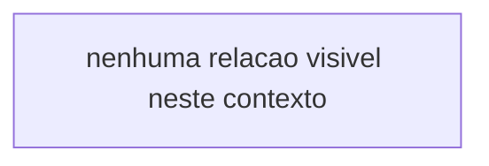

<!-- GENERATED, DO NOT EDIT: regenerado por /reversa-debugger-graph em 2026-10-21T16:32:33-03:00 a partir de 1 bugs -->

# Grafo de relacoes

## Clusters

- Nenhuma aresta visivel: os bugs restritos deste contexto nao entram nas views.

## Impact score

Heuristica de triagem (`causados*3 + bloqueados*2 + regressoes*4 + relacionados*1`, somando apenas arestas `supported`/`confirmed`, com `related-to` limitado a 3). Nao substitui `priority` nem `severity`.

| Bug | Impact score |
|---|---|
| `BUG-20261021-7O7V` | 0 |
