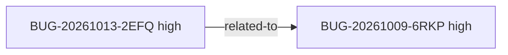

<!-- GENERATED, DO NOT EDIT: regenerado por /reversa-debugger-graph em 2026-10-13T14:37:13-03:00 a partir de 6 bugs -->

# Grafo de relacoes

## Clusters

- `BUG-20261013-2EFQ` converge com `BUG-20261009-6RKP` (upload-gedcom) por `related-to` no estado `supported`.

## Impact score

Heuristica de triagem (`causados*3 + bloqueados*2 + regressoes*4 + relacionados*1`, somando apenas arestas `supported`/`confirmed`, com `related-to` limitado a 3). Nao substitui `priority` nem `severity`.

| Bug | Impact score |
|---|---|
| `BUG-20261013-2EFQ` | 1 |
