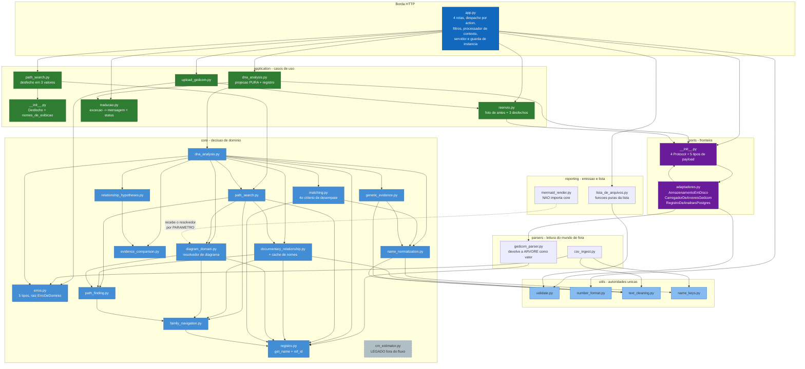

# Diagrama C4 — Componentes (Nível 3) — analisador-genealogico

> Nível de documentação: **Completo** (`state.json` → `doc_level`)
> Re-extração de **2026-10-10**. Substitui o artefato de 2026-10-05, que descrevia **19 módulos em quatro pacotes**, o estado global em `core/gedcom_state.py` e **dois ciclos de pacote**.
> Snapshot da versão substituída: `.reversa/snapshots/2026-10-10-pre-reextracao/c4-components.md`
> Confiança: 🟢 CONFIRMADO | 🟡 INFERIDO | 🔴 LACUNA
> Nível 1: `c4-context.md` · Nível 2: `c4-containers.md` · Visão geral: `architecture.md`

O nível 3 descreve os componentes internos do **container 1 (Aplicação web)**: **31 componentes** em **sete** unidades — a rota, a camada de aplicação, a fronteira de portas e os quatro pacotes do núcleo.

---

## Estrutura de dependências

---

## Inventário de componentes

### Borda HTTP

| Componente | Responsabilidade | Depende de | É usado por | Conf. |
| --- | --- | --- | --- | --- |
| `app.py` (559 úteis) | Ler a requisição, validar presença e forma, delegar aos **casos de uso**, escolher o modo de renderização **pelo desfecho**, aplicar os filtros de template, montar as duas listas por processador de contexto, servir as **duas artes** e subir o servidor com a guarda de instância única | `application`, `ports`, `reporting.lista_de_arquivos`, `utils.number_format`, `core.dna_analysis` (a classe `Dependencias`) | ponto de entrada | 🟢 |

> ⚠️ **A borda deixou de ser só infraestrutura.** Ela ganhou **regras catalogadas** (`BR-T-12` a `BR-T-17` e `BR-E-01` a `BR-E-06`) — ordem dos ramos, mensagens de aposentar, degradação em `404`, `405` e `ETag`. Nenhuma delas é regra de **domínio**; todas são de **superfície HTTP e apresentação**. Ver a ressalva ao `ADR-02` no `ADR-36`.

### `application/` — casos de uso

| Componente | Responsabilidade | Depende de | É usado por | Conf. |
| --- | --- | --- | --- | --- |
| `__init__.py` (59) | O enum **`Desfecho`** (`RESULTADO`, `SEM_RESULTADO`, `ERRO_DE_ENTRADA`) e `nomes_de_exibicao`, a lista ordenada compartilhada pelos três fluxos | `core.registro` | `app.py`, `application.path_search` | 🟢 |
| `upload_gedcom.py` (104) | Caso de uso do envio: transforma o **motivo em texto** do armazenamento na **exceção de domínio tipada** (achado `A002`) | `application.reenvio`, `core.erros` | `app.py` | 🟢 |
| `reenvio.py` (74) | A regra de reenvio (`RN-17`): **foto de antes**, aposentadoria das versões anteriores de mesmo nome visível e os três desfechos | porta de armazenamento | `app.py`, `application.upload_gedcom` | 🟢 |
| `dna_analysis.py` (248) | Chamar o núcleo, **projetar** o resultado no payload da porta (função pura) e **registrar** o histórico sem que a persistência possa bloquear a análise | `core.dna_analysis`, `ports` | `app.py` | 🟢 |
| `path_search.py` (79) | Chamar o núcleo e derivar o **desfecho** dos dois insumos que ele sinaliza | `core.path_search`, `application.__init__` | `app.py` | 🟢 |
| `traducao.py` (135) | Tabela **exceção de domínio → literal de tela e status**, com os literais **medidos** por sonda antes da extração | `core.erros` | `app.py` | 🟢 |

### `ports/` — fronteira de aplicação

| Componente | Responsabilidade | Depende de | É usado por | Conf. |
| --- | --- | --- | --- | --- |
| `__init__.py` (433 cruas) | Os **quatro `Protocol`** (`ArmazenamentoDeArquivos`, `CarregadorDeArvores`, `RepositorioDeArvores` **sem implementação**, `RegistroDeAnalises`) e os **cinco tipos de payload** | `parsers.gedcom_parser` (só para tipagem) | `application`, `adaptadores` | 🟢 |
| `adaptadores.py` (393 cruas) | `ArmazenamentoEmDisco` (`guardar`, `resolver`, `listar`, `aposentar`), `CarregadorDeArvoresGedcom` e `RegistroDeAnalisesPostgres`. **Não reimplementa regra:** delega a `utils/validate.py` | `utils.validate`, `parsers.gedcom_parser`, `psycopg2` (preguiçoso) | `app.py` | 🟢 |

### `utils/` — autoridades únicas transversais

| Componente | Responsabilidade | Depende de | É usado por | Conf. |
| --- | --- | --- | --- | --- |
| `validate.py` (197) | **Toda** a decisão sobre o que pode ser gravado e o que pode ser lido: nome visível, chave por conteúdo, **forma de nome** em duas funções, disponibilidade do item, reconhecimento de GEDCOM. **Módulo puro** | `hashlib`, `re` | `adaptadores`, `app.py`, `reporting.lista_de_arquivos` | 🟢 |
| `text_cleaning.py` (74) | **Autoridade única** da limpeza de mojibake | `re` | `name_normalization`, `csv_ingest`, `genetic_evidence`, `documentary_relationship`, `dna_analysis` | 🟢 |
| `name_keys.py` (27) | `norm_name` — normalização de texto **pura, sem domínio**. Nasceu aqui para **quebrar o ciclo** `core/` ↔ `parsers/` | — | `csv_ingest`, `name_normalization` (que a reexporta) | 🟢 |
| `number_format.py` (42) | **Autoridade única** do formato numérico de tela (`formatar_cm`, `formatar_inteiro`), exposta como filtros | — | `app.py` | 🟢 |

> 🟢 **`utils/` continua sendo o único pacote folha real**, e ganhou um quarto módulo exatamente para preservar essa propriedade.

### `parsers/` — leitura do mundo de fora

| Componente | Responsabilidade | Depende de | É usado por | Conf. |
| --- | --- | --- | --- | --- |
| `gedcom_parser.py` (76) | Traduzir o GEDCOM em registros `INDI`/`FAM` e no grafo bipartido e **devolver a árvore como VALOR** (`carregar_arvore`). A casca `load_gedcom_and_build_graph` **foi removida** | `ged4py`, `networkx` | `ports.adaptadores` | 🟢 |
| `csv_ingest.py` (192) | Ler o CSV tolerando encoding, separador, preâmbulo e linha torta; achar colunas por papel; agregar cM (caminho **legado**, mantido e exposto ao núcleo por injeção) | `pandas`, `utils.name_keys`, `utils.text_cleaning`, `core.erros` | `application` (por injeção em `Dependencias`) | 🟢 |

> ⚠️ **A direção da dependência mudou.** `parsers/` **não escreve mais estado**: devolve valor. E `core/` **não importa mais `parsers/`**: recebe as funções de leitura de CSV **por injeção** (a classe `Dependencias`, montada uma vez na borda). É o que quebrou o ciclo `core/` ↔ `parsers/`.

### `core/` — decisão de domínio

| Componente | Responsabilidade | Depende de | É usado por | Conf. |
| --- | --- | --- | --- | --- |
| `registro.py` (33) | **Leitura pura de registro**: `get_name` e `ref_id`. `get_name` é **cópia literal do oráculo** — não "melhorar" | — | quase todos | 🟢 |
| `erros.py` (77) | As **cinco** exceções de domínio, irmãs, com raiz `ErroDeDominio(ValueError)` | — | `application`, `parsers`, `core.path_search` | 🟢 |
| `name_normalization.py` (85) | Normalização, decomposição de nomes e o vocabulário do matching; reexporta `norm_name` de `utils` | `utils.name_keys`, `utils.text_cleaning` | `matching`, `genetic_evidence`, `dna_analysis` | 🟢 |
| `matching.py` (155) | Construir os índices e **decidir a aceitação** de cada candidato: score, filtro anti-falso-positivo, Jaccard e **quatro** níveis de desempate | `thefuzz`, `name_normalization`, `registro` | `dna_analysis` | 🟢 |
| `family_navigation.py` (119) | Resolver pessoa por nome e navegar parentesco; **a árvore entra por parâmetro** | `registro` | `documentary_relationship`, `path_finding`, `path_search`, `diagram_domain` | 🟢 |
| `path_finding.py` (72) | Os dois algoritmos: BFS bidirecional por pais e caminho curto no grafo. **Sem import tardio** — o grafo vem da árvore | `networkx`, `family_navigation` | `documentary_relationship`, `path_search`, `diagram_domain` | 🟢 |
| `documentary_relationship.py` (531) | Parentesco documental completo **e** o **cache de nomes** com chave derivada do conteúdo | `family_navigation`, `path_finding`, `registro`, `text_cleaning` | `path_search`, `dna_analysis` | 🟢 |
| `diagram_domain.py` (62) | O **resolvedor de diagrama**: sete consultas de domínio já ligadas à árvore, para o renderizador não importar `core` | `family_navigation`, `path_finding`, `registro` | `path_search`, `dna_analysis`, `mermaid_render` (**por parâmetro**) | 🟢 |
| `genetic_evidence.py` (229) | Evidência genética por (nome, kit). **Não conhece o GEDCOM** | `name_normalization`, `text_cleaning`, `erros` | `dna_analysis` | 🟢 |
| `relationship_hypotheses.py` (198) | Traduzir cM em **lista** de possibilidades, pelo SCP 4.0. **Sem dependência de projeto** | — | `evidence_comparison`, `dna_analysis` | 🟢 |
| `evidence_comparison.py` (209) | O **confronto** em quatro estados, com método declarado e rol de causas | `relationship_hypotheses` | `dna_analysis` | 🟢 |
| `path_search.py` (180) | Fachada do fluxo de busca: resolver, escolher entre homônimos, decidir direto × indireto. `__all__` declara **apenas** `path_search` | `documentary_relationship`, `family_navigation`, `path_finding`, `registro`, `diagram_domain` | `application.path_search` | 🟢 |
| `dna_analysis.py` (253) | Orquestrar os três eixos, montar o payload e ordenar. Declara a classe **`Dependencias`** que a borda preenche | os anteriores + `erros` | `application.dna_analysis` | 🟢 |
| `cm_estimator.py` (53) | **LEGADO fora do fluxo**: nove faixas escritas à mão, sem fonte verificável | — | **ninguém no fluxo** (só testes e harness) | 🟢 |

### `reporting/` — emissão e lista

| Componente | Responsabilidade | Depende de | É usado por | Conf. |
| --- | --- | --- | --- | --- |
| `mermaid_render.py` (252) | Transformar um caminho em texto Mermaid e **aplicar o contrato de escape** (lista branca) e do id de nó. **Não importa `core`** | — (recebe `dominio`) | `path_search`, `dna_analysis` (por injeção) | 🟢 |
| `lista_de_arquivos.py` (168) | Funções **puras** que transformam entradas da pasta em itens de aba: agrupamento pela chave, rótulo, disponibilidade, data e tamanho | `utils.validate` | `app.py` (processador de contexto e filtro) | 🟢 |

---

## 🟢 Achado de arquitetura: os ciclos FORAM QUEBRADOS

O artefato de 2026-10-05 registrava **dois ciclos de pacote** como achado vermelho. **Os dois foram fechados em 2026-10-06**, e a decisão está no `ADR-34`:

| Ciclo | Como estava | Como está |
| --- | --- | --- |
| **`core/` ↔ `reporting/`** | O renderizador importava `core.family_navigation`, `core.path_finding` e `core.gedcom_state` para obter sete consultas | O renderizador **não importa `core`**: recebe o **resolvedor de diagrama** por parâmetro, um `dict` de sete funções já ligadas à árvore por `functools.partial` |
| **`core/` ↔ `parsers/`** | `core/dna_analysis.py` importava `parsers.csv_ingest`; `parsers/csv_ingest.py` importava `core.name_normalization` | `norm_name` foi para `utils/name_keys.py`, e as funções de leitura de CSV entram **por injeção**. `core/` **não importa `parsers/`** |

**As três consequências que o artefato anterior nomeava, e o estado de cada uma:**

1. **`reporting/` continua não sendo folha, e isso é decisão declarada** (`ADR-11`): decidir o casal do ancestral comum, o ancestral que ancora o ramo e o ponto de corte por casamento é decisão de **negócio**. O que mudou foi **quem busca o dado**, não onde a decisão mora. O renderizador continua chamando `get_spouses(pid)`, e não `get_spouses(arvore, pid)`.
2. **`parsers/` deixou de escrever o estado do domínio.** `carregar_arvore` devolve a árvore, e não existe mais o contador `versao` — o que obrigou o cache de nomes a derivar a própria chave do conteúdo (`L-24`).
3. **`utils/` continua sendo o único pacote folha real**, e ganhou `name_keys.py` justamente para continuar sendo.

> 🟢 **A grafo de importação é agora estritamente descendente**, sem ciclo de pacote e sem import tardio. A dívida #5 do artefato anterior está **fechada**, e a `OPP-20261006-ULVW` registra a costura.

---

## Cadeia de dependência dos fluxos

| Fluxo | Cadeia de componentes | Conf. |
| --- | --- | --- |
| **`upload_gedcom`** | `app.py` → `application.upload_gedcom` → `application.reenvio` (**foto de antes**) → `ports.ArmazenamentoEmDisco.guardar` → `utils.validate` → *(disco)* → `ports.CarregadorDeArvoresGedcom` → `parsers.gedcom_parser.carregar_arvore` → `application.nomes_de_exibicao` | 🟢 |
| **`aposentar_arquivo`** | `app.py` → `ports.ArmazenamentoEmDisco.aposentar` → `utils.validate.referencia_de_arquivo_da_pasta` → *(disco: `os.replace`)* | 🟢 |
| **`selecionar_arvore`** | `app.py` → `_arvore_do_formulario` → `ports.CarregadorDeArvoresGedcom` → *(disco)* → `parsers.gedcom_parser` → render | 🟢 |
| **`path_search`** | `app.py` → `application.path_search` → `core.path_search` → `family_navigation.find_person_by_name` → `documentary_relationship` → `path_finding.find_ancestral_path` *(ou `find_indirect_path`)* → `diagram_domain.resolvedor_de_diagrama` → `mermaid_render` → **`_desfecho`** → `app.py` escolhe o render | 🟢 |
| **`dna_analysis`** | `app.py` → *(disco + parse)* → `application.dna_analysis` → `core.dna_analysis` → `Dependencias.read_csv` *(injetado)* → `genetic_evidence.build_genetic_evidence` → `matching.build_ged_indexes` + `match_candidates` → `documentary_relationship` → `evidence_for` → `hypotheses_for_evidence` → `evidence_comparison.compare` → `mermaid_render` → **projeção pura** → `ports.RegistroDeAnalises` | 🟢 |
| **`GET /`** | `app.py` → `_listas_da_tela` (processador de contexto) → `ports.listar` → `reporting.lista_de_arquivos.itens_da_aba` × 2 → `utils.validate.pode_ser_usado` | 🟢 |
| **`GET /banner.png`** e **`GET /apple-touch-icon.png`** | `app.py` → `os.path.isfile(app.config[...])` → `send_file` (**`ETag`**) ou `("", 404)` | 🟢 |

> **`parsers.gedcom_parser` aparece nos fluxos que precisam de árvore**, porque o GEDCOM é parseado a cada requisição. O "recurso compartilhado" é o **arquivo em disco**, e não um objeto em memória de vida longa.

---

## Superfícies de compatibilidade — de dívida a histórico

O artefato de 2026-10-05 registrava duas superfícies grandes de reexportação (`path_search.py` com 17 nomes e `dna_analysis.py` com os símbolos do `cm_estimator` e da ingestão). **As duas foram removidas** (`ADR-24` e `ADR-34`):

| Componente | O que reexportava | Estado em 2026-10-10 |
| --- | --- | --- |
| `core/path_search.py` | 17 nomes de `family_navigation`, `path_finding`, `mermaid_render` e `gedcom_state` | 🟢 **removido** (`OPP-20261006-ESKO`); `__all__ = ["path_search"]`. Os consumidores reais — três arquivos de teste e o harness — foram migrados para o módulo canônico |
| `core/dna_analysis.py` | `aggregate_matches`, `detect_columns`, `read_csv_with_fallback` | 🟢 **removido** (`T016`): os três passaram a ser **injetados** pela borda, e reexportá-los obrigaria o núcleo a importar `parsers/` |
| `core/dna_analysis.py` | `get_relationships_by_cm`, `SHARED_CM_DATA` | 🟢 **removido** (`T022`): quem os exercita os importa do **módulo canônico** (`cm_estimator`) |
| `core/name_normalization.py` | `norm_name` | 🟡 **mantido**, e é a **única** superfície que sobreviveu — com consumidores legítimos. Nasceu como reexportação depois da `OPP-20261006-LIGH` |

> 🟢 **A dívida #17 do artefato anterior está fechada**, com uma exceção declarada. A leitura correta da linha 🟡 é: é exceção, e não padrão.

---

*Gerado pelo Reversa-Architect em 2026-10-10 (re-extração, nível completo).*
