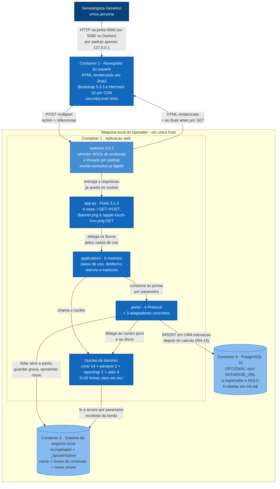

# Diagrama C4 — Containers (Nível 2) — analisador-genealogico

> Nível de documentação: **Completo** (`state.json` → `doc_level`)
> Re-extração de **2026-10-10**. Substitui o artefato de 2026-10-05, que descrevia **três** containers, o estado em memória do processo e a ausência de banco.
> Snapshot da versão substituída: `.reversa/snapshots/2026-10-10-pre-reextracao/c4-containers.md`
> Confiança: 🟢 CONFIRMADO | 🟡 INFERIDO | 🔴 LACUNA
> Nível 1: `c4-context.md` · Nível 3: `c4-components.md` · Visão geral: `architecture.md`

---

## Nível 2 — Containers

---

## Inventário de containers

| # | Container | Tecnologia | Responsabilidade | Estado | Conf. |
| --- | --- | --- | --- | --- | --- |
| 1 | **Aplicação web** | Python 3.14.6 · Flask 3.1.3 · waitress 3.0.2 | Validar e gravar uploads, listar e aposentar arquivos, parsear o GEDCOM, executar os três fluxos, projetar o resultado, registrar o histórico e renderizar a tela. **Único processo do sistema** | **Nenhum estado de domínio em memória.** A árvore é um valor por requisição; o que resta são os adaptadores (singletons de processo) e um cache de nomes derivado do conteúdo | 🟢 |
| 2 | **Navegador do usuário** | HTML5 · Jinja2 · Bootstrap 5.3.3 · Mermaid 10 (CDN) | Exibir a tela, enviar os formulários e **renderizar o diagrama Mermaid no cliente** | Sem estado próprio além do DOM, das referências em campos ocultos e do `ETag` das artes | 🟢 |
| 3 | **Sistema de arquivos local** | Sistema de arquivos do host | Guardar os arquivos enviados sob chave de conteúdo, e manter os **aposentados** em `_aposentados/` | **Persistente.** O único estado que sobrevive ao processo **e** cujo ciclo de vida o sistema modela (`state-machines.md` §7) | 🟢 |
| 4 | **PostgreSQL 16** *(novo)* | PostgreSQL 16 em `docker-compose.yml`, driver `psycopg2` | Guardar o **histórico das análises** — análise, pessoas, conexões, kits, nós de caminho e descartados | **Persistente e OPCIONAL.** Sem `DATABASE_URL` o registrador é nulo e a tela não muda um byte | 🟢 |

**Não há** container de fila, cache, worker assíncrono ou serviço externo de rede. 🟢

**Por que quatro, e não um.** (a) O container 2 não é cliente burro desde que a renderização do diagrama foi movida para o cliente (`ADR-03`). (b) O container 3 passou a ter **dois papéis** — guardar e aposentar. (c) O container 4 é novo e é o único cuja existência é **condicional**: ele pode simplesmente não estar lá.

> 🟡 **O container 4 é o único declarado como opcional em toda a arquitetura.** A ausência dele não é modo degradado nem erro: é o comportamento de antes da feature 008, e é o estado do ambiente oficial — **`psycopg2-binary` está pinado e não está instalado no `.venv`** (`L-26`).

---

## Comunicação entre containers

| Origem | Destino | Protocolo / formato | Gatilho | Conf. |
| --- | --- | --- | --- | --- |
| Navegador | Aplicação | **HTTP `POST` multipart** na rota `/`, com `action` e as referências | Ação do usuário | 🟢 |
| Navegador | Aplicação | **HTTP `GET`** em `/banner.png` e `/apple-touch-icon.png`, com `If-None-Match` na rebusca | Carregamento da página e revalidação | 🟢 |
| Aplicação | Navegador | **HTML** renderizado no servidor; o diagrama viaja como **string Mermaid** dentro do HTML | Resposta da requisição | 🟢 |
| Aplicação | Navegador | **PNG** com `ETag`, respondendo **`304` sem corpo** na rebusca | Requisição das artes | 🟢 |
| Aplicação | Navegador | **HTTP 405** nas rotas de arte, para qualquer método que não seja `GET` | Tentativa de escrita | 🟢 |
| Aplicação | Navegador | **HTTP 413** com HTML em português | Corpo acima de **16 MB** | 🟢 |
| Adaptador de armazenamento | Sistema de arquivos | Gravação de bytes (`open(caminho, "wb")`), apenas se a chave ainda não existir | Upload aceito | 🟢 |
| Adaptador de armazenamento | Sistema de arquivos | **`os.replace`** para `_aposentados/` | `action=aposentar_arquivo` ou substituição no reenvio | 🟢 |
| Adaptador de armazenamento | Sistema de arquivos | `os.listdir` + `os.stat` — **sem `open`** | Toda renderização da tela de entrada | 🟢 |
| Adaptador de carga | Sistema de arquivos | Leitura por caminho **validado por forma** | Todo `POST` que não é upload | 🟢 |
| Adaptador de registro | PostgreSQL | **`INSERT` em uma única transação**, via `psycopg2`, conexão aberta e fechada na chamada | Depois do cálculo da análise | 🟢 |
| Navegador | CDN | **HTTPS** para Bootstrap e Mermaid | Carregamento da página | 🟢 |

**Fluxo de uma requisição de análise, do ponto de vista dos containers** 🟢

1. O navegador envia `POST` com `action` e a referência (chave de conteúdo + nome visível).
2. A rota valida a **forma** da referência, resolve o caminho e **parseia a árvore** — que passa a viajar **como argumento** por todo o fluxo.
3. O caso de uso chama o núcleo; o núcleo devolve o resultado **sem conhecer HTTP nem o banco**.
4. O caso de uso **projeta** o resultado em dado plano e o entrega à porta de registro — que **pode não existir**.
5. O template renderiza; o navegador interpreta a string Mermaid e desenha o diagrama.

> 🟢 **A árvore é re-parseada em toda requisição de análise**, e isso **deixou de ser uma escolha discutível**: sem estado global, não há alternativa. O "recurso compartilhado" é o **arquivo em disco**, e não um objeto em memória de vida longa — o que é exatamente o que torna a concorrência segura.

---

## Propriedades arquiteturais dos containers

### Concorrência e exclusividade 🟢

- O container 1 é **single-instance por construção**: o socket é criado, marcado (`SO_EXCLUSIVEADDRUSE` no Windows) e **ligado antes de servir**, e entregue pronto ao waitress. Uma segunda instância na mesma porta **falha no `bind`** com diagnóstico que separa "porta ocupada" de "endereço indisponível".
- O mesmo container é **multi-thread**: `ANALISADOR_THREADS` tem padrão **4**.
- 🟢 **O motivo da guarda mudou, e a corrida que a justificava desapareceu.** Até 2026-10-07 o container 1 mantinha estado de domínio em memória, compartilhado entre threads. Hoje **não mantém**: a árvore entra por parâmetro. O que resta como motivo é o **armazenamento em disco**, que continua único por processo — e é uma corrida de sistema de arquivos, não de identidade.
- 🟡 **O que ainda pode intercalar:** `guardar` verifica a existência do caminho e depois escreve; `aposentar` verifica o destino e depois move. Mecanismo 🟢; alcance não medido 🟡.

### Fronteira entre servidor e cliente 🟢

- O servidor **não** gera HTML de grafo em disco: ele emite **texto Mermaid**, e quem desenha é o container 2.
- O contrato de escape vive no **servidor** (`reporting/mermaid_render.py`), e não no cliente: o texto é sanitizado **antes** de sair. Dois bugs de escape (`BUG-20260929-J6PQ`, `BUG-20261002-T4ZM`) moldaram a lista branca.
- Consequência operacional: o único golden file pendente (`SCR-G03`, indicador de carregamento) **não pode** ser capturado por `curl`, porque depende de JavaScript no container 2.
- 🟢 **Novo nesta rodada:** o container 2 também é cliente de **dois recursos binários** (`/banner.png` e `/apple-touch-icon.png`), servidos com `ETag` e sem validade longa de cache.

### Persistência 🟢

- O container 3 guarda **arquivos imutáveis no conteúdo**: o mesmo conteúdo produz a mesma chave. O que muda é a **posição** — na pasta ou em `_aposentados/` —, e **nada é apagado pelo sistema** (`RN-07`).
- O container 4 guarda **o retrato da análise**, e não a árvore: `tree_ref` referencia o arquivo do container 3. Não há consulta de leitura no código da aplicação.
- 🔴 **O container 4 não tem política de retenção.** Ele persiste dado pessoal — nome, sexo, datas, local de nascimento — inclusive de pessoas vivas, e não há expurgo nem consentimento (`P-07` / `L-29`).

### Empacotamento 🟢

- `docker/Dockerfile` (`python:3.14-slim`) e `docker-compose.yml` sobem **dois serviços**: `app` e `db`, com as portas publicadas em `127.0.0.1` (`5080:5000` e `5432:5432`).
- **O container de build é construído por lista de permissão** (`.dockerignore` com `*` e depois `!requirements.txt`, `!src/`, `!src/**`), com `src/uploads/` reexcluído depois. É **por isso** que a arte de runtime mora em `src/assets/` (`ADR-29`) e o dado real do operador não entra na imagem.

---

## Fora do escopo deste diagrama

| Caminho | Natureza | Por que não é container |
| --- | --- | --- |
| `_reversa_sdd/`, `.reversa/`, `_reversa_forward/`, `_reversa_bugs/`, `_reversa_docs/` | Artefatos do framework Reversa | Não são executados pela aplicação |
| `plugins/dsh-markdownlint/` | Sub-projeto **Node/JavaScript** independente | Plugin do harness DSH; não é importado pelo Python |
| `docs/` · `.github/skills/` | Cópia do mini-site e skills de apoio | `docs/` é o **alvo da publicação**: o GitHub Pages serve a branch `master`, pasta `/docs`. A publicação passou a ser **passo manual** (`python publicar_docs.py`) |
| `.github/workflows/` | **Não existe** | O workflow de deploy do GitHub Pages foi **removido em 2026-10-08**. **Não há pipeline de teste, build ou análise estática** |
| `tests/` | Suíte de testes | Roda fora do runtime; **importa `src/app.py`**, e é por isso que nada no import do app pode exigir driver, rede ou biblioteca de imagem |

---

*Gerado pelo Reversa-Architect em 2026-10-10 (re-extração, nível completo).*
