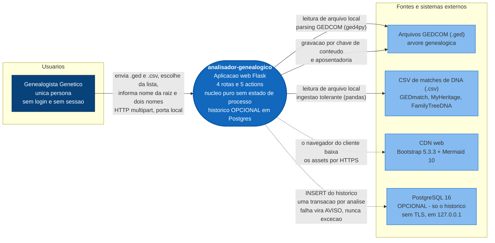

# Diagrama C4 — Contexto (Nível 1) — analisador-genealogico

> Nível de documentação: **Completo** (`state.json` → `doc_level`)
> Re-extração de **2026-10-10**. Substitui o artefato de 2026-10-05, que descrevia **uma única rota**, o estado em memória do processo e a ausência de banco de dados.
> Snapshot da versão substituída: `.reversa/snapshots/2026-10-10-pre-reextracao/c4-context.md`
> Confiança: 🟢 CONFIRMADO | 🟡 INFERIDO | 🔴 LACUNA
> Níveis 2 e 3: `c4-containers.md` e `c4-components.md` · Visão geral: `architecture.md`

---

## Nível 1 — Contexto

> **Não há integração de rede com terceiros.** Os arquivos chegam **pelo upload do navegador** ou por **escolha na lista**, e são lidos **do disco local**; o único tráfego de saída é o download dos assets de CDN feito pelo navegador do próprio usuário e o `INSERT` no Postgres **local**. A aplicação **não** consome nem produz API REST/GraphQL e não publica eventos. 🟢
>
> 🟡 **O Postgres é o único externo cuja existência é condicional.** Sem `DATABASE_URL` ele simplesmente não participa, e a tela não muda um byte.

---

## Legenda dos elementos

| Elemento | Descrição | Conf. |
| --- | --- | --- |
| **Genealogista Genético** | Única persona. **Não há login, sessão, papéis nem permissões.** O `dono` existe em toda assinatura de porta e como coluna `owner_id`, e **não isola nada** (ver `permissions.md`) | 🟢 |
| **analisador-genealogico** | Aplicação Flask com **quatro rotas**: `GET`+`POST /` e três `GET` de recurso. O despacho é pelo campo `action`, com **cinco** valores. O núcleo vive em `src/core/` + `parsers/` + `reporting/` + `utils/`, atrás de `application/` e `ports/`. **Não há estado de domínio em memória** | 🟢 |
| **GEDCOM (`.ged`)** | Entrada da árvore, parseada por `ged4py`. **Parseada a cada `POST`** — sem estado global, não há alternativa. Armazenada como arquivo **imutável no conteúdo** sob chave de conteúdo | 🟢 |
| **CSV de DNA** | Entrada dos matches. Leitura **tolerante**: `utf-8` com recuo para `latin-1`, separador detectado entre `,` `;` TAB `\|`, cabeçalho localizado sob preâmbulo e linhas irregulares descartadas **com aviso** | 🟢 |
| **CDN web** | Bootstrap 5.3.3 e Mermaid 10, carregados pelo navegador. Mermaid inicializado com `securityLevel: 'strict'` | 🟢 |
| **PostgreSQL 16** | O **histórico das análises**, em 6 tabelas. Recebe **dado já projetado** e o grava em **uma transação**. Nenhum código de `src/` o lê | 🟢 |

---

## Superfície de interação (o contrato real)

| Método | Rota | `action` | O que o usuário recebe |
| --- | --- | --- | --- |
| `GET` | `/` | — | A tela com o formulário **e as duas abas de lista já preenchidas** |
| `GET` | `/banner.png` | — | A arte do topo (PNG derivado), com `ETag`; `404` se ausente |
| `GET` | `/apple-touch-icon.png` | — | O ícone de atalho (PNG opaco 180×180), com `ETag`; `404` se ausente |
| `POST` | `/` | `upload_gedcom` | Lista de nomes da árvore e **uma das três mensagens** de desfecho (`novo`, `identico`, `substituido`) |
| `POST` | `/` | `aposentar_arquivo` | Confirmação de que o arquivo **saiu da lista e não foi apagado** |
| `POST` | `/` | `selecionar_arvore` | O **mesmo** estado do envio: a tela da árvore escolhida |
| `POST` | `/` | `dna_analysis` | Por conexão: parentesco documental, evidência genética, possibilidades, **confronto com um dos quatro estados**, observações e diagrama. Mais os descartados e, quando houver, o **aviso de histórico não registrado** |
| `POST` | `/` | `path_search` | Caminho textual + diagrama Mermaid, direto ou indireto. O **modo de renderização vem do desfecho**, não do texto |

> **Não existe API REST/JSON, webhook, fila ou evento.** Toda saída é **HTML renderizado no servidor** (Jinja2) para uma tela única, mais **dois PNG**. 🟢
> Todas as respostas de erro de conteúdo são **HTML com `success=false`** — com **duas exceções**: o teto de corpo excedido responde **HTTP 413**, e as rotas de arte respondem **`404`** com corpo vazio na ausência do arquivo. 🟢

---

## Notas de fronteira

- 🟢 **O que substitui a sessão continua sendo a chave de conteúdo.** Como não há sessão, a continuidade entre requisições viaja no próprio formulário: os campos ocultos `gedcom_filename` e `matches_csv_filename` carregam `<sha256 do conteúdo truncado>__<nome visível>`, e o servidor **remonta a árvore a partir dela antes de ramificar**. A chave é **identificador, não segredo**.
- 🟢 **A defesa contra escape passou a ser por FORMA DE NOME, e não por alfabeto fechado.** O alfabeto recusava acento e espaço — que o gravador **preserva de propósito** —, e **quatro arquivos reais** ficaram inalcançáveis, com a tela dizendo que não existiam (`BUG-20261009-6RKP` / `RN-20`). A defesa continua sendo de forma, em **duas funções com perguntas distintas**: uma para **ler**, outra para **aposentar**. Detalhamento em `permissions.md` §4.2.
- 🟢 **A corrida entre requisições concorrentes deixou de existir.** O artefato anterior registrava, como vetor vivo, a troca de árvore entre threads. Não há mais estado de domínio compartilhado: a árvore é um valor por requisição. Permanece a concorrência sobre o **armazenamento em disco**.
- 🟡 **Não há isolamento entre donos.** O `dono` é parâmetro obrigatório **sem comportamento** e coluna gravada **sem filtro**; nenhum índice começa por `owner_id`. O critério de aceite do `BUG-20260929-BJJH` **continua não atendido**.
- 🔴 **O histórico persiste dado pessoal** — nome, sexo, datas e local de nascimento, inclusive de pessoas vivas — **sem política de retenção**. Apagar a árvore já não apaga o retrato.
- 🟢 **A exposição é ato explícito:** o padrão de escuta é `127.0.0.1` — também no `docker-compose`, onde as duas portas são publicadas localmente —, e uma segunda instância na mesma porta é recusada.
- **Fora do escopo deste diagrama:** a instrumentação de *desenvolvimento* dentro de `_reversa_sdd/` — oráculo congelado (`oracle/`), harness diferencial (`parity/`), goldens (`screens/`), suíte de migração (`migration/`) e os **36 ADRs**. **Nada disso faz parte do sistema em execução.** O repositório também hospeda o sub-projeto Node `plugins/dsh-markdownlint/` e a pasta `docs/` publicada no GitHub Pages, ambos fora do runtime. 🟢

---

*Gerado pelo Reversa-Architect em 2026-10-10 (re-extração, nível completo).*
