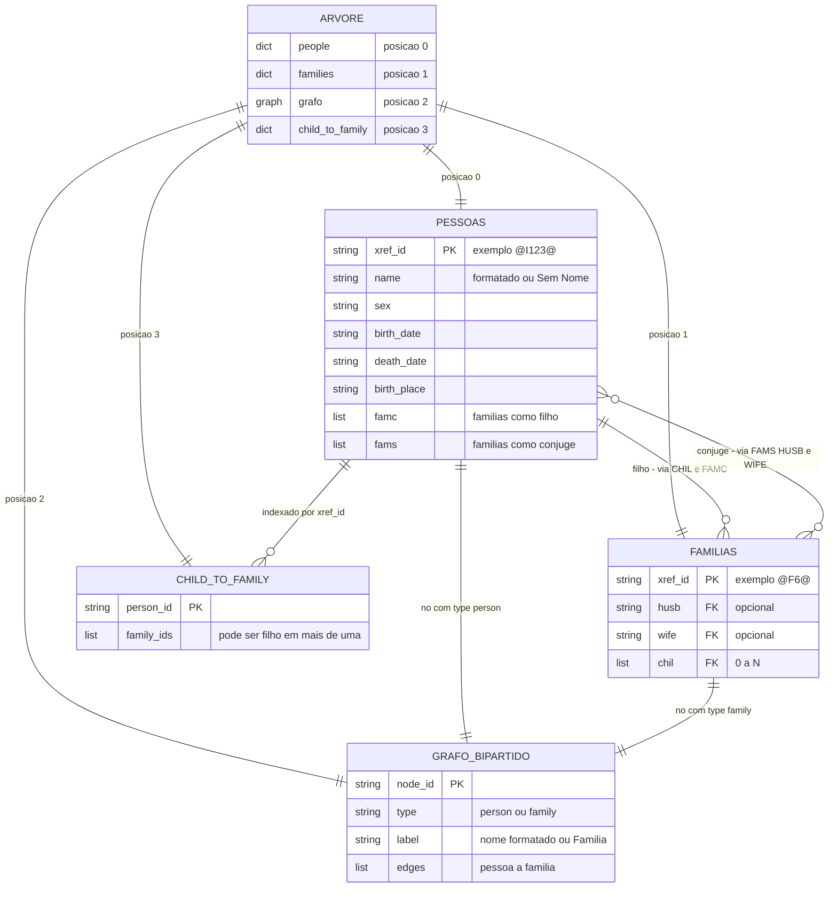
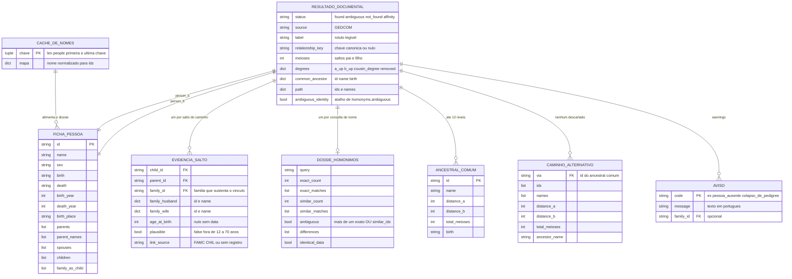
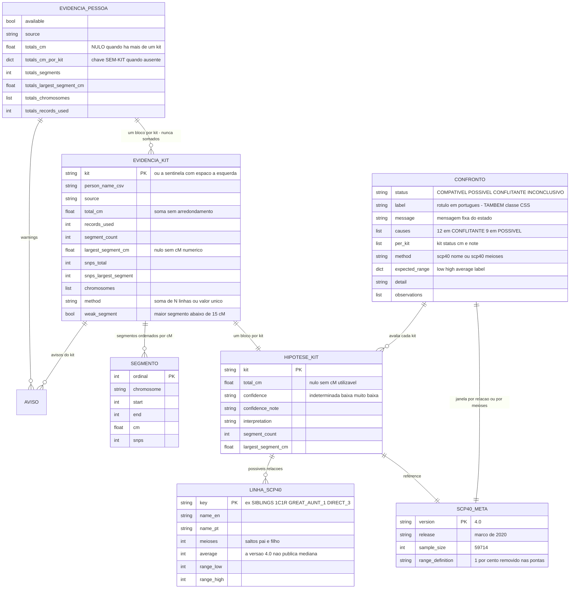
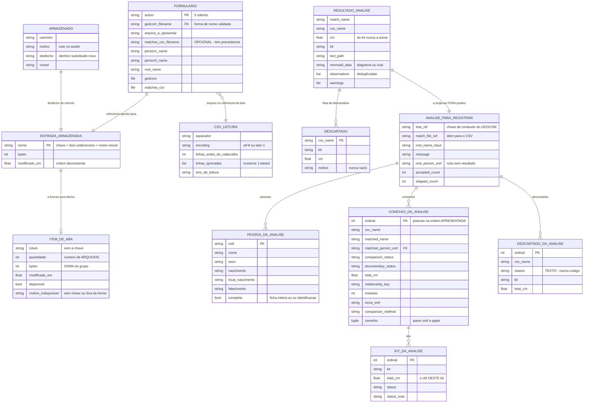
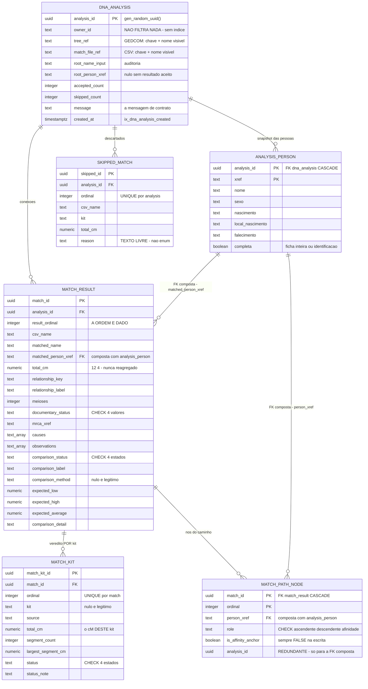

# ERD Completo — analisador-genealogico

> Nível de documentação: **Completo** (`state.json` → `doc_level`)
> Re-extração de **2026-10-10**. Substitui o artefato de 2026-10-05, que afirmava que **o sistema não tem banco de dados** e descrevia 27 estruturas em memória, disco e payload.
> Snapshot da versão substituída: `.reversa/snapshots/2026-10-10-pre-reextracao/erd-complete.md`
> Confiança: 🟢 CONFIRMADO | 🟡 INFERIDO | 🔴 LACUNA
> Fonte dos campos, tipos, padrões e sentinelas: `data-dictionary.md`. Visão geral: `architecture.md`.

---

## 1. Como ler este ERD

**A afirmação da rodada anterior — "este sistema não tem banco de dados" — deixou de valer.** A feature 008 introduziu **PostgreSQL 16 opcional** para o histórico das análises. As **43 estruturas** abaixo existem em **cinco** lugares, e a notação de ERD é usada como **modelo lógico** nos quatro primeiros e como **esquema físico real** no quinto:

| Onde | Quantas | Vida útil | Dono | Notação |
| --- | ---: | --- | --- | --- |
| **Memória, por requisição** | 24 | Morre com a requisição | `core/*`, `parsers/*`, `reporting/*` | lógica |
| **Memória, de módulo** | 2 | Vive com o processo: uma chaveada por conteúdo, outra pelo arquivo | `documentary_relationship._INDICE_DE_NOMES`; `ports/adaptadores.CacheDeArvores` | lógica |
| **Disco** | 2 | Persistente; conteúdo imutável, posição mutável | `ports/adaptadores.py` | lógica |
| **Payload de fronteira** | 9 | Uma requisição | `application/*` e `ports/*` | lógica |
| **PostgreSQL** | 6 | **Persistente e opcional** | `init.sql` + `RegistroDeAnalisesPostgres` | **física** |

> ⚠️ **`PK` e `FK` são lógicos nos quatro primeiros grupos e REAIS no quinto.** No GEDCOM em memória, uma referência pendente (`CHIL` apontando para xref inexistente) **não é rejeitada**: a aresta simplesmente não é criada (`BR-U-18`). No banco, ao contrário, há `FOREIGN KEY` de verdade com `ON DELETE CASCADE` e `CHECK` de domínio fechado — a integridade que o alvo da migração exigia **já existe** onde foi implementada.
>
> ⚠️ **`None` significa "não sei / não existe", nunca zero.** A regra é invariante do sistema e está anotada campo a campo no `data-dictionary.md` §11.

---

## 2. Diagrama A — A árvore do GEDCOM

| Relacionamento | Cardinalidade | Regra | Conf. |
| --- | --- | --- | --- |
| `ARVORE` → as quatro partes | `1..1` cada | A árvore é uma **tupla de quatro posições**, e é assim que entra em **toda** função do núcleo. **Não há estado de processo** | 🟢 |
| `PESSOAS` → `FAMILIAS` (como filho) | `0..N` | `FAMC` é preferido; sem ele, o índice `child_to_family` acumula todas as famílias em que a pessoa aparece como `CHIL` | 🟢 |
| `PESSOAS` → `FAMILIAS` (como cônjuge) | `0..N` | pelos sub-registros `FAMS` | 🟢 |
| `FAMILIAS` → `PESSOAS` | `0..2` cônjuges + `0..N` filhos | `HUSB` e `WIFE` são **opcionais** | 🟢 |
| `PESSOAS`/`FAMILIAS` → `GRAFO_BIPARTIDO` | `1..1` por nó | Aresta só é criada se **os dois** nós existirem; família sem `xref_id` é ignorada por completo | 🟢 |

> 🟢 **`ESTADO_VERSAO` deixou de existir.** O contador `versao` saiu com o módulo de estado (`ADR-24`). O sinal de invalidação do cache de nomes passou a ser **derivado do conteúdo** — ver o diagrama E.
> 🟢 **O grafo é `networkx.Graph` não-direcionado, e não `MultiGraph`.** A direção parental **não** está no grafo: é derivada por `get_parents`/`get_children`, que leem `FAMC`/`FAMS`/`CHIL` diretamente dos registros.
> 🟢 **O import tardio do grafo desapareceu.** Ele era reatribuído a cada parse; hoje é um **valor** da tupla, e quem precisa dele o pega dela.

---

## 3. Diagrama B — Parentesco documental

| Relacionamento | Cardinalidade | Regra | Conf. |
| --- | --- | --- | --- |
| `RESULTADO_DOCUMENTAL` → `FICHA_PESSOA` | `1..1` × 2 | **Sempre duas fichas completas** — inclusive quando não há caminho. É o custo registrado em `L-20` | 🟢 |
| `RESULTADO_DOCUMENTAL` → `EVIDENCIA_SALTO` | `0..N` | Um por aresta do caminho; **zero** quando não há caminho | 🟢 |
| `RESULTADO_DOCUMENTAL` → `ANCESTRAL_COMUM` | `0..12` | Enumerados até **12 níveis**, limitados a **12**, ordenados por `(meioses totais, maior distância, nome)` | 🟢 |
| `ANCESTRAL_COMUM` → colapso | `0..N` cadeias | Mais de uma cadeia de pais até o mesmo ancestral gera `colapso_de_pedigree` (teto de **8** cadeias) | 🟢 |
| `CACHE_DE_NOMES` → `FICHA_PESSOA` | `1..N` | Cache **de módulo**, com chave derivada do **conteúdo** da árvore. Ver a lacuna `E-05` | 🟡 |

---

## 4. Diagrama C — Evidência genética, possibilidades e confronto

| Relacionamento | Cardinalidade | Regra | Conf. |
| --- | --- | --- | --- |
| `EVIDENCIA_PESSOA` → `EVIDENCIA_KIT` | `0..N` | Chave de evidência é **(nome, kit)**. **Nunca somados entre si** | 🟢 |
| `EVIDENCIA_KIT` → `SEGMENTO` | `0..N` | Ordenados por cM decrescente, com `None` por último | 🟢 |
| `HIPOTESE_KIT` → `LINHA_SCP40` | `0..27` | 27 relações publicadas; **lista vazia é resposta válida** e significa "não descarta parentesco" | 🟢 |
| `LINHA_SCP40` → ausência | 6 relações | `1C4R`, `1C5R`, `1C6R`, `3C2R`, 2º e 3º bisavós **não são publicadas** e **não recebem número inventado** — a janela passa a ser a envoltória por meioses | 🟢 |
| `CONFRONTO` → `HIPOTESE_KIT` | `0..N` | Avalia cada kit; o estado final é o **mais conservador** | 🟢 |

> **O `status` do confronto é derivado, não armazenado em memória** — ver a máquina de decisão em `state-machines.md` §3. **No banco ele É armazenado** (`match_result.comparison_status`), com `CHECK` de domínio fechado.

---

## 5. Diagrama D — Payload da fronteira e armazenamento

| Relacionamento | Cardinalidade | Regra | Conf. |
| --- | --- | --- | --- |
| `FORMULARIO` → `ENTRADA_ARMAZENADA` | `1..1` por requisição pós-upload | A referência é validada **por forma de nome** antes de virar caminho; fora da forma, `"Erro: Arquivo 'X' não existe mais."` | 🟢 |
| `ARMAZENADO` → `ENTRADA_ARMAZENADA` | `1..1` | O desfecho é **derivado da foto de antes** e **não persiste**: existe só para escolher a mensagem (`M-07`) | 🟢 |
| `RESULTADO_ANALISE` → `DESCARTADO` | `0..N` | **Disjuntos:** um match ou vira resultado, ou vira descartado — nunca os dois | 🟢 |
| `RESULTADO_ANALISE` → `ANALISE_PARA_REGISTRAR` | `1..1` | A projeção é **pura**: não reordena, não recalcula cM, não formata e não chama o núcleo | 🟢 |
| `ANALISE_PARA_REGISTRAR` → `PESSOA_DA_ANALISE` | `0..N` | Uma vez por pessoa, com a **ficha completa vencendo** a mera identificação | 🟢 |
| `CONEXAO_DA_ANALISE` → `KIT_DA_ANALISE` | `0..N` | Pareamento com o veredito **por índice**, e não por rótulo | 🟢 |
| `CONEXAO_DA_ANALISE` → `caminho` | `0..N` pares | Cada par é `(xref, papel)`, com papel **derivado** pela projeção. `afinidade` **nunca** aparece aqui | 🟢 |

---

## 6. Diagrama E — Esquema PostgreSQL (**novo, e o único físico**)

| Relacionamento | Cardinalidade | Regra | Conf. |
| --- | --- | --- | --- |
| `DNA_ANALYSIS` → `ANALYSIS_PERSON` | `0..N` | A **árvore não é duplicada**: `tree_ref` referencia o arquivo imutável de `src/uploads/`. O que se grava é o **retrato** desta análise | 🟢 |
| `DNA_ANALYSIS` → `MATCH_RESULT` | `0..N` | `result_ordinal` é o **único campo que reproduz a ordem do núcleo**, que é `(tem_caminho, -cM)` | 🟢 |
| `MATCH_RESULT` → `MATCH_KIT` | `0..N` | O veredito **por kit** é o que explica por que dois kits do mesmo nome chegaram a estados diferentes | 🟢 |
| `MATCH_RESULT` → `MATCH_PATH_NODE` | `0..N` | Um por nó; `role` tem domínio fechado | 🟢 |
| `ANALYSIS_PERSON` → `MATCH_RESULT` e `MATCH_PATH_NODE` | `1..N` | **FK composta** com `ON DELETE CASCADE`: garante que **todo nó do caminho tem retrato** no snapshot. `RESTRICT` foi testado e **quebrado** — impediria apagar a análise | 🟢 |
| *ausência de índice por `owner_id`* | — | `RN-10`: nenhuma consulta filtra por dono, e um índice sugeriria escopo. O isolamento segue **aberto** | 🟢 |

> 🟢 **É integridade real, ao contrário do legado em memória**, onde a referência pendente era aceita e a aresta simplesmente não era criada. O `CHECK` de `comparison_status` **não é autoridade**: a autoridade da regra continua sendo `core/evidence_comparison.py`; o banco só recusa lixo.
> 🔴 **Cinco tabelas do alvo NÃO foram criadas** — `app_user`, `consent_record`, `data_retention_policy`, `access_audit` e `uploaded_file`. A ausência de `data_retention_policy` é a que mais pesa hoje (`L-29`).

---

## 7. Inventário das 43 estruturas

| # | Estrutura (ERD) | Nome no código | Diagrama | Onde vive | Conf. |
| ---: | --- | --- | --- | --- | --- |
| 1 | `ARVORE` | tupla `(people, families, graph, child_to_family)` | A | requisição | 🟢 |
| 2 | `PESSOAS` | registro `ged4py` INDI em `arvore[0]` | A | requisição | 🟢 |
| 3 | `FAMILIAS` | registro `ged4py` FAM em `arvore[1]` | A | requisição | 🟢 |
| 4 | `GRAFO_BIPARTIDO` | `arvore[2]` (`networkx.Graph`) | A | requisição | 🟢 |
| 5 | `CHILD_TO_FAMILY` | `arvore[3]` | A | requisição | 🟢 |
| 6 | `CACHE_DE_NOMES` | `_INDICE_DE_NOMES` | B | **módulo** | 🟢 |
| 7 | `RESULTADO_DOCUMENTAL` | `documentary_relationship(...)` | B | requisição | 🟢 |
| 8 | `FICHA_PESSOA` | `person_summary(...)` | B | requisição | 🟢 |
| 9 | `EVIDENCIA_SALTO` | `hop_evidence(...)` | B | requisição | 🟢 |
| 10 | `DOSSIE_HOMONIMOS` | `homonym_dossier(...)` | B | requisição | 🟢 |
| 11 | `ANCESTRAL_COMUM` | item de `common_ancestors` | B | requisição | 🟢 |
| 12 | `CAMINHO_ALTERNATIVO` | item de `additional_paths` | B | requisição | 🟢 |
| 13 | `AVISO` | `{code, message}` | B e C | requisição | 🟢 |
| 14 | `EVIDENCIA_PESSOA` | `evidence_for(...)` | C | requisição | 🟢 |
| 15 | `EVIDENCIA_KIT` | bloco de `evidencias[nome][kit]` | C | requisição | 🟢 |
| 16 | `SEGMENTO` | item de `evidencia["segments"]` | C | requisição | 🟢 |
| 17 | `HIPOTESE_KIT` | bloco de `possible_relationships` | C | requisição | 🟢 |
| 18 | `LINHA_SCP40` | tupla de `SCP40_ROWS` | C | requisição | 🟢 |
| 19 | `SCP40_META` | `SCP40_META` | C | requisição | 🟢 |
| 20 | `CONFRONTO` | `compare(...)` | C | requisição | 🟢 |
| 21 | `FORMULARIO` | `request.form` + `request.files` | D | requisição | 🟢 |
| 22 | `ENTRADA_ARMAZENADA` | `EntradaArmazenada` | D | payload | 🟢 |
| 23 | `ITEM_DE_ABA` | item de `itens_da_aba(...)` | D | requisição | 🟢 |
| 24 | `ARMAZENADO` | retorno de `guardar_com_substituicao` | D | requisição | 🟢 |
| 25 | `CSV_LEITURA` | `df` + `df.attrs` | D | requisição | 🟢 |
| 26 | `RESULTADO_ANALISE` | item de `results_sorted` | D | requisição | 🟢 |
| 27 | `DESCARTADO` | item de `skipped_matches` | D | requisição | 🟢 |
| 28 | `ANALISE_PARA_REGISTRAR` | `AnaliseParaRegistrar` | D | payload | 🟢 |
| 29 | `PESSOA_DA_ANALISE` | `PessoaDaAnalise` | D | payload | 🟢 |
| 30 | `CONEXAO_DA_ANALISE` | `ConexaoDaAnalise` | D | payload | 🟢 |
| 31 | `KIT_DA_ANALISE` | `KitDaAnalise` | D | payload | 🟢 |
| 32 | `DESCARTADO_DA_ANALISE` | `DescartadoDaAnalise` | D | payload | 🟢 |
| 33 | `RESULTADO_ANALISE_CASO_DE_USO` | `ResultadoDeAnalise` | D | payload | 🟢 |
| 34 | `RESULTADO_BUSCA` | `ResultadoDeBusca` + `Desfecho` | D | payload | 🟢 |
| 35 | `ARQUIVO_APOSENTADO` | `_aposentados/<nome>` | D | **disco** | 🟢 |
| 36 | `CONSTANTE` | `data-dictionary.md` §10 | D | requisição | 🟢 |
| 37 | `DNA_ANALYSIS` | tabela `dna_analysis` | E | **PostgreSQL** | 🟢 |
| 38 | `ANALYSIS_PERSON` | tabela `analysis_person` | E | **PostgreSQL** | 🟢 |
| 39 | `MATCH_RESULT` | tabela `match_result` | E | **PostgreSQL** | 🟢 |
| 40 | `MATCH_KIT` | tabela `match_kit` | E | **PostgreSQL** | 🟢 |
| 41 | `MATCH_PATH_NODE` | tabela `match_path_node` | E | **PostgreSQL** | 🟢 |
| 42 | `SKIPPED_MATCH` | tabela `skipped_match` | E | **PostgreSQL** | 🟢 |
| 43 | `CACHE_DE_ARVORES` | `CacheDeArvores._itens` (adaptador) | — | **módulo** | 🟢 |

> 🟢 **Desde a feature 047, `ARVORE` e seus quatro componentes também podem viver como memória de módulo** — o `CACHE_DE_ARVORES`, com teto 1, chaveado pelo arquivo e invalidado por `mtime_ns`/tamanho (`ADR-38`). As linhas 1–5 continuam descrevendo a vida padrão (por requisição); o cache apenas a estende enquanto o processo viver. Desligado por `ANALISADOR_CACHE_DE_ARVORE=0`.

---

## 8. O que este ERD **não** tem — e por quê

| Ausência | Motivo | Conf. |
| --- | --- | --- |
| **Constraint de integridade no GEDCOM em memória** | Não há tabela para a árvore. Referência GEDCOM pendente é **aceita** e a aresta não é criada. **No banco**, ao contrário, há FK real | 🟢 |
| **Unicidade de `xref_id`** | Garantida pelo `dict` (chave), não por constraint | 🟢 |
| **Entidade de usuário** | Não existe — nem em `src/`, nem em `init.sql`. `owner_id` é uma **coluna de texto**, e não uma FK para uma tabela de usuários | 🟢 |
| **Tabela de versão de esquema / runner de migração** | Sem migração para aplicar, seria decoração. **Limite declarado:** `CREATE TABLE IF NOT EXISTS` não altera tabela existente — mudar o esquema exige `docker compose down -v` (perdendo o histórico) ou `ALTER TABLE` manual | 🟢 |
| **Política de retenção** | A tabela do alvo (`data_retention_policy`) não foi criada. O histórico persiste dado pessoal **sem expurgo** (`L-29`) | 🔴 |
| **Tabela que reabre a análise** | Nenhum código de `src/` **lê** as tabelas: a persistência só escreve. Não há como reconstruir uma análise a partir do banco pela aplicação | 🟢 |
| **Veredito humano sobre uma conexão** | `M-04`: o operador não tem onde registrar "aceitei / rejeitei / corrigi". A feature 008 decidiu gravar **o que a análise concluiu**, e não **o que o operador achou dela** | 🟢 |

---

## 9. Lacunas do modelo de dados 🔴

| ID | Lacuna | Conf. |
| --- | --- | --- |
| **E-01** | **Ordem é dado, e a cobertura dela é desigual.** Três ordens determinam resultado: a de inserção das arestas do grafo (decide qual caminho o `shortest_path` devolve — **sem teste**), a dos candidatos de nome (decide o desempate — **determinística desde 2026-10-06**, com teste) e a de apresentação (**explícita e persistida** em `result_ordinal`). A primeira continua sem proteção | 🟢 |
| **E-02** | ✅ **FECHADA NO BANCO em 2026-10-08.** A lacuna dizia que o resultado não referenciava a pessoa escolhida por chave, só por nome. Hoje `match_result.matched_person_xref` é **FK composta** para `analysis_person(analysis_id, xref)`, e `match_path_node.person_xref` também. **No payload em memória a lacuna persiste** — `match_name` continua sendo texto | 🟢 |
| **E-03** | ✅ **FECHADA em 2026-10-05** — a sentinela `" SEM-KIT"` (com espaço à esquerda) não pode colidir com kit real | 🟢 |
| **E-04** | ✅ **DECIDIDA em 2026-10-05 e EXECUTADA em 2026-10-08.** Persistir era requisito do alvo; a feature 008 trouxe a capacidade para o legado. `RESULTADO_ANALISE` e `DESCARTADO` **deixaram de ser só payload de tela** e passaram a ser entidades persistidas | 🟢 |
| **E-05** | 🔴 **NOVA: a chave do cache de nomes pode não invalidar.** `(len(people), primeira chave, última chave)` é igual para duas árvores do mesmo tamanho com os mesmos xrefs extremos — provável entre exports do mesmo exportador. O dossiê de homônimos passa a listar xrefs de **outra** árvore, **sem exceção** (`L-24`) | 🟡 |
| **E-06** | 🔴 **NOVA: a coluna `owner_id` existe e nenhuma consulta a usa, e não há FK para uma entidade de dono.** Ela satisfaz a **forma** do requisito do alvo e não o conteúdo: o teste negativo de 404 continua sendo portão de go-live da Onda 3 | 🟢 |
| **E-07** | 🔴 **NOVA: não há teste do caminho de gravação.** Erro de SQL, de ordem de FK ou de tipo só apareceria no contêiner, porque o driver não está no `.venv` (`L-28`) | 🟢 |

---

*Gerado pelo Reversa-Architect em 2026-10-10 (re-extração, nível completo).*
