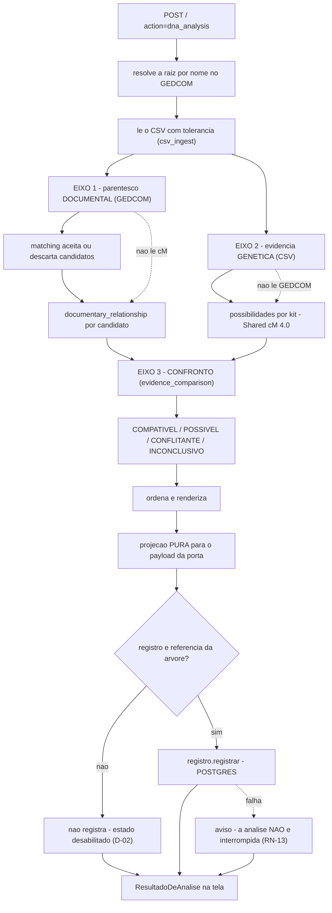
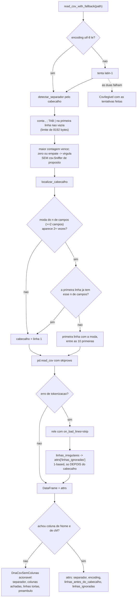
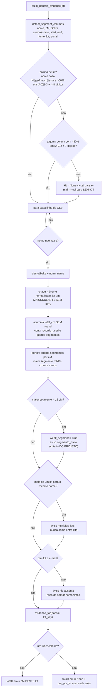
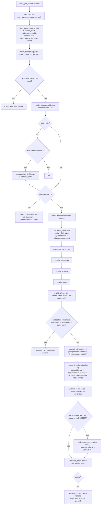
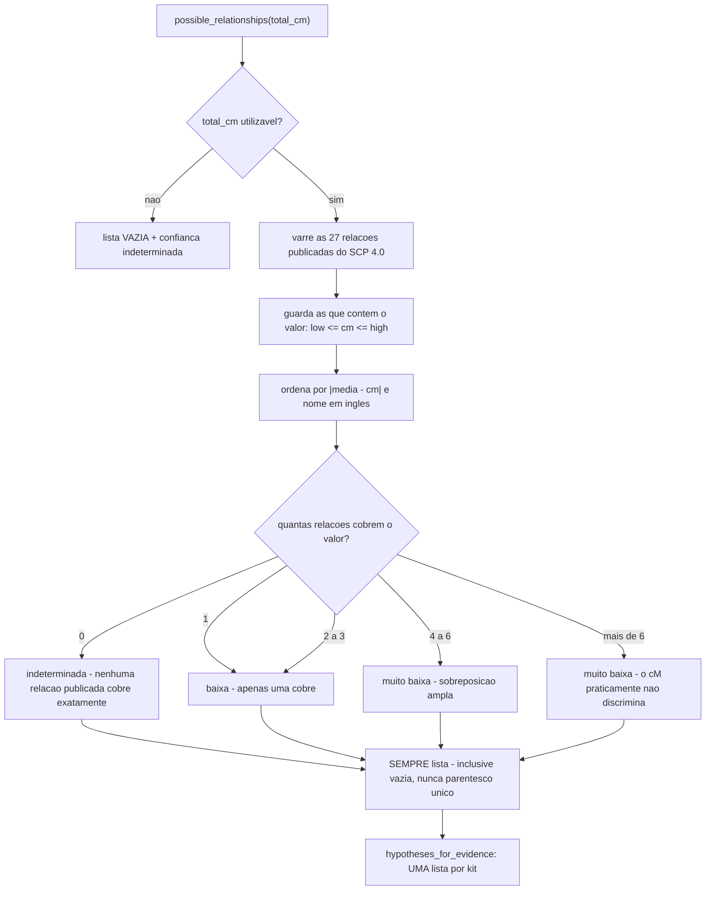
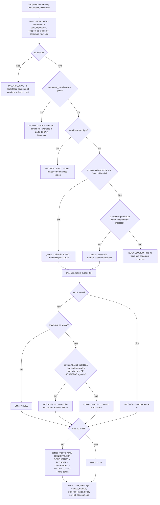
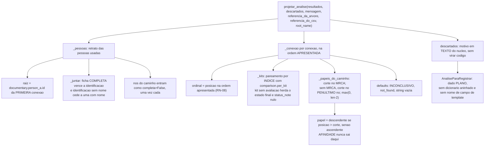
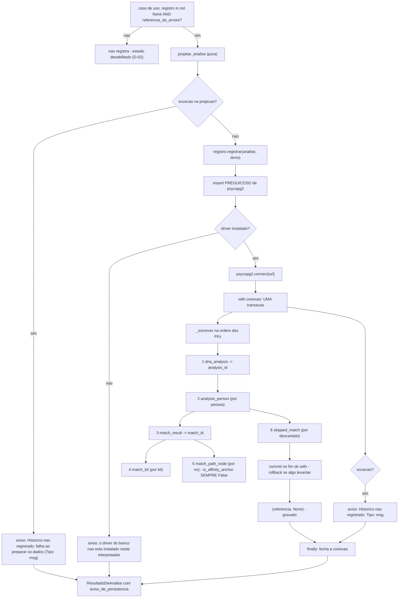
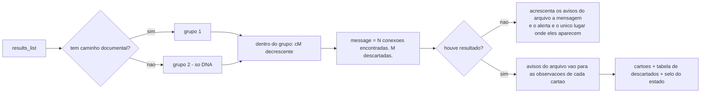

# Fluxograma — módulo `analise-dna`

> Gerado pelo Reversa-Archaeologist em 2026-10-10 (re-extração, nível **completo**).
> Fontes: `src/application/dna_analysis.py`, `src/core/dna_analysis.py`, `src/core/genetic_evidence.py`, `src/core/relationship_hypotheses.py`, `src/core/evidence_comparison.py`, `src/core/matching.py`, `src/core/name_normalization.py`, `src/core/registro.py`, `src/core/cm_estimator.py`, `src/core/erros.py`, `src/parsers/csv_ingest.py`, `src/ports/__init__.py`, `src/ports/adaptadores.py` (`RegistroDeAnalisesPostgres`), `src/application/traducao.py`, `src/app.py` (ramo `dna_analysis`) e `src/templates/index.html` (§ de DNA).
> Escala de confiança: 🟢 CONFIRMADO | 🟡 INFERIDO | 🔴 LACUNA
> **Regra do projeto:** o DNA determina a **evidência genética**; ele **não** determina parentesco. Nenhum eixo contamina o outro, e o cM nunca é usado sozinho para afirmar vínculo.

> **O que mudou desde 2026-10-05.** Esta unidade absorveu três camadas que não existiam na extração anterior: a **fronteira de aplicação** (`src/application/dna_analysis.py`, com projeção pura do resultado no payload da porta), a **persistência histórica** (`RegistroDeAnalises`, feature 008 — o único consumidor da capacidade Postgres) e o **registro puro** (`src/core/registro.py`, onde `get_name` passou a morar quando `core/gedcom_state.py` foi apagado). A **divergência viva** registrada na rodada passada — o determinismo do desempate — foi **implementada** (C37).

## 1. Visão geral — três eixos que não se misturam, e um quarto que vem depois

> 🟢 **O eixo 3 é o único lugar onde os dois se encontram**, e ele só **compara**: não corrige o GEDCOM, não reescreve vínculo e não inventa caminho a partir do DNA. Um conflito vira estado, aviso e lista de causas.
>
> 🟢 **O eixo 4 (persistência) fica depois e fora da decisão.** Nenhum módulo de `src/core/` conhece o registro, e nenhum fluxo consulta o banco para decidir, completar ou corrigir um resultado.

## 2. Leitura tolerante do CSV (`parsers/csv_ingest.py`)

> 🟢 **Os `attrs` do DataFrame são o canal escolhido porque a assinatura é contrato.** `read_csv_with_fallback` é reexportada por `dna_analysis` e por `__all__`; trocar o retorno por tupla quebraria esses consumidores.
>
> 🟢 **As guardas do cabeçalho existem contra dois falsos positivos medidos:** um arquivo **sem** cabeçalho não pode perder a primeira linha de dados, e um arquivo que **não é tabela** (um GEDCOM com uma linha contendo vírgula) não pode eleger essa linha como cabeçalho e esconder o problema real.

## 3. Evidência genética por (nome, kit) — kits nunca se somam

> 🟢 **`SEM_KIT = " SEM-KIT"` tem um espaço à esquerda de propósito.** `_clean` faz `strip` em todo valor do CSV, então nenhum kit real pode começar com espaço — era assim que o literal `"SEM-KIT"` colidia com um kit de verdade (risco `E-03` da feature).
>
> 🟢 **`totals.cm = None` quando há mais de um kit é o número honesto**, e não uma lacuna: não se sabe qual kit é a pessoa do GEDCOM, e somar laboratórios diferentes produziria um valor que nenhuma das duas fontes sustenta.
>
> 🟢 **O cM acumulado não é arredondado em ponto nenhum.** O contrato está congelado em `tests/test_formatacao_cm.py` (19.200000000000003 é o valor esperado), e arredondar aqui quebraria a paridade contra o oráculo congelado. O arredondamento é só de apresentação (`utils/number_format.py`).

## 4. Índices do GEDCOM e decisão de aceitação (`core/matching.py`)

> 🟢 **O 4º critério de desempate é a implementação da decisão humana de 2026-10-05** (`_reversa_sdd/questions.md#pergunta-1` e `adrs/23`). Sem ele, empate exato nos três critérios caía na **ordem de iteração de um `set`** — medida como variável a cada `PYTHONHASHSEED`. `tests/test_characterization_matching.py` congela o comportamento nas duas direções: o menor `xref_id` vence, e o resultado não depende da ordem do pool.
>
> 🟢 **O cache de `features` existe por custo medido, não por estilo:** `norm_name` custa ≈41 µs e `surnames_set` ≈72 µs, e o laço de candidatos renormalizava o mesmo nome ≈7 vezes por candidato, a cada match do CSV, para um valor que não depende do CSV.
>
> 🟡 **O `pool` é um `set`.** A decisão agora é determinística por causa do 4º critério, mas ela ainda **depende** de `pool` conter os mesmos elementos — o que é garantido pelo índice, e não pela ordem.

## 5. Do cM às possibilidades (`core/relationship_hypotheses.py`)

> 🟢 **A fonte é citada com o que ela diz e com o que ela não diz** — a faixa é "Range (low to high; 99th percentile)", com 1 % dos envios removido; a versão 4.0 **não publica mediana** (por isso existe `average` e não `median`); as distribuições se sobrepõem; endogamia e colapso de pedigree **aumentam** o cM para o mesmo parentesco, então o valor é um teto otimista nesses casos.
>
> 🟢 **A confiança (indeterminada/baixa/muito baixa) é heurística DO PROJETO, declarada como tal.** A fonte não define grau de confiança algum. Quanto mais relações cobrem o valor, menos o valor discrimina.
>
> 🟢 **Relações não publicadas nunca recebem número inventado** (1C4R, 1C5R, 1C6R, 3C2R, 2º e 3º bisavós). Quando a relação exata não foi publicada, a janela é a **envoltória** das relações publicadas com o mesmo número de meioses (`meioses_window`); sem nenhuma, o confronto fica INCONCLUSIVO.
>
> 🟢 **`LIMITE_SEGMENTO_FRACO` (15 cM) é critério do projeto**, e o próprio módulo registra que a fonte não afirma nada sobre "segmento abaixo de X é falso positivo".

## 6. O confronto (`core/evidence_comparison.py`)

> 🟢 **O critério de POSSIVEL é sobreposição de FAIXAS, e não distância em meioses.** Irmãos (1613–3488) e primos de 1º grau com 1 remoção (102–980) estão a **uma** meiosa de distância e **não** se sobrepõem; usar meioses ali daria POSSIVEL onde o cM separa claramente as duas leituras.
>
> 🟡 **`_avaliar_kit` recebe `meioses_documental` e não o usa.** O parâmetro sobrou da versão anterior ao critério de sobreposição. Não altera comportamento, mas é superfície que convida a reintroduzir o critério por meioses.
>
> 🟡 **INCONCLUSIVO fica por último na ordem de conservadorismo.** Consequência: um kit sem cM utilizável não rebaixa o resultado quando outro kit é COMPATIVEL. É a ordem declarada no código — escolha, não acidente.
>
> 🟢 **A tela usa o estado como classe CSS** (`badge estado-{{ status }}` em `index.html`). Renomear um dos quatro estados quebra a cor do selo **em silêncio**: não há teste que compare o nome do estado com a folha de estilo.

## 7. Projeção do resultado no payload da porta (`application/dna_analysis.py`)

> 🟢 **A projeção é pura e é pública para poder ser exercitada sem banco** (`B003` da auditoria de 2026-10-08): ela lê o que o núcleo devolveu e nada mais — não chama função do núcleo, não recalcula cM, não reordena e não formata (`D-15`).
>
> 🟢 **A ordem de `_juntar` é a regra que impede `analysis_person.completa` de mentir.** A mesma pessoa pode ser o match de uma conexão e um nó do caminho de outra; se a ficha completa chegasse depois da incompleta e fosse descartada, os dados dela se perderiam.
>
> 🟢 **`caminho` carrega pares `(xref, papel)`** porque `match_path_node.role` é `NOT NULL` com domínio fechado e o núcleo **não** entrega o papel de cada nó: quem deriva é a projeção, dividindo o caminho no ancestral comum. O adaptador só escreve.
>
> 🟡 **`match_file_ref` é o nome do arquivo ARMAZENADO** (`<chave>__<nome visível>`), obtido com `os.path.basename(caminho_do_csv)`. O `RF-03` exige a chave de conteúdo, e inventá-la na projeção criaria um identificador que não existe.

## 8. Registro histórico (`RegistroDeAnalisesPostgres`, feature 008)

> 🟢 **A `RN-13` vale para as DUAS metades:** nem a projeção nem a gravação podem impedir o resultado de chegar à tela. Uma exceção aqui seria a persistência bloqueando a análise — exatamente o que ela não pode.
>
> 🟢 **O import do driver é preguiçoso, e é requisito, não estilo.** `psycopg2` **não está instalado no `.venv/`**, que é o interpretador oficial da suíte e da paridade; um `import psycopg2` no topo derrubaria `import app` nos dois. Nada acontece na construção do adaptador: não abre conexão, não valida a URL e não toca a rede (`D-02`).
>
> 🟢 **Uma conexão por análise e uma transação por análise** (`D-04`, `D-05`): 4 threads e uma gravação por requisição tornam um pool otimização sem necessidade medida. `with conexao` é o gerenciador do próprio psycopg2 — commit no fim, rollback se algo levantar — e ele **não** fecha a conexão; quem fecha é o `finally`.
>
> 🔴 **Não há teste de caminho feliz de INSERT.** Os testes de persistência exercitam a persistência **desabilitada** e **indisponível** por desenho, porque o driver não existe no interpretador oficial. Um erro de SQL, de ordem de FK ou de tipo só apareceria no contêiner.

## 9. Ordem de apresentação, mensagens e tela

> 🟢 **A ordem não é ordem de confiança.** Medido no GEDCOM real em 2026-10: 71 conexões, das quais 64 sem caminho no GEDCOM — antes descartadas em silêncio por não terem caminho. Ordenar só por cM enterraria as 7 documentais no meio das 64.
>
> 🟢 **O aviso de substituição do CSV acompanha a mensagem do resultado, e não a substitui**: a análise é o assunto da tela, e a substituição é uma nota sobre o insumo dela.
>
> 🟢 **A referência escolhida na LISTA tem precedência sobre o arquivo enviado**, e o campo é opcional de propósito: sem ele o caminho é exatamente o de antes, e é essa prova que a paridade e os testes de rota consomem. O CSV passa pela **mesma** porta do GEDCOM com `tipo="csv"` — que **não** valida conteúdo (dívida #10) — e pela **mesma** regra de reenvio (`RN-17`).

## 10. Catálogo de regras de negócio

> Critério de contagem: **uma afirmação normativa distinta por linha**. Os IDs `C1`..`C95` são locais deste artefato (o `RN-xx` citado em outras passagens é o requisito da feature de origem).

### 10.1 Raiz da análise e entrada

| # | Regra | Onde | Confiança |
| --- | --- | --- | --- |
| C1 | A raiz é achada por `root_name.lower() in get_name(p).lower()` sobre `arvore[0]`, e vence o primeiro `pid` na ordem de iteração. | `core/dna_analysis.py:125-129` | 🟢 |
| C2 | Sem nenhum registro casando, levanta `PessoaNaoEncontrada` com o literal `Seu nome '<X>' não foi encontrado no GEDCOM.` | `core/dna_analysis.py:128` | 🟢 |
| C3 | Nome de raiz que casa mais de um registro **não bloqueia**: a análise segue com o primeiro e **avisa**, listando os xrefs exatos. | `core/dna_analysis.py:182-189` | 🟢 |
| C4 | `dono` está na assinatura e **não** participa de decisão nenhuma. | `application/dna_analysis.py:256-262` | 🟢 |

### 10.2 Leitura do CSV

| # | Regra | Onde | Confiança |
| --- | --- | --- | --- |
| C5 | Encoding tentado em ordem: `utf-8`, depois `latin-1`, com `errors="replace"`. | `csv_ingest.py:148` | 🟢 |
| C6 | Separador = maior contagem na primeira linha não vazia entre `,` `;` TAB `|`; empate ou zero fica com a vírgula. **Nunca `csv.Sniffer`**. | `csv_ingest.py:77-91` | 🟢 |
| C7 | Cabeçalho = primeira linha cujo nº de campos é a **moda** entre linhas com ≥2 campos, exigindo moda com frequência ≥2, primeira linha diferente da moda e índice < 10. | `csv_ingest.py:94-124` | 🟢 |
| C8 | Sem essas condições o cabeçalho é a linha 1 — protege arquivo sem cabeçalho e arquivo que não é tabela. | `csv_ingest.py:119-120` | 🟢 |
| C9 | Linhas com nº de campos diferente do cabeçalho são descartadas e seus números (1-based, só depois do cabeçalho) ficam em `attrs["linhas_ignoradas"]`. | `csv_ingest.py:127-138` | 🟢 |
| C10 | Linhas **antes** do cabeçalho são préâmbulo, não linha torta, e viram `attrs["linhas_antes_do_cabecalho"]`. | `csv_ingest.py:132-138` | 🟢 |
| C11 | Falha de todas as tentativas → `CsvIlegivel`, com a lista de tentativas em português. | `csv_ingest.py:178-183` | 🟢 |
| C12 | Sem coluna de Nome **e** de cM → `DnaCsvSemColunas` com separador usado, até 8 colunas achadas, linhas irregulares e a linha do cabeçalho. | `core/dna_analysis.py:147-159` | 🟢 |
| C13 | `detect_columns` acha Nome em `Name`/`MatchedName`/`Nome` e cM em `cM`/`TotalCM`/`Total cM`, por comparação exata sobre colunas já sem espaços. | `csv_ingest.py:186-196` | 🟢 |
| C14 | Coluna de kit: (a) nome casando `kit\|gedmatch\|teste\|test\b` com >50 % dos valores em `[A-Z]{1,3}\d{4,8}`; senão (b) coluna com >30 % em `[A-Z]{2}\d{7}`. | `genetic_evidence.py:72-82` | 🟢 |
| C15 | Coluna de e-mail = a **última** coluna cujo nome contém `mail`. | `genetic_evidence.py:70`, `csv_ingest.py:194` | 🟢 |

### 10.3 Evidência genética

| # | Regra | Onde | Confiança |
| --- | --- | --- | --- |
| C16 | Chave de evidência = (nome normalizado após `demojibake`, kit em maiúsculas ou a sentinela). | `genetic_evidence.py:137-146` | 🟢 |
| C17 | `SEM_KIT = " SEM-KIT"` com espaço à esquerda: `_clean` faz `strip`, então nenhum kit real começa com espaço. | `genetic_evidence.py:34-37` | 🟢 |
| C18 | `"nan"` e `"none"` (case-insensitive) viram vazio; linha sem nome é ignorada. | `genetic_evidence.py:111-113`, `:134-136` | 🟢 |
| C19 | Sem kit e sem e-mail → `kit = None`, chave = sentinela, e o aviso `kit_ausente` sai **uma vez por nome**. | `genetic_evidence.py:190-197` | 🟢 |
| C20 | cM inválido ou ausente soma `0.0`; SNPs e posições inválidas viram `None`. | `genetic_evidence.py:97-108`, `:148-152` | 🟢 |
| C21 | O cM acumulado **não** é arredondado; o arredondamento é só de apresentação. | `genetic_evidence.py:163-167` | 🟢 |
| C22 | Mais de um kit para o mesmo nome gera o aviso `multiplos_kits`, e **nunca** há soma entre kits. | `genetic_evidence.py:181-189` | 🟢 |
| C23 | Fonte = primeira fonte não vazia do kit; na exibição, `fonte não identificada no CSV` quando nula. | `genetic_evidence.py:176-177`, `:255` | 🟢 |
| C24 | Por kit: `segment_count`, `largest_segment_cm`, `snps_total`, `snps_largest_segment`, `chromosomes` ordenados por `(len, valor)` e `method` declarando se é soma de N linhas ou valor de uma linha. | `genetic_evidence.py:198-208` | 🟢 |
| C25 | Maior segmento < 15,0 cM marca `weak_segment` e gera o aviso `segmento_fraco` — critério **do projeto**. | `genetic_evidence.py:209-210`, `:244-251` | 🟢 |
| C26 | Sem evidência para a pessoa → `available=False`, `totals.cm=None` e aviso `sem_evidencia`. | `genetic_evidence.py:222-231` | 🟢 |
| C27 | Com `kit_key`, `evidence_for` devolve só aquele kit; sem ele, junta todos **sem somar cM**. | `genetic_evidence.py:233` | 🟢 |
| C28 | `totals.cm` é o cM do kit quando há **um**, e `None` quando há mais de um. | `genetic_evidence.py:234-235` | 🟢 |
| C29 | `cm_por_kit` traz cada kit separado, usando a sentinela como chave quando o kit é nulo. | `genetic_evidence.py:259` | 🟢 |

### 10.4 Índices e matching

| # | Regra | Onde | Confiança |
| --- | --- | --- | --- |
| C30 | `ged_index` mapeia nome normalizado → pids; `surname_index` mapeia sobrenome → pids. | `matching.py:48-60` | 🟢 |
| C31 | O cache de `features` existe por custo medido e **não** altera decisão: os valores são os mesmos. | `matching.py:43-47`, `:64-71` | 🟢 |
| C32 | `given_tokens` = 2 primeiros tokens não-stop-word; se todos forem stop words, os 2 primeiros tokens crus. | `matching.py:64-67` | 🟢 |
| C33 | Casamento **exato** de nome aceita direto, sem scoring. | `matching.py:78` | 🟢 |
| C34 | Sem exato: pool pelos sobrenomes do CSV; se vazio, tenta prefixos de 3 letras contra o `surname_index`. | `matching.py:82-94` | 🟢 |
| C35 | Pool ainda vazio → motivo `sem candidatos por sobrenome (abreviação/corrupção?)`. | `matching.py:96-97` | 🟢 |
| C36 | `score = round(0.55·token_sort + 0.25·partial + 0.20·given + (8·interseção − 4·comuns), 2)`. | `matching.py:106-114` | 🟢 |
| C37 | Desempate em 4 níveis: maior interseção → maior `s_given` → maior `score` → **menor `xref_id`**. | `matching.py:116-125` | 🟢 |
| C38 | Filtro anti-falso-positivo: ambos com sobrenome, interseção vazia e nenhum sufixo casando → descarta. | `matching.py:133-137` | 🟢 |
| C39 | `required_intersection` = 1, e vira 2 quando o prenome é genérico **e** o CSV traz ≥2 sobrenomes. | `matching.py:139-141` | 🟢 |
| C40 | Jaccard de prefixos (prefixo 4) só é exigido com ≥2 sobrenomes no CSV: 0,5; cai para 0,33 quando `cM ≥ 150` **e** o prenome não é genérico. | `matching.py:143-149` | 🟢 |
| C41 | Aceitação pelos 5 ramos (genérico/2/0,67/100; não-genérico/2/0,50/85/80; não-genérico/1/0,80/86; ≥90/92; ≥95/88) mais o ramo de prefixo de sobrenome. | `matching.py:153-168` | 🟢 |
| C42 | Token do meio do CSV ausente no GEDCOM rebaixa a aceitação: exige `score ≥96`, `given ≥92`, interseção mínima e jaccard ok. | `matching.py:170-174` | 🟢 |
| C43 | O motivo do descarte carrega os números medidos (`given`, `final`, `inter/min`, `jaccard`). | `matching.py:177-179` | 🟢 |

### 10.5 Fluxo do núcleo

| # | Regra | Onde | Confiança |
| --- | --- | --- | --- |
| C44 | O matching usa o cM **do kit**, nunca a soma de kits diferentes. | `core/dna_analysis.py:208-211` | 🟢 |
| C45 | Vence o **primeiro** candidato com caminho documental; sem nenhum, o primeiro da lista. | `core/dna_analysis.py:234-236` | 🟢 |
| C46 | `dossie_por_nome` e `documental_por_pessoa` evitam recalcular o mesmo dossiê (varredura de ~35 mil nomes) e o mesmo parentesco. | `core/dna_analysis.py:196-200`, `:228-233` | 🟢 |
| C47 | O resolvedor de diagrama é montado **uma vez por análise**, fora do laço. | `core/dna_analysis.py:202-204` | 🟢 |
| C48 | Avisos do arquivo entram nas observações de cada resultado; sem nenhum resultado, entram na mensagem final. | `core/dna_analysis.py:272-275` | 🟢 |
| C49 | As observações são **deduplicadas** preservando a ordem: documental → genética → confronto → avisos da raiz e do arquivo. | `core/dna_analysis.py:100-115` | 🟢 |
| C50 | O Mermaid só é montado quando há caminho documental; sem caminho o campo é `None`. | `core/dna_analysis.py:91-97` | 🟢 |

### 10.6 Possibilidades

| # | Regra | Onde | Confiança |
| --- | --- | --- | --- |
| C51 | 27 relações publicadas do SCP 4.0, com meioses, média, mínimo e máximo, e a fonte citada com versão, data e limitações. | `relationship_hypotheses.py:48-92` | 🟢 |
| C52 | Seleção por `low ≤ cm ≤ high` (inclusivo), ordenada por `\|média − cm\|` e nome em inglês. | `relationship_hypotheses.py:178-184` | 🟢 |
| C53 | A resposta é **sempre lista**, inclusive vazia; nunca um parentesco único afirmado como conclusão. | `relationship_hypotheses.py:161-205` | 🟢 |
| C54 | Confiança é heurística **do projeto**: 0 relações → indeterminada; 1 e 2–3 → baixa; 4–6 e >6 → muito baixa. | `relationship_hypotheses.py:140-158` | 🟢 |
| C55 | `total_cm` nulo → lista vazia e confiança indeterminada. | `relationship_hypotheses.py:167-174` | 🟢 |
| C56 | Relações não publicadas nunca recebem número inventado; a janela por meioses é a envoltória das publicadas com o mesmo número, ou `None`. | `relationship_hypotheses.py:120-137` | 🟢 |
| C57 | Uma hipótese por kit; sem evidência, lista vazia. | `relationship_hypotheses.py:208-223` | 🟢 |

### 10.7 Confronto

| # | Regra | Onde | Confiança |
| --- | --- | --- | --- |
| C58 | Sem DNA → INCONCLUSIVO, com o texto de que o parentesco documental continua valendo por si. | `evidence_comparison.py:177-181` | 🟢 |
| C59 | Sem caminho documental → INCONCLUSIVO e **nenhum caminho inventado a partir do DNA**, com 3 causas. | `evidence_comparison.py:183-190` | 🟢 |
| C60 | Identidade ambígua → INCONCLUSIVO, listando os registros homônimos exatos. | `evidence_comparison.py:192-201` | 🟢 |
| C61 | Janela = faixa publicada (`scp40:<nome>`) ou envoltória por meioses (`scp40:meioses=<n>`); sem nenhuma → INCONCLUSIVO. | `evidence_comparison.py:116-147` | 🟢 |
| C62 | `low ≤ cm ≤ high` → **COMPATIVEL**. | `evidence_comparison.py:85-87` | 🟢 |
| C63 | Fora da janela: **POSSIVEL** quando alguma relação publicada que contém o valor tem faixa que **se sobrepõe** à janela. | `evidence_comparison.py:95-105` | 🟢 |
| C64 | Fora da janela e sem sobreposição → **CONFLITANTE**, com o rol de 12 causas. | `evidence_comparison.py:107-113`, `:232-235` | 🟢 |
| C65 | Estado final entre kits = o **mais conservador** na ordem CONFLITANTE > POSSIVEL > COMPATIVEL > INCONCLUSIVO, com nota por kit. | `evidence_comparison.py:225-238` | 🟢 |
| C66 | `per_kit` fica vazio quando o confronto termina antes de avaliar kit por kit — é o que permite à projeção herdar o estado final. | `evidence_comparison.py:177-220` | 🟢 |
| C67 | As observações do confronto herdam os avisos documentais de código `data_impossivel`, `colapso_de_pedigree` e `caminhos_multiplos`. | `evidence_comparison.py:173-175` | 🟢 |

### 10.8 Projeção

| # | Regra | Onde | Confiança |
| --- | --- | --- | --- |
| C68 | `_juntar`: a ficha **completa** vence a identificação, e uma identificação sem nome cede lugar a uma com nome. | `application/dna_analysis.py:66-81` | 🟢 |
| C69 | `_ficha` sem `id` devolve `None` — não há pessoa sem xref. | `application/dna_analysis.py:84-97` | 🟢 |
| C70 | `_papeis_do_caminho` corta no ancestral comum; sem MRCA, o corte cai no **penúltimo** nó; caminho de um nó → ascendente. | `application/dna_analysis.py:117-126` | 🟢 |
| C71 | `afinidade` **nunca** é atribuída pela projeção. | `application/dna_analysis.py:110-112` | 🟢 |
| C72 | `_kits` pareia metadados e veredito **por índice**; kit sem avaliação herda o estado final com `status_note` nulo. | `application/dna_analysis.py:145-161` | 🟢 |
| C73 | A raiz do retrato é `documentary.person_a.id` da **primeira** conexão; nós do caminho entram uma vez cada, sem sobrescrever ficha completa. | `application/dna_analysis.py:164-189` | 🟢 |
| C74 | `ordinal` é a posição na ordem **apresentada**; defaults `INCONCLUSIVO`, `not_found` e string vazia. | `application/dna_analysis.py:192-219` | 🟢 |
| C75 | `projetar_analise` é **pura**: não reordena, não recalcula cM, não formata e não chama o núcleo. | `application/dna_analysis.py:222-253` | 🟢 |
| C76 | O motivo do descarte é transportado como **texto**, sem virar código (`reason_code` é do alvo). | `ports/__init__.py:352-366` | 🟢 |
| C77 | `match_file_ref` é o **nome do arquivo armazenado**, derivado com `os.path.basename` do caminho do CSV. | `application/dna_analysis.py:276` | 🟢 |

### 10.9 Persistência

| # | Regra | Onde | Confiança |
| --- | --- | --- | --- |
| C78 | `registro is None` **ou** `referencia_da_arvore` vazia → não registra: é o estado desabilitado (D-02). | `application/dna_analysis.py:272` | 🟢 |
| C79 | Sem `DATABASE_URL` a borda monta registrador nulo (`_REGISTRO = None`). | `app.py:160-161` | 🟢 |
| C80 | A gravação acontece **depois** do núcleo; nenhum módulo de `src/core/` conhece o registro. | `ports/__init__.py:390-397` | 🟢 |
| C81 | Exceção na projeção **ou** na gravação → aviso `Histórico não registrado: falha ao preparar os dados (Tipo: msg).` e o resultado chega à tela. | `application/dna_analysis.py:279-284` | 🟢 |
| C82 | O adaptador faz **import preguiçoso** de `psycopg2` dentro de `registrar`; ausente → aviso, nunca exceção. | `ports/adaptadores.py:280-284` | 🟢 |
| C83 | Nada acontece na construção do adaptador: não abre conexão, não valida a URL e não toca a rede. | `ports/adaptadores.py:274-275` | 🟢 |
| C84 | Uma conexão por análise (sem pool) e **uma transação por análise**; o `finally` fecha a conexão. | `ports/adaptadores.py:285-297` | 🟢 |
| C85 | A ordem de escrita respeita as chaves estrangeiras: `dna_analysis` → `analysis_person` → `match_result` → `match_kit`/`match_path_node` → `skipped_match`. | `ports/adaptadores.py:305-388` | 🟢 |
| C86 | `is_affinity_anchor` é **sempre FALSE** — afinidade é atribuída por `path_search.py`. | `ports/adaptadores.py:374-376` | 🟢 |
| C87 | `dono` vira a coluna `owner_id` e **nenhuma** consulta filtra por ele. | `ports/adaptadores.py:314` | 🟢 |
| C88 | `aviso_de_persistencia` nulo significa "nada a avisar" (gravado **ou** desabilitado) e a tela não renderiza nada. | `application/dna_analysis.py:48-51`, `index.html:373-374` | 🟢 |

### 10.10 Borda da rota

| # | Regra | Onde | Confiança |
| --- | --- | --- | --- |
| C89 | A referência de CSV escolhida na **lista** tem precedência sobre o arquivo enviado, e o campo é opcional. | `app.py:442-456` | 🟢 |
| C90 | Referência de CSV que não resolve → `Erro: Arquivo '<ref>' não existe mais.` | `app.py:448-453` | 🟢 |
| C91 | O CSV passa pela **mesma** porta do GEDCOM com `tipo="csv"` (que não valida conteúdo) e pela **mesma** regra de reenvio (`RN-17`). | `app.py:459-480` | 🟢 |
| C92 | O aviso de substituição do CSV é **acrescentado** à mensagem do resultado, nunca a substitui. | `app.py:485-489` | 🟢 |
| C93 | Erro de domínio → tabela de tradução (mensagem + status); falha inesperada → `Ocorreu um erro: {e}` com `success=False`. | `app.py:500-503`, `application/traducao.py:117-132` | 🟢 |
| C94 | Ordem de apresentação: primeiro quem tem caminho documental, depois quem só tem DNA; dentro do grupo, cM decrescente. | `core/dna_analysis.py:266-270` | 🟢 |
| C95 | Mensagem final `N conexões encontradas. M descartadas.`, com os avisos do arquivo acrescentados **somente** quando não há resultado. | `core/dna_analysis.py:271-276` | 🟢 |

## 11. Observações e lacunas

* 🟢 **A divergência viva da rodada passada foi fechada.** O `_reversa_sdd/analise-dna/` de 2026-10-05 registrava `RF-26`/`T-31` (determinismo do desempate) como decidido e **não implementado**, e o Detetive de 2026-10-05 mediu a violação (laço sobre `set`, comparação estrita). Hoje o código tem o 4º critério — menor `xref_id` — e `tests/test_characterization_matching.py` o congela. **A dívida de 2026-10-05 não existe mais.**
* 🟡 **`_avaliar_kit` recebe `meioses_documental` e não o usa.** Superfície morta que convida a reintroduzir o critério por meioses, que foi descartado de propósito em 2026-10-05.
* 🟡 **INCONCLUSIVO é o último da ordem de conservadorismo.** Um kit sem cM utilizável não rebaixa o resultado quando outro kit é COMPATIVEL. Está declarado no código, mas não há teste que fixe a ordem como contrato.
* 🟡 **Os quatro estados são também nomes de classe CSS** (`badge estado-{{ status }}`). Renomear um estado muda o texto e quebra a cor do selo em silêncio.
* 🟡 **A projeção recua para o penúltimo nó quando o MRCA não está no caminho.** É recuo declarado no código, mas pode marcar como ascendente um nó que é descendente em um caminho indireto.
* 🔴 **O CSV continua sem validação de conteúdo.** Só a forma do nome é validada (`tipo == "csv"` não chama `validar_conteudo_gedcom`); um arquivo que não é lista de matches só é recusado quando `detect_columns` não acha Nome/cM. A assimetria com o GEDCOM é a dívida #10, preservada de propósito.
* 🔴 **Não há teste de caminho feliz de INSERT.** Os testes de persistência exercitam a persistência desabilitada e a indisponível por desenho, porque `psycopg2` não está instalado no `.venv`. Erro de SQL, de ordem de FK ou de tipo só apareceria no contêiner.
* 🟢 **`cm_estimator` segue legado fora do fluxo.** As nove faixas escritas à mão continuam existindo, o módulo declara que não devem ser usadas em código novo, e a superfície que as reexportava para `core/dna_analysis` saiu (`T022`).
* 🟢 **O pareamento kit ↔ veredito é por índice, não por rótulo.** É o que sustenta dois kits com o mesmo nome — ou dois kits sem kit — sem confundir o cM de um com o veredito do outro.

---

*Gerado pelo Reversa-Archaeologist em 2026-10-10 (re-extração).*
