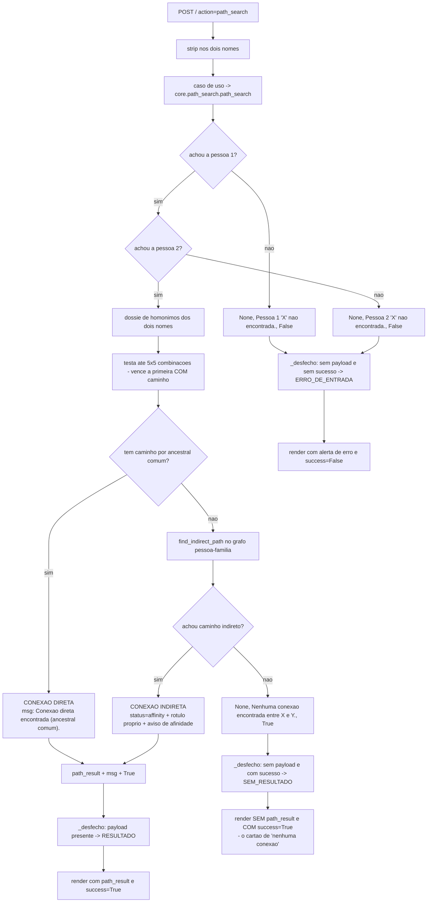
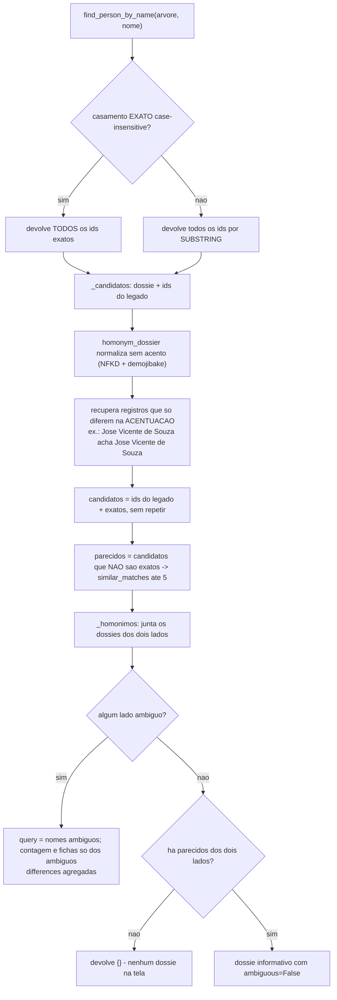
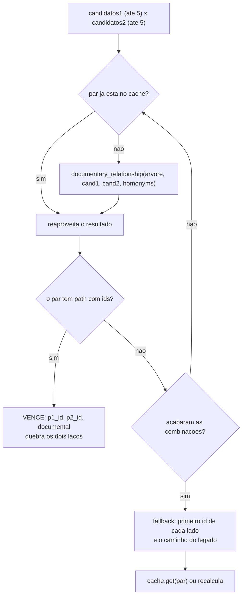
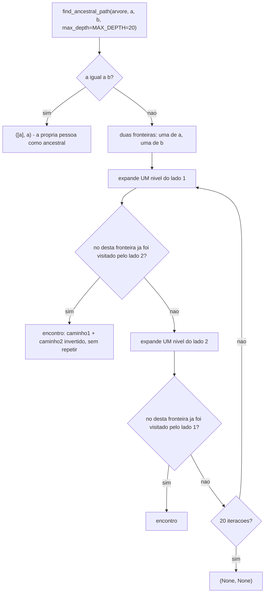
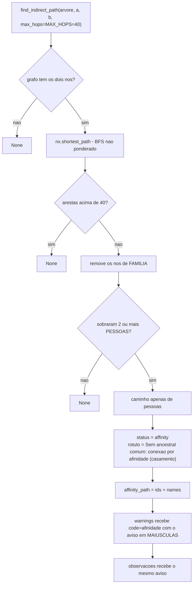
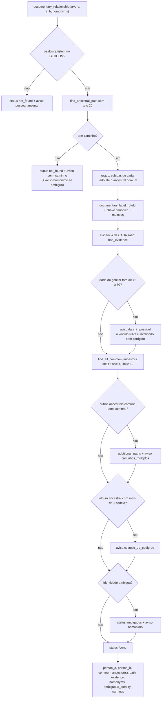
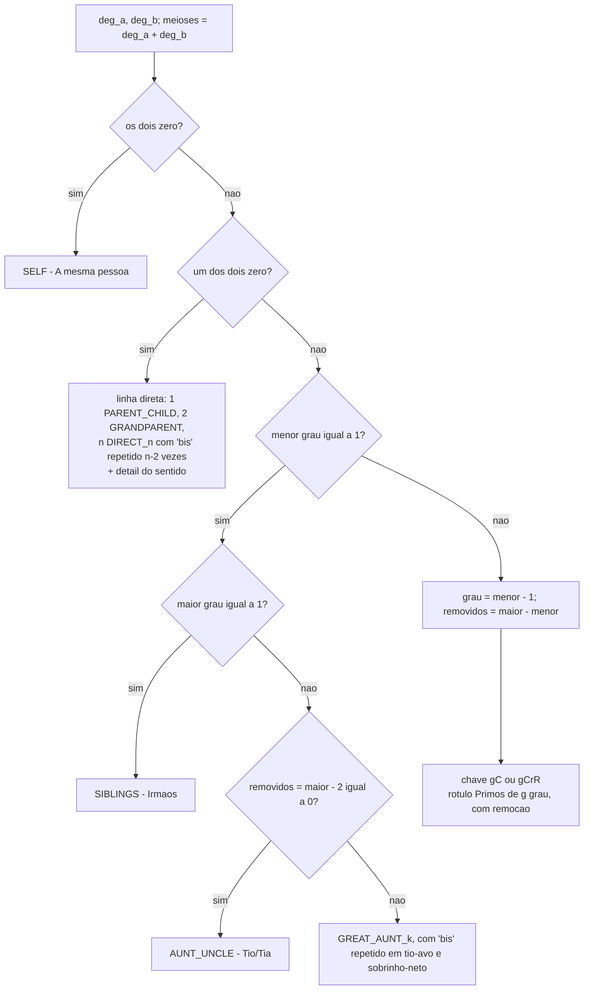
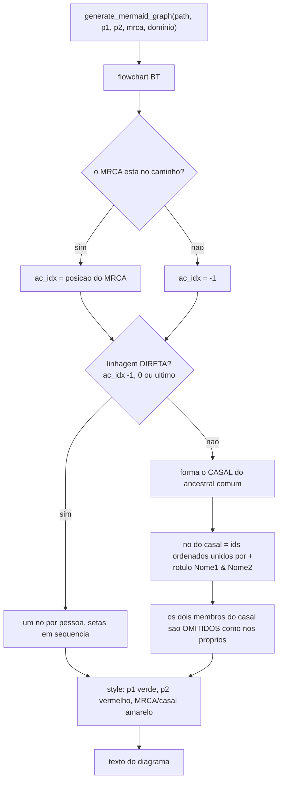
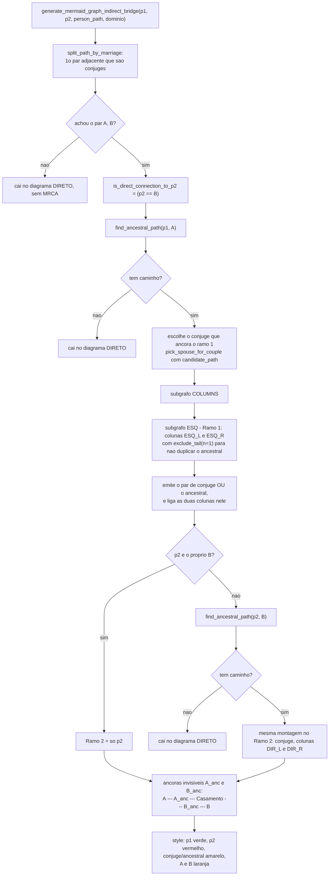
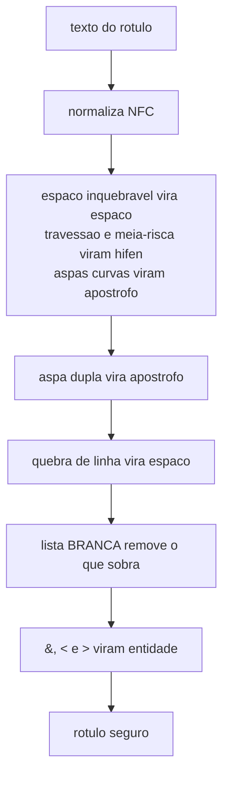

# Fluxograma — módulo `busca-caminho`

> Gerado pelo Reversa-Archaeologist em 2026-10-10 (re-extração, nível **completo**).
> Fontes: `src/application/path_search.py`, `src/application/__init__.py`, `src/core/path_search.py`, `src/core/path_finding.py`, `src/core/family_navigation.py`, `src/core/documentary_relationship.py`, `src/core/diagram_domain.py`, `src/core/registro.py`, `src/reporting/mermaid_render.py`, `src/app.py` (ramo `path_search`) e `src/templates/index.html` (§ de busca).
> Escala de confiança: 🟢 CONFIRMADO | 🟡 INFERIDO | 🔴 LACUNA
> **Regra do projeto:** esta busca é **documental**. Não há DNA nesta tela, e a conexão por casamento **nunca** é apresentada como parentesco consanguíneo.

> **O que mudou desde 2026-10-05.** A unidade ganhou a **fronteira de aplicação** (`application/path_search.py` com `ResultadoDeBusca`, e o enum `Desfecho` em `application/__init__.py`, que substitui o booleano `success` que atravessava a fronteira). O núcleo **encolheu**: o bloco que reexportava 17 nomes de `family_navigation`, `path_finding`, `mermaid_render` e `gedcom_state` foi removido (`OPP-20261006-ESKO`) e `__all__` passou a declarar só `path_search`. E `reporting/mermaid_render.py` deixou de importar `core` (`OPP-20261006-ULVW`): recebe o **resolvedor de diagrama** por parâmetro.

## 1. Fluxo do caso de uso (`application/path_search.py`)

> 🟢 **O desfecho existe para o literal de tela não ganhar autoridade semântica.** Sem ele, o adaptador teria de distinguir "pessoa não encontrada" (alerta de erro) de "nenhuma conexão encontrada" (cartão, **com sucesso**) pelo **texto** da mensagem — exatamente o que a `RF-20` proíbe. Os três valores são derivados dos dois insumos que o núcleo já sinaliza: presença de payload e indicador de sucesso.
>
> 🟢 **A precedência de `_desfecho` é o payload primeiro:** payload presente é `RESULTADO` mesmo que o indicador viesse falso — e ele não vem, nos três estados que o núcleo produz hoje.
>
> 🟢 **A tupla de três elementos do núcleo é contrato de paridade** e não foi tocada (`D-12`): `_reversa_sdd/parity/harness.py` compara o indicador de sucesso contra o oráculo, e nove asserções de teste a desempacotam.

## 2. Resolução das pessoas e dossiê de homônimos

> 🟢 **O dossiê compara sem acento, e `find_person_by_name` compara com acento.** A assimetria é deliberada: o nome vindo do CSV (sem acento) não acharia o registro acentuado no GEDCOM, e o dossiê recupera justamente esses registros — que são os homônimos que a regra manda **não** escolher em silêncio.
>
> 🟢 **O rótulo e a contagem falam apenas do lado ambíguo.** Misturar os dois lados faria a tabela de homônimos listar a própria pessoa 1 como se fosse homônima da pessoa 2.

## 3. Escolha do par de candidatos — até 5×5 combinações

> 🟢 **A escolha deixou de ser o 1º ID.** Medido no GEDCOM real: "Jose Vicente de Souza" tem três registros (dois diferindo só no acento) e **só um** tem pais — antes, a tela respondia "nenhuma conexão" para uma conexão que o GEDCOM contém.
>
> 🟢 **O teto de 5×5 existe para que um nome muito comum não transforme a busca em varredura**, e o fallback preserva o comportamento do legado quando nenhuma combinação tem caminho.

## 4. Caminho direto — BFS bidirecional subindo por pais

> 🟢 **`MAX_DEPTH = 20` conta ITERAÇÕES do BFS bidirecional, não gerações** — cada iteração expande um nível de **um** dos dois lados, alternadamente. A extração anterior descrevia como "20 níveis" e estava errada.
>
> 🟢 **O teto corta em silêncio**, e o aviso do confronto diz que isso **não prova** ausência de parentesco. Preservar a fidelidade ao legado foi decisão humana de 2026-09-30.
>
> 🟢 **`get_parents` prefere o `FAMC` do registro e só cai no índice filho→famílias quando não há `FAMC`.** A assimetria é do legado e é contrato.

## 5. Caminho indireto por afinidade

> 🟢 **A conexão indireta é marcada como afinidade em três lugares** — `status`, rótulo e aviso em maiúsculas — e **nunca** como parentesco consanguíneo.
>
> 🟡 **`MAX_HOPS` conta arestas do grafo pessoa↔família, e não passos pessoa-a-pessoa.** Como o caminho alterna pessoa → família → pessoa, 40 arestas correspondem a cerca de 20 vínculos entre pessoas. O limite efetivo em gerações é, portanto, aproximadamente metade do número declarado.
>
> 🟢 **`get_spouses` busca no `FAMS` e, se nada achar, varre TODAS as famílias.** A varredura só roda quando a lista por `FAMS` fica vazia — e é isso que faz o cônjuge de uma segunda família desaparecer quando a primeira resolve. Contrato aceito desde 2026-09-30; torná-la sempre ativa **muda o resultado**.

## 6. Parentesco documental (`documentary_relationship`)

> 🟢 **Nenhuma data invalida um vínculo.** O GEDCOM manda; o sistema **registra a evidência** (`age_at_birth`, `plausible`) e **avisa**. O caso medido está no próprio código: mãe nascida 11 anos **depois** do filho (`@F6@`, Celso Gomes Gama n. 1961, filho de Maria Auxiliadora n. 1972) que o legado apresentava como "conexão direta por ancestral comum".
>
> 🟢 **O colapso de pedigree é medido por contagem de cadeias até o mesmo ancestral** (`_cadeias_ate`, teto `LIMITE_DE_CADEIAS = 8`), e o aviso declara a consequência: ele **infla o cM esperado** e enfraquece a leitura do valor compartilhado.
>
> 🟡 **A contagem de cadeias é truncada no teto.** `_cadeias_ate` devolve assim que `total >= 8`, então o aviso pode dizer "alcançado por 8 cadeias distintas" quando são mais. O número exibido é um **piso**, não a contagem.
>
> 🟡 **A ordenação de `find_all_common_ancestors` não é totalmente determinística.** A varredura parte de `set(de_a) & set(de_b)` e a chave de ordenação é `(total_meioses, max(distância), nome)`. Quando dois ancestrais empatam nos **três** critérios — mesmo nome, mesmas distâncias —, a ordem relativa vem da iteração do `set`, que varia com o `PYTHONHASHSEED`. É a mesma classe de defeito que o desempate do `matching` fechou em 2026-10-05, e aqui **continua aberta**: afeta a ordem de `common_ancestors` e de `additional_paths` na tela.
>
> 🟡 **`_chave_de` usa `(len(people), primeira chave, última chave)` como chave de invalidação do cache de nomes.** Dois GEDCOMs de tamanhos diferentes não colidem; dois do **mesmo tamanho** e com os mesmos xrefs extremos (ex.: dois exports do mesmo exportador, ambos com `@I1@` … `@I35460@`) produzem a **mesma** chave, e o índice de nomes da árvore anterior é reaproveitado para a nova. Ver §13.

## 7. Tradução de graus em parentesco (`documentary_label`)

> 🟢 **A chave canônica é o que casa o parentesco documental com a tabela do Shared cM Project.** `GREAT_AUNT_1`, `GREAT_AUNT_2`, `DIRECT_4` e `DIRECT_5` existem aqui e são reconhecidas (ou declaradas ausentes) lá.
>
> 🟡 **`bis` é repetido, não traduzido:** `acima = 4` produz "bisbisavô". É a convenção do projeto; o português genealógico usaria "trisavô".
>
> 🟢 **`meioses = deg_a + deg_b` é a grandeza que o cM efetivamente mede**, e é ela — não o rótulo — que a janela do confronto usa quando a relação exata não foi publicada.

## 8. Renderização Mermaid — caminho direto

> 🟢 **O `sid` do nó é derivado do xref** (`@` removido, `+` virando `_`, tudo que não é `[A-Za-z0-9_]` removido) e prefixado com `N_`. Por isso o nó do casal é o **mesmo** independentemente da ordem dos dois ids: eles são ordenados antes de virar `sid`.
>
> 🟢 **As decisões de layout moram no renderizador, e isso é deliberado** (`ADR-11`): `reporting/` não é folha e não pode ser, porque decidir o casal do ancestral comum é decisão de negócio. O que mudou na `OPP-20261006-ULVW` foi apenas **quem busca o dado** — o renderizador recebe `dominio` e não importa `core`.

## 9. Renderização Mermaid — caminho indireto

> 🟢 **O fechamento de cada `subgraph` é garantido por um context manager.** Um `end` a mais ou a menos **muda a árvore do diagrama sem levantar erro nenhum** — era exatamente o risco da `OPP-20260929-H2YY`.
>
> 🟢 **O destino das setas difere entre "par de cônjuges" e "ancestral sozinho"**, e o helper trata os dois: o par já chega como id de nó, e o ancestral ainda precisa passar por `sid`. Assumir que o mesmo id serve para os dois muda a saída nos casos com cônjuge.
>
> 🟢 **A aresta de casamento é explícita e rotulada** (`--- |Casamento|`), entre duas âncoras invisíveis — é o que permite o diagrama dizer que a ligação é por afinidade sem desenhar uma seta de filiação.

## 10. Contrato de escape do rótulo Mermaid

> 🟢 **A lista é BRANCA, e não negra** (`_LABEL_SEGURO`). A negra anterior era furada pela **crase**, que logo após a aspa de abertura desvia o lexer do Mermaid para markdown-string e faz o fecha-colchete nunca virar o token exigido pela gramática (`BUG-20260929-J6PQ`). A versão seguinte era **estreita demais** e descartava 14 caracteres sem intenção (`BUG-20261002-T4ZM`).
>
> 🟢 **O critério é INERTE, e não "seguro":** dentro do estado `string` o lexer consome tudo com `<string>[^"]+`, então colchete, dois pontos, barra e palavra-chave são inertes. O que não pode passar é a aspa dupla e a crase.

## 11. Catálogo de regras de negócio

> Critério de contagem: **uma afirmação normativa distinta por linha**. Os IDs `D1`..`D67` são locais deste artefato.

### 11.1 Resolução e homônimos

| # | Regra | Onde | Confiança |
| --- | --- | --- | --- |
| D1 | A busca faz `strip` nos dois nomes antes de qualquer coisa. | `core/path_search.py:130-131` | 🟢 |
| D2 | `find_person_by_name` tenta casamento **exato** case-insensitive e só depois **substring**, devolvendo todos os ids que casam. | `family_navigation.py:43-49` | 🟢 |
| D3 | Pessoa 1 ausente → `Pessoa 1 '<X>' não encontrada.` com `success=False`; o mesmo para a pessoa 2. | `core/path_search.py:136-138` | 🟢 |
| D4 | O dossiê de homônimos normaliza **sem acento** (`NFKD` + `demojibake`), recuperando registros que só diferem na acentuação. | `documentary_relationship.py:169-180` | 🟢 |
| D5 | `_candidatos` une os ids do legado aos exatos, sem repetir e preservando a ordem de inserção. | `core/path_search.py:80-86` | 🟢 |
| D6 | Os "parecidos" (não exatos) entram apenas como `similar_matches`, limitados a 5. | `core/path_search.py:83-85` | 🟢 |
| D7 | O dossiê agregado só é ambíguo se **algum lado** for ambíguo; a contagem e as fichas vêm só dos lados ambíguos. | `core/path_search.py:98-111` | 🟢 |
| D8 | Sem ambiguidade e sem parecidos, `_homonimos` devolve `{}` e a tela não mostra a seção. | `core/path_search.py:100-101` | 🟢 |
| D9 | `ambiguous` é verdadeiro com mais de um registro de **mesmo nome normalizado**, ou quando o chamador passa `similar_ids` não vazios. | `documentary_relationship.py:257-270` | 🟢 |
| D10 | `identical_data` é verdadeiro quando há mais de um registro e **nenhum** campo diverge entre as fichas. | `documentary_relationship.py:269` | 🟢 |
| D11 | Os campos comparados entre homônimos são: data e local de nascimento, data de falecimento, pais, filhos e sexo. | `documentary_relationship.py:185-192` | 🟢 |

### 11.2 Escolha do par

| # | Regra | Onde | Confiança |
| --- | --- | --- | --- |
| D12 | As combinações testadas são limitadas a 5 candidatos de cada lado (`LIMITE_DE_CANDIDATOS`). | `core/path_search.py:68`, `:151-152` | 🟢 |
| D13 | Vence a **primeira** combinação cujo caminho documental tem `path.ids` — não a de menor distância. | `core/path_search.py:151-160` | 🟢 |
| D14 | Os pares já calculados são reaproveitados por um cache local `(cand1, cand2) -> documental`. | `core/path_search.py:149`, `:153-155` | 🟢 |
| D15 | Sem nenhuma combinação com caminho, o fluxo cai no **primeiro id de cada lado**, preservando o comportamento do legado. | `core/path_search.py:162-164` | 🟢 |

### 11.3 Caminho direto

| # | Regra | Onde | Confiança |
| --- | --- | --- | --- |
| D16 | `MAX_DEPTH = 20` conta **iterações** do BFS bidirecional, alternando os dois lados. | `path_finding.py:33`, `:66-90` | 🟢 |
| D17 | `a == b` devolve `([a], a)` — a própria pessoa como ancestral. | `path_finding.py:64-65` | 🟢 |
| D18 | O encontro costura os dois caminhos sem repetir o nó comum. | `path_finding.py:73`, `:85` | 🟢 |
| D19 | Esgotado o teto sem encontro, o retorno é `(None, None)` — corte **silencioso**. | `path_finding.py:91` | 🟢 |
| D20 | `get_parents` usa o `FAMC` do registro quando existe; só sem `FAMC` consulta o índice filho→famílias. | `family_navigation.py:52-72` | 🟢 |
| D21 | `get_parents` coleta `HUSB` e `WIFE` de **todas** as famílias do `FAMC`, sem repetir. | `family_navigation.py:63-71` | 🟢 |
| D22 | Pesos e limiares do BFS não existem: o caminho é o primeiro encontrado, e a ordem de inserção das arestas é contrato de paridade. | `path_finding.py:17-20` | 🟢 |

### 11.4 Caminho indireto

| # | Regra | Onde | Confiança |
| --- | --- | --- | --- |
| D23 | `MAX_HOPS = 40` é comparado contra o número de **arestas** do grafo pessoa↔família. | `path_finding.py:36`, `:49` | 🟢 |
| D24 | O caminho indireto usa `nx.shortest_path` (BFS não ponderado) e remove os nós de família. | `path_finding.py:48-51` | 🟢 |
| D25 | Sobrando menos de 2 pessoas depois da compressão, o resultado é `None`. | `path_finding.py:52` | 🟢 |
| D26 | Grafo ausente ou nó ausente devolve `None`, sem exceção. | `path_finding.py:45-46`, `:53-54` | 🟢 |
| D27 | `get_spouses` resolve pelo `FAMS` e **só cai na varredura global** quando a via `FAMS` não devolve nada. | `family_navigation.py:97-106` | 🟢 |
| D28 | `split_path_by_marriage` devolve o **primeiro** par adjacente de cônjuges e as duas metades do caminho. | `family_navigation.py:113-127` | 🟢 |
| D29 | `pick_spouse_for_couple` prefere o cônjuge que aparece no caminho candidato; senão devolve o primeiro. | `family_navigation.py:130-138` | 🟢 |
| D30 | `exclude_tail(seq, n=1)` corta a cauda para não duplicar o ancestral na ponta. | `family_navigation.py:141-146` | 🟢 |

### 11.5 Parentesco documental

| # | Regra | Onde | Confiança |
| --- | --- | --- | --- |
| D31 | Sem caminho, o status é `not_found`, com aviso `sem_caminho` afirmando que isso **não prova** ausência de parentesco. | `documentary_relationship.py:497-529` | 🟢 |
| D32 | Os graus são `indice` (subidas de A) e `len(path) - 1 - indice` (subidas de B) a partir do ancestral comum. | `documentary_relationship.py:531-532` | 🟢 |
| D33 | A evidência de cada salto sobe (`hop_evidence(child, parent)`) antes do MRCA e desce depois dele. | `documentary_relationship.py:535-540` | 🟢 |
| D34 | Idade de genitor fora de **12 a 70** anos gera aviso `data_impossivel` e o vínculo **não** é invalidado. | `documentary_relationship.py:40-41`, `:542-552` | 🟢 |
| D35 | `plausible` é `None` quando falta data — ausência de data não é suspeita. | `documentary_relationship.py:309-310` | 🟢 |
| D36 | A busca por todos os ancestrais comuns usa teto próprio de **12** níveis e devolve no máximo **12**. | `documentary_relationship.py:46`, `:453-469` | 🟢 |
| D37 | Os ancestrais comuns são ordenados por `(meioses totais, maior distância, nome)`. | `documentary_relationship.py:468` | 🟢 |
| D38 | Caminho alternativo existe quando há **outro** ancestral comum com caminho até os dois lados. | `documentary_relationship.py:554-562` | 🟢 |
| D39 | Havendo alternativos, o aviso `caminhos_multiplos` declara que o exibido é o de menor distância total e que nenhum foi descartado. | `documentary_relationship.py:564-570` | 🟢 |
| D40 | Colapso de pedigree é mais de **uma cadeia** de pais até o mesmo ancestral; o aviso lista até 3 e declara o efeito no cM. | `documentary_relationship.py:406-427`, `:572-584` | 🟢 |
| D41 | A contagem de cadeias para no teto `LIMITE_DE_CADEIAS = 8`. | `documentary_relationship.py:47`, `:422-424` | 🟢 |
| D42 | Identidade ambígua → status `ambiguous` e aviso `homonimo` com a orientação de conferir as fichas antes de aceitar o parentesco. | `documentary_relationship.py:586-597` | 🟢 |
| D43 | `person_summary` monta a ficha comparável com id, nome, sexo, nascimento (data, ano e local), falecimento (data e ano), pais, nomes dos pais, cônjuges, filhos e família como filho. | `documentary_relationship.py:146-162` | 🟢 |
| D44 | `hop_evidence` resolve a família por `FAMC` e, sem ele, pelo índice filho→famílias; sem família localizada, `link_source` diz isso. | `documentary_relationship.py:285-301`, `:324` | 🟢 |
| D45 | `parse_year` extrai o **primeiro** ano de 3 ou 4 dígitos e **não** normaliza `BEFORE`/`AFTER`. | `documentary_relationship.py:76-87` | 🟢 |

### 11.6 Tradução de graus

| # | Regra | Onde | Confiança |
| --- | --- | --- | --- |
| D46 | `meioses = deg_a + deg_b` em todos os casos, inclusive `SELF` (0). | `documentary_relationship.py:343` | 🟢 |
| D47 | `(0,0)` → `SELF`; um lado zero → linha direta (`PARENT_CHILD`, `GRANDPARENT`, `DIRECT_n`). | `documentary_relationship.py:344-358` | 🟢 |
| D48 | Na linha direta o rótulo repete `"bis"` `n-2` vezes e o `detail` declara o sentido. | `documentary_relationship.py:353-357` | 🟢 |
| D49 | `menor == 1`: `(1,1)` → `SIBLINGS`; `(1,2)` → `AUNT_UNCLE`; acima disso → `GREAT_AUNT_<removidos>`. | `documentary_relationship.py:362-375` | 🟢 |
| D50 | Caso contrário: `grau = menor - 1`, `removidos = maior - menor`, chave `gC` ou `gCrR`. | `documentary_relationship.py:377-385` | 🟢 |
| D51 | O rótulo usa numerais ordinais até 10º e o número cru acima disso. | `documentary_relationship.py:332`, `:379` | 🟢 |

### 11.7 Diagrama

| # | Regra | Onde | Confiança |
| --- | --- | --- | --- |
| D52 | O `sid` do nó preserva apenas `[A-Za-z0-9_]`, remove `@`, troca `+` por `_` e prefixa `N_`. | `mermaid_render.py:31-36` | 🟢 |
| D53 | O nó do casal é o `sid` dos dois ids **ordenados** unidos por `+` — logo, independente da ordem recebida. | `mermaid_render.py:88`, `:167`, `:254` | 🟢 |
| D54 | Linhagem direta é `ac_idx` em `-1`, `0` ou no último nó; só fora disso o MRCA vira um nó de casal. | `mermaid_render.py:81` | 🟢 |
| D55 | Os dois membros do casal são **omitidos** como nós próprios quando o casal é emitido. | `mermaid_render.py:82`, `:94-96` | 🟢 |
| D56 | O diagrama indireto abre `subgraph`s aninhados (`COLUMNS`, `ESQ`/`DIR`, `*_COLS`, `*_L`, `*_R`) com `direction BT`. | `mermaid_render.py:170-269` | 🟢 |
| D57 | O fechamento de cada `subgraph` é o fim do `with` (`contextmanager`), nunca uma linha solta. | `mermaid_render.py:173-188` | 🟢 |
| D58 | Sem par de cônjuges, sem caminho até A, ou sem caminho até B, o diagrama indireto **cai no direto** com `mrca=None`. | `mermaid_render.py:140-141`, `:149-150`, `:245-246` | 🟢 |
| D59 | O casamento é uma aresta rotulada entre duas âncoras invisíveis (`style` transparente), e não uma seta de filiação. | `mermaid_render.py:271-281` | 🟢 |
| D60 | As cores são fixas por papel: p1 verde, p2 vermelho, MRCA/casal amarelo e o casal da afinidade laranja. | `mermaid_render.py:112-115`, `:283-300` | 🟢 |
| D61 | O rótulo passa por NFC, troca espaço inquebrável, travessões e aspas curvas, converte a aspa dupla em apóstrofo, colapsa quebras de linha, aplica a lista branca e converte `&`, `<` e `>` em entidade. | `mermaid_render.py:55-65` | 🟢 |

### 11.8 Fronteira e desfecho

| # | Regra | Onde | Confiança |
| --- | --- | --- | --- |
| D62 | O desfecho é derivado de (payload, sucesso): payload presente → `RESULTADO`; sem payload e com sucesso → `SEM_RESULTADO`; sem payload e sem sucesso → `ERRO_DE_ENTRADA`. | `application/path_search.py:66-76` | 🟢 |
| D63 | O campo de template **não** atravessa a fronteira: `dados` é o payload do núcleo sem renomear nada. | `application/path_search.py:32-45` | 🟢 |
| D64 | O caso de uso **não** monta as dependências de diagrama: elas chegam por parâmetro, montadas uma vez na borda. | `application/path_search.py:51-53` | 🟢 |
| D65 | `dono` está na assinatura e **não** participa de decisão nenhuma. | `application/path_search.py:55-56` | 🟢 |
| D66 | A rota escolhe o modo de renderização pelo **desfecho**, nunca pelo texto da mensagem. | `app.py:513-522` | 🟢 |
| D67 | Erro de domínio passa pela tabela de tradução; falha inesperada vira `Ocorreu um erro: {e}` com `success=False`. | `app.py:523-528` | 🟢 |

## 12. Observações e lacunas

* 🟢 **Nenhuma data invalida um vínculo.** O sistema registra a evidência e avisa; corrigir o GEDCOM não é papel de agente.
* 🟢 **A conexão indireta nunca é parentesco consanguíneo** — declarado em três lugares independentes.
* 🟢 **O núcleo encolheu nesta rodada.** O bloco que reexportava 17 nomes foi removido (`OPP-20261006-ESKO`) depois que a varredura mostrou que `app.py` importa apenas `path_search` e que `core/dna_analysis.py` não importa nada daqui. Os consumidores reais eram três arquivos de teste e o harness, todos migrados para o módulo canônico.
* 🟢 **`reporting/` deixou de importar `core`** (`OPP-20261006-ULVW`): o ciclo `core/` ↔ `reporting/` foi fechado com o **resolvedor de diagrama**, um `dict` de funções já ligadas à árvore por `functools.partial`. O renderizador continua chamando `get_spouses(pid)`, e não `get_spouses(arvore, pid)` — é isso que preserva a costura sem arrastar o renderizador para a migração.
* 🟡 **`MAX_HOPS` conta arestas do grafo bipartido**, e não passos entre pessoas: o teto efetivo em vínculos pessoa-a-pessoa é aproximadamente metade do valor declarado.
* 🟡 **A ordem de `common_ancestors` e de `additional_paths` pode variar com o `PYTHONHASHSEED`** quando dois ancestrais empatam em meioses, distância e nome. É a mesma classe do defeito que o `matching` fechou em 2026-10-05, e aqui segue aberta.
* 🟡 **A contagem de cadeias do colapso é truncada em 8**, então o aviso exibe um piso, não o total.
* 🟡 **`bis` é repetido, não traduzido** — "bisbisavô" onde o português genealógico diria "trisavô".
* 🟡 **`_diferencas` é chamado duas vezes** em `homonym_dossier` (uma para `differences`, outra dentro de `identical_data`), e cada chamada remonta `person_summary` de todos os ids — o que varre as famílias do arquivo. O comentário do próprio código diz que as fichas são montadas "UMA vez"; isso vale dentro de uma chamada, não entre as duas.
* 🟡 **`person_summary` chama `get_parents` duas vezes** (uma para `parents`, outra para `parent_names`) e `get_children` uma vez, que varre **todas** as famílias sem índice. É a mesma dívida de custo registrada em 2026-10-05.
* 🔴 **`get_children` não tem índice**: cada chamada percorre todas as famílias do arquivo. Com 35 mil pessoas e vários homônimos por nome, o custo do dossiê cresce com o número de candidatos.

## 13. Achado a encaminhar — colisão da chave do cache de nomes

🟡 **O cache de módulo `_INDICE_DE_NOMES` pode não invalidar entre duas árvores diferentes.**

`_chave_de` devolve `(len(people), chaves[0], chaves[-1])` com `chaves = sorted(people)`. A docstring declara que a chave é "barata e suficiente para distinguir dois GEDCOMs carregados", e ela **é** suficiente para os casos triviais. O que ela não distingue é o caso em que as duas árvores têm **o mesmo número de pessoas e os mesmos xrefs extremos** — o que é provável entre dois exports do mesmo exportador, que costumam numerar de forma contígua.

Consequência, se a colisão ocorrer num processo de longa duração (o servidor): `_indice_por_nome` devolve o mapa da árvore **anterior**, com xrefs que não existem na nova. O dossiê de homônimos passa a listar fichas de pessoas que não estão na árvore carregada. Não há exceção: `person_summary` degrada em silêncio (`get_name(None)` devolve `Sem Nome`, e as consultas devolvem `[]`/`None`).

O cenário é **inferido**, não executado nesta rodada: exige dois GEDCOMs reais do mesmo tamanho com a mesma assinatura de xrefs, submetidos ao mesmo processo. A correção mínima possível seria acrescentar à chave algo derivado do conteúdo (por exemplo, o `id()` **não** serve — é reciclado, e o próprio código explica por quê), ou um contador de parse. Fica registrado para a Fase 3 (Detetive) e para o Revisor.

---

*Gerado pelo Reversa-Archaeologist em 2026-10-10 (re-extração).*
