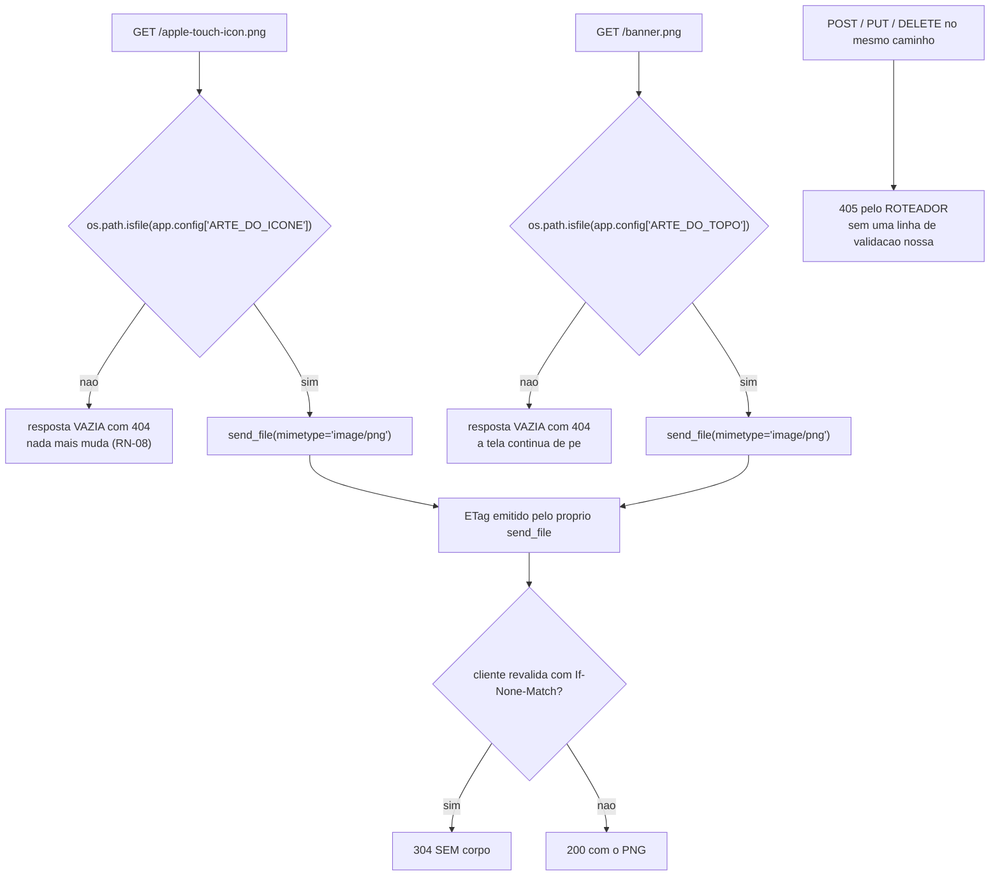
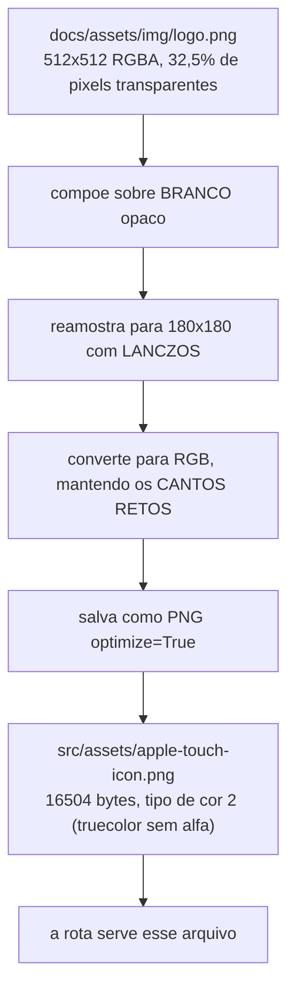
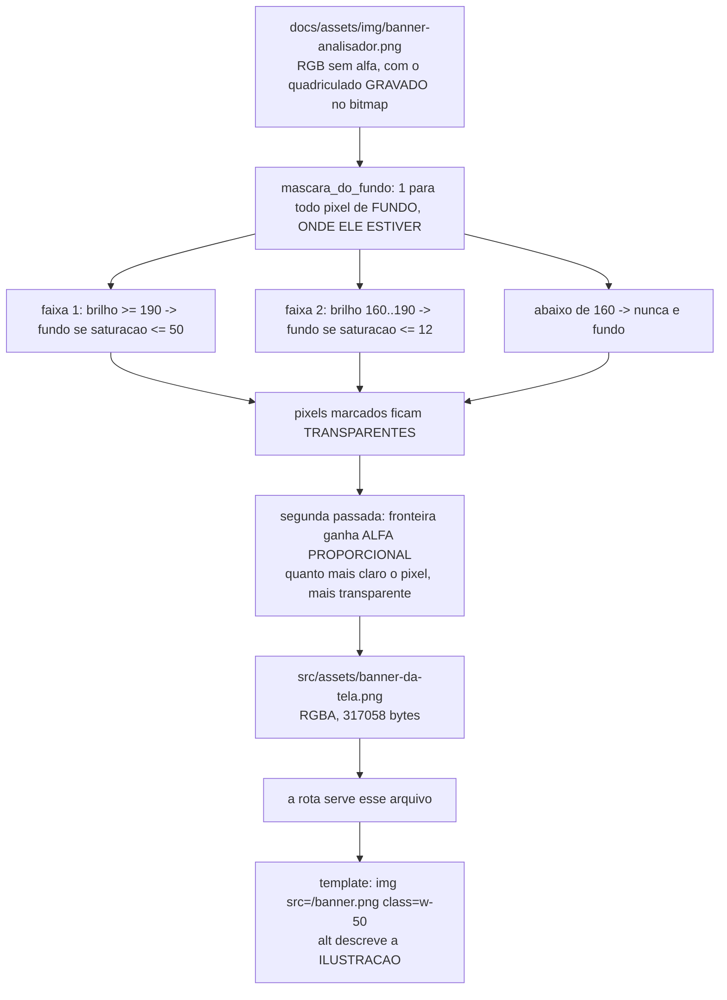
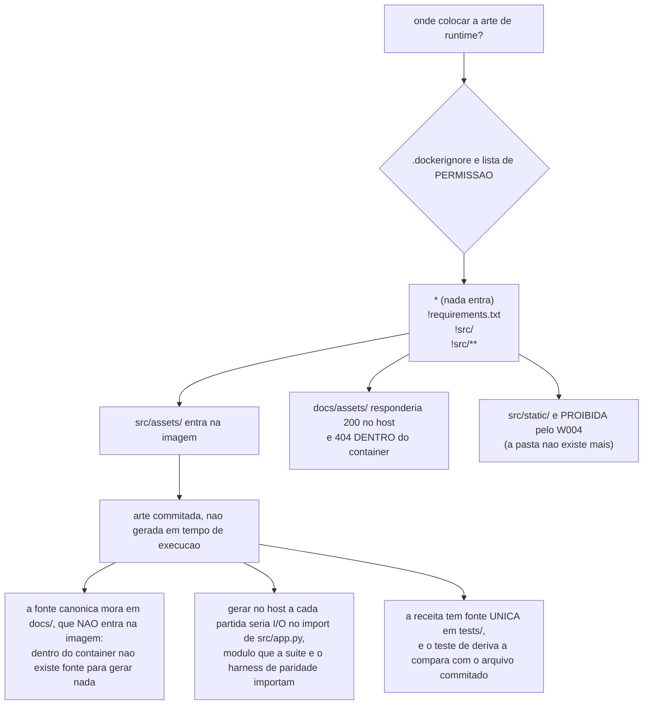
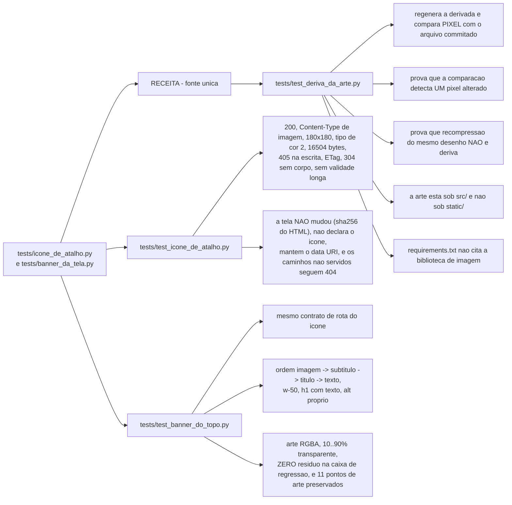

# Fluxograma — módulo `recursos-da-tela`

> Gerado pelo Reversa-Archaeologist em 2026-10-10 (re-extração, nível **completo**).
> Fontes: `src/app.py` (`ARTE_DO_ICONE`/`icone_de_atalho`, `ARTE_DO_TOPO`/`banner_do_topo`), `src/templates/index.html` (a masthead), `src/assets/{apple-touch-icon,banner-da-tela}.png`, `tests/icone_de_atalho.py` e `tests/banner_da_tela.py` (as receitas), `tests/test_icone_de_atalho.py`, `tests/test_banner_do_topo.py` e `tests/test_deriva_da_arte.py` (os contratos de teste), `.dockerignore`.
> Escala de confiança: 🟢 CONFIRMADO | 🟡 INFERIDO | 🔴 LACUNA

> **Unidade nova nesta rodada.** `recursos-da-tela` nasceu das features 009 (ícone de atalho) e 011 (arte do topo), e não tem equivalente em 2026-10-05. A unidade tem **zero linhas próprias de módulo**: as duas rotas moram em `src/app.py`, dentro do balde transversal do Scout. Ela é uma unidade porque são **dois contratos HTTP distintos**, com regras próprias de degradação, cache, derivação de arte e um contrato de teste dedicado — e porque `docs/assets/` publica a *fonte* canônica enquanto `src/assets/` guarda a *derivada de runtime*.
>
> **Regra do projeto:** a arte servida **não é** a arte canônica que o operador vê. Ela é uma **renderização derivada**, e a receita que a produz tem fonte única em `tests/`, com um teste de deriva ao lado dela.

## 1. As duas rotas de arte

> 🟢 **As duas rotas são registradas somente com `GET`.** A recusa de escrita sai do roteador com `405`, e não de uma validação escrita à mão que pudesse divergir da convenção.
>
> 🟢 **Sem `Cache-Control` de validade longa, nas duas.** A arte do ícone foi trocada **duas vezes em um único dia**, e uma validade de um ano congelaria o cliente que já tivesse buscado — o `ETag` só age **depois** de a validade expirar. Quem dá a revalidação barata é o `ETag` do `send_file`, que responde `304` sem corpo.
>
> 🟢 **Arte ausente devolve `404` e nada mais muda.** O atalho degrada para ícone genérico, e a tela continua de pé — no caso do banner, porque o título passou a ser **texto** (abaixo da imagem) e sobrevive à arte ausente por construção, não por depender do `alt`.
>
> 🟢 **Os caminhos ficam em `app.config`** (`ARTE_DO_ICONE`, `ARTE_DO_TOPO`) para que o caso de ausência seja testável **sem tocar no repositório**: o teste aponta a chave para um caminho inexistente em vez de mexer na arte de verdade.

## 2. O ícone de atalho — `/apple-touch-icon.png`

> 🟢 **As três transformações têm motivo medido:**
> 1. **Compor sobre branco** — a arte tem 32,5 % de pixels totalmente transparentes e os quatro cantos em `(0,0,0,0)`. O sistema móvel compõe transparência sobre **preto** no ícone de atalho, então servir a arte crua daria um quadrado preto com o desenho por cima, incluindo as aberturas internas entre folhas e galhos.
> 2. **180×180** — é a medida que o sistema espera; outra medida é reamostrada por ele e perde nitidez.
> 3. **Cantos retos** — o sistema aplica a própria máscara arredondada; arredondar aqui produziria arredondamento duplo, com um anel de fundo no canto.
>
> 🟢 **A opacidade é provada por propriedade do formato, não por amostragem.** O PNG declara o tipo de cor no próprio cabeçalho, e o tipo **2** é `truecolor` **sem canal alfa**: não existe pixel transparente num PNG cujo cabeçalho diz que não há canal alfa. Isso dispensa a biblioteca de imagem no teste — o que importa porque ela **não** está em `requirements.txt`.
>
> 🟢 **A descoberta é por caminho convencional.** Não há como declarar o ícone de atalho no documento e ser obedecido: o sistema procura esse caminho na raiz. Por isso a rota é um acréscimo **puro** — o template não foi tocado, e `GET /` continua byte a byte o mesmo. O `favicon.ico` e o alias legado `apple-touch-icon-precomposed.png` **continuam sem resposta**: o `favicon.ico` só é buscado quando o documento **não** declara ícone, e o template declara um `data URI`.

## 3. A arte do topo — `/banner.png`

> 🟢 **A remoção de fundo é GLOBAL, e não por inundação a partir da borda.** A primeira versão inundava, para poupar as partes claras da arte, e **foi medida como insuficiente**: a árvore, o livro e o texto formam **anúncios fechados**, e o fundo preso dentro deles nunca é alcançado. Medido no resultado da primeira versão: o pixel `(300,150)` continuava opaco e sobravam **8.379** pixels de tom de fundo ainda opacos numa amostra de 1/9 da imagem — o quadriculado gravado continuava visível **dentro dos bolsões**.
>
> 🟢 **Duas faixas de brilho, porque um limite só comia a arte clara.** Com `brilho >= 160 e saturação <= 50`, o fundo (cinza neutro, saturação 0..7) **e** o preenchimento do texto dourado (brilho ≈212, saturação ≈24) caíam os dois no fundo, e as letras ficavam **ocas** em partes — defeito medido no composto sobre magenta. A separação existe porque o quadriculado é **neutro** e a tinta clara da arte é levemente **quente**: acima de 190 o teto é largo (50), porque ali o fundo pode estar tingido; entre 160 e 190 o teto é estreito (12).
>
> 🟢 **A segunda passada existe por causa do serrilhado.** Entre a arte e o xadrez há uma faixa de um a dois pixels de cinza intermediário; deixá-la opaca desenharia um halo claro em volta de tudo. O alfa parcial é proporcional a quanto o pixel se afasta do fundo.
>
> 🟢 **O resíduo é medido com limite MAIS ESTRITO que o da regra** (`SATURACAO_MAXIMA - 5`). Não é elegância: medir o resíduo com o mesmo limite da regra devolve **sempre zero**, e foi exatamente esse erro que deixou um bloco inteiro de quadriculado passar **duas vezes** — a métrica dizia `0,00 %` enquanto o composto sobre magenta mostrava o bloco.
>
> 🟢 **O título voltou a ser texto.** A `T036` trocou o `<h1>` por imagem; a `T044` inverteu isso — arte reduzida à metade, subtítulo, título em texto e o texto de apresentação, **nessa ordem**. E o `alt` da arte descreve a ilustração, e não o título: com o título escrito logo abaixo, repeti-lo no `alt` faria o leitor de tela anunciar a mesma coisa duas vezes.

## 4. Por que `src/assets/` — e por que a arte é commitada

> 🟢 **A falha que a lista de permissão evita é silenciosa:** arte fora de `src/` responde **200 na máquina de desenvolvimento** e **404 no container** — o ambiente que o operador usa. A escolha de pasta não é estética.
>
> 🟢 **`src/uploads/` é reexcluído depois do `!src/**`.** A última regra que casa vence, e a linha existe porque a pasta carrega dado real do operador — entre **13 arquivos** (mais 4 aposentados), um GEDCOM de 5,3 MB. Enviá-lo ao daemon do Docker seria a mesma classe de exposição que o Princípio I proíbe.
>
> 🟢 **A receita é código de TESTE, e não de runtime.** A biblioteca de imagem não entra em `requirements.txt`, que é a lista de **runtime**; o container não precisa dela porque a arte chega pronta dentro da imagem. Há teste que falha se `pillow`/`PIL==` aparecer no arquivo de dependências. O `import` é preguiçoso, dentro das funções, para que importar o módulo não exija a biblioteca.
>
> 🟢 **A deriva é comparada PIXEL a pixel, nunca por `sha256`.** Medido na própria feature: o **mesmo** desenho existe em disco com 32.317 bytes e, vindo de outra codificação, com 44.069 bytes — e a diferença de pixel entre os dois é **zero**. Uma comparação por hash acusaria divergência onde não há nenhuma, e teste que grita sem motivo é desligado.

## 5. O que os testes prendem

> 🟢 **O teste de deriva é sensível a UM pixel, e prova isso.** Sem essa prova ele poderia estar comparando algo consigo mesmo e passar por vacuidade — o modo de falha mais perigoso de um teste de fidelidade.
>
> 🟢 **O `sha256` do HTML de `GET /` é um invariante datado, e o comentário o declara assim:** ele mede "a tela não mudou **desde a última mudança declarada**", e não "a tela nunca muda". O valor foi atualizado três vezes em 2026-10-10, cada uma amarrada a uma `RN` de um adendo vigente.
>
> 🟢 **A arte do banner tem regressão ponto a ponto nas DUAS direções:** uma caixa onde o quadriculado sobreviveu (não pode voltar a ter fundo opaco) e **11 pontos** que cobrem as duas famílias de risco — arte escura e pouco saturada (capa, lombada, base do livro) e arte clara e quase neutra (o preenchimento do texto dourado). Se alguém "resolver" um resíduo baixando o brilho ou alargando a saturação, um desses pontos vira buraco e o teste cai.

## 6. Catálogo de regras de negócio

> Critério de contagem: **uma afirmação normativa distinta por linha**. Os IDs `E1`..`E30` são locais deste artefato.

| # | Regra | Onde | Confiança |
| --- | --- | --- | --- |
| E1 | As duas rotas são registradas **somente** com `GET`; a escrita é recusada pelo roteador com `405`. | `app.py:263`, `:308` | 🟢 |
| E2 | A rota do ícone serve o arquivo apontado por `app.config["ARTE_DO_ICONE"]`; a do banner, o de `ARTE_DO_TOPO`. | `app.py:278`, `:315` | 🟢 |
| E3 | Arte ausente devolve resposta **vazia** com `404`, e nenhuma rota existente altera a resposta por causa disso. | `app.py:279-280`, `:316-317` | 🟢 |
| E4 | As duas rotas declaram `mimetype="image/png"`. | `app.py:281`, `:318` | 🟢 |
| E5 | Os caminhos das artes são ancorados no arquivo do app (`dirname(abspath(__file__))`), e não no diretório corrente. | `app.py:255-257`, `:300-302` | 🟢 |
| E6 | Não há `Cache-Control` de validade longa; a revalidação barata é o `ETag` do `send_file`, que responde `304` sem corpo. | `app.py:270-273`, `:312-313` | 🟢 |
| E7 | O ícone de atalho é descoberto por **caminho convencional** na raiz; o template **não** o declara. | `app.py:247-249` | 🟢 |
| E8 | O ícone da aba continua sendo um `data URI` embutido no documento, e não uma segunda rota. | `index.html:8` | 🟢 |
| E9 | `favicon.ico` e `apple-touch-icon-precomposed.png` **não** têm rota: o `favicon.ico` só é buscado quando o documento não declara ícone. | `test_icone_de_atalho.py:192-203` | 🟢 |
| E10 | A arte do ícone é uma **renderização derivada**: canônica composta sobre branco e reamostrada para **180×180**. | `tests/icone_de_atalho.py:72-84` | 🟢 |
| E11 | O fundo da composição do ícone é **branco** — a arte tem 51,5 % de creme em duas tonalidades, e eleger uma faria a outra parecer errada. | `tests/icone_de_atalho.py:61-63` | 🟢 |
| E12 | Os cantos do ícone ficam **retos**: o sistema aplica a própria máscara arredondada. | `tests/icone_de_atalho.py:15-16` | 🟢 |
| E13 | O PNG derivado do ícone tem **16.504 bytes**, e esse número é a âncora que denuncia reamostragem, fundo ou compressão diferentes. | `tests/icone_de_atalho.py:69` | 🟢 |
| E14 | A opacidade do ícone é provada pelo **tipo de cor 2** (`truecolor` sem alfa) lido do IHDR, sem biblioteca de imagem. | `test_icone_de_atalho.py:97-108` | 🟢 |
| E15 | A arte do banner é uma **renderização derivada** com o fundo removido, porque a fonte chegou em `RGB` com o quadriculado de transparência gravado no bitmap. | `app.py:292-296` | 🟢 |
| E16 | A remoção de fundo é **global**, e não por inundação a partir da borda — a inundação deixa bolsões fechados intactos. | `tests/banner_da_tela.py:10-22`, `:110-124` | 🟢 |
| E17 | Um pixel é fundo em **duas faixas**: brilho ≥190 com saturação ≤50, e brilho 160..190 com saturação ≤12; abaixo de 160 nunca é fundo. | `tests/banner_da_tela.py:76-107` | 🟢 |
| E18 | Os limites `CLARO_MINIMO = 160` e `SATURACAO_MAXIMA = 50` saem de medição, com folga declarada para os dois lados. | `tests/banner_da_tela.py:46-73` | 🟢 |
| E19 | A fronteira recebe **alfa proporcional**: quanto mais claro o pixel, mais transparente, para o serrilhado não virar halo. | `tests/banner_da_tela.py:156-176` | 🟢 |
| E20 | O resíduo de fundo é medido com limite **mais estrito** que o da regra, e o valor precisa ser **zero** na caixa de regressão. | `tests/banner_da_tela.py:180-201`, `test_banner_do_topo.py:303-319` | 🟢 |
| E21 | Onze pontos da arte têm de continuar **opacos**, cobrindo arte escura pouco saturada e arte clara quase neutra. | `test_banner_do_topo.py:321-354` | 🟢 |
| E22 | A arte de runtime mora em `src/assets/`, porque o `.dockerignore` é lista de **permissão** e só `requirements.txt` e `src/**` entram na imagem. | `.dockerignore`, `app.py:251-254`, `:298-299` | 🟢 |
| E23 | `src/static/` é proibida (`W004`), e há teste que falha se a arte cair numa pasta estática. | `test_deriva_da_arte.py:89-95` | 🟢 |
| E24 | `src/uploads/` é reexcluído do contexto de build **depois** de `!src/**`, porque carrega dado real do operador. | `.dockerignore` | 🟢 |
| E25 | A arte derivada é **commitada**, e não gerada em tempo de execução — a fonte canônica não entra na imagem, e gerar no import de `app.py` seria I/O na suíte e na paridade. | `tests/icone_de_atalho.py:18-27` | 🟢 |
| E26 | A receita tem **fonte única** em `tests/`; o teste de deriva a importa e compara **pixel** com o arquivo commitado. | `test_deriva_da_arte.py:29-51` | 🟢 |
| E27 | A comparação por `sha256` entre canônica e derivada é **proibida** na prática: o mesmo desenho com outra codificação muda de bytes e não de pixel. | `test_deriva_da_arte.py:3-16`, `:71-86` | 🟢 |
| E28 | A biblioteca de imagem **não** entra em `requirements.txt`; há teste que falha se `pillow`/`PIL==` aparecer lá. | `test_deriva_da_arte.py:98-109` | 🟢 |
| E29 | A masthead segue a ordem **imagem → subtítulo → título em texto → texto de apresentação**, e a ordem tem teste próprio. | `index.html:55-61`, `test_banner_do_topo.py:159-170` | 🟢 |
| E30 | A arte do topo é reduzida a `w-50`, e o `alt` descreve a **ilustração**, nunca o título. | `index.html:56-58`, `test_banner_do_topo.py:150-157`, `:201-214` | 🟢 |

## 7. Observações e lacunas

* 🟢 **As duas rotas são o mesmo desenho, e isso é deliberado:** `GET` sozinho, `ETag` para a rebusca, `404` com resposta vazia na ausência da arte, caminho ancorado no arquivo do app e a arte em `src/assets/`. Não há uma diferença de contrato entre elas.
* 🟢 **A arte servida não é a arte do operador.** Nas duas rotas a resposta é uma **derivada**, e a transformação existe porque servir o arquivo como ele chegou produz um defeito **visível** — quadrado preto no atalho, grade cinza atrás do logo.
* 🟢 **`docs/assets/img/apple-touch-icon.png` existe e é byte a byte igual à de runtime** (16.504 bytes). É a cópia que o mini-site publicado consome; a *fonte da receita* é `docs/assets/img/logo.png`, e as duas cópias servem a alvos de publicação distintos.
* 🟡 **O `sha256` da tela em `test_icone_de_atalho.py` é um invariante mantido à mão.** Ele foi atualizado três vezes em 2026-10-10, e cada atualização é uma decisão humana registrada em comentário. Enquanto isso for assim, o teste prende o que promete; se virar rotina, deixa de prender.
* 🟡 **A caixa de regressão `(778,232)–(918,338)` descreve uma composição que não existe mais** (a que tinha abajur). Ela continua valendo como caixa — ali é fundo hoje —, mas o comentário do teste registra a origem, o que evita que alguém a leia como medida da arte atual.
* 🟡 **As duas rotas servem o arquivo do disco a cada requisição**, sem cache em memória. Com 317 KB no banner, o `send_file` do Flask usa `wsgi.file_wrapper`/`send_file` do Werkzeug; o custo é do sistema operacional, não do processo. Não há medição de impacto no repositório.
* 🔴 **Não há verificação de que a arte servida é a derivada correta no ambiente do container.** Os testes rodam no host, onde `docs/` existe; se a arte falhar dentro da imagem, a degradação é o `404` — que é justamente o caso que a escolha de `src/assets/` existe para evitar.

---

*Gerado pelo Reversa-Archaeologist em 2026-10-10 (re-extração).*
