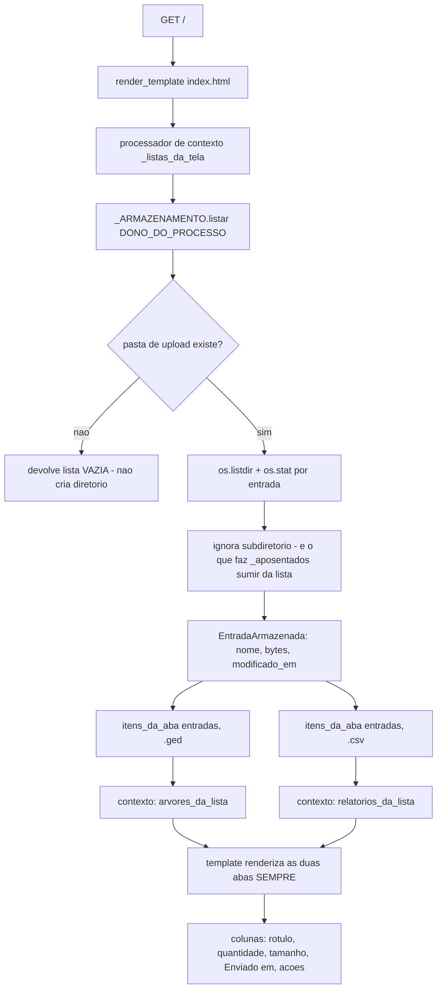
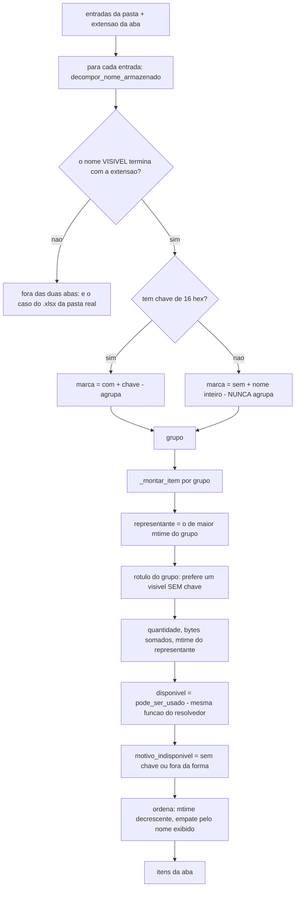
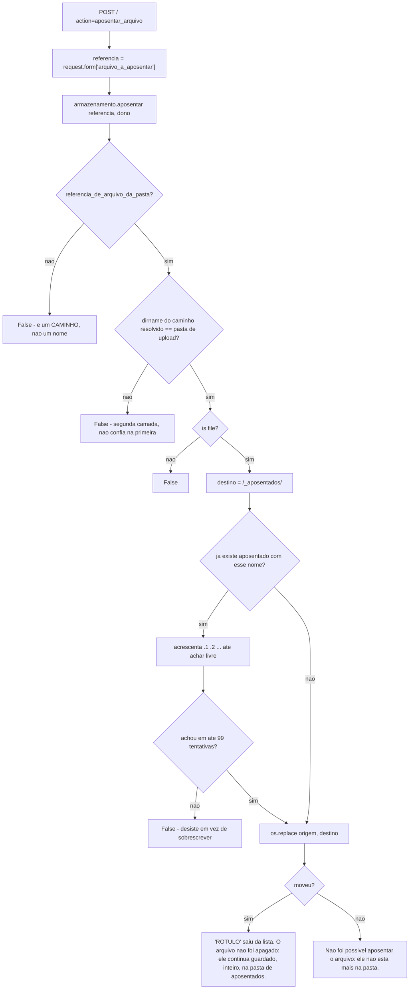
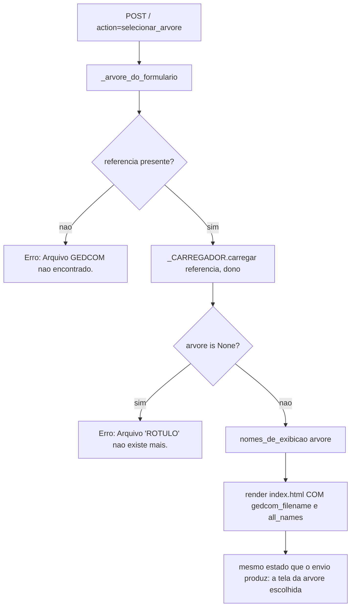

# Fluxograma — módulo `tela-de-entrada`

> Gerado pelo Reversa-Archaeologist em 2026-10-10 (re-extração, nível **completo**).
> Fontes: `src/reporting/lista_de_arquivos.py`, `src/app.py` (`index` no ramo GET, `_listas_da_tela`, `_arvore_do_formulario`), `src/ports/adaptadores.py` (`listar` e `aposentar`), `src/utils/validate.py` (as duas perguntas sobre o nome).
> Módulo **novo** nesta rodada: nasceu nas features 011 e 012, e nao tem equivalente na extração de 2026-10-05.
> Escala de confiança: 🟢 CONFIRMADO | 🟡 INFERIDO | 🔴 LACUNA

## 1. Rendering da tela de entrada (`GET /`)

## 2. De entradas da pasta a itens de lista (`itens_da_aba`)

**Por que a marca "sem chave" carrega o nome inteiro:** dois arquivos **sem** chave nao podem cair no mesmo item — a chave nao os alcanca, e le-los para agrupar custaria os 29 MB que a listagem evita.

## 3. Aposentar um arquivo (`POST /` com `action=aposentar_arquivo`)

> 🟢 **A ordem dos ramos é a regra, e não estilo.** `aposentar_arquivo` vem **antes** de `_arvore_do_formulario()`, porque essa funcao resolve e **parseia** a arvore escolhida — e a arvore escolhida pode ser exatamente a que se esta aposentando. Depois do move, o parse falharia e o operador veria "arquivo nao existe mais" no lugar da confirmacao: a acao teria funcionado e a tela diria que nao.

## 4. Escolher uma arvore da lista (`POST /` com `action=selecionar_arvore`)

> 🟢 **Por que o ramo existe:** sem ele, este `action` cairia no `return` do fim de `index()`, que renderiza `index.html` **sem** `gedcom_filename` — a arvore resolvida seria descartada e o operador clicaria sem nada acontecer. Era o defeito medido em 2026-10-09 (`RF-02` da feature 012).

## 5. Algoritmos e decisoes nao triviais

| # | Decisao | Onde | Por que |
| --- | --- | --- | --- |
| B1 | As duas listas entram por **processador de contexto** | `src/app.py:_listas_da_tela` | A rota tem **23** `render_template` (medidos em 2026-10-10; **12** passam `gedcom_filename`); repetir o argumento em cada um seria 23 lugares para esquecer um |
| B2 | **Nao ha `os.listdir` na rota** | `src/app.py` | Quem le a pasta e a **porta**; um `listdir` na borda traria de volta o acesso a disco que a feature 006 tirou de la |
| B3 | Agrupamento pela chave de conteudo, item proprio quando nao ha chave | `lista_de_arquivos.py:itens_da_aba` | `RN-01` e `RN-10`: agrupar o sem-chave exigiria ler o conteudo |
| B4 | A aba e decidida pela extensao do **nome visivel cru** | `itens_da_aba` | `RN-03`/`D-10`: `planilha.csv.ged` entra na aba de arvore mesmo tendo conteudo de CSV; quem recusa e o USO (`D-08`) |
| B5 | O item indisponivel **aparece marcado**, com motivo | `_montar_item` | `RN-11`/`D-11`: esconder o inalcancavel tiraria do operador o arquivo que ele mais quer aposentar |
| B6 | Dois motivos distintos de indisponibilidade | `validate.py:motivo_de_indisponibilidade` | "sem chave" (arquivo anterior a chave por conteudo) e "fora da forma" (acento/espaco recusados) — dizer "sem chave" para o acentuado seria mentir sobre o motivo |
| B7 | Rotulo sem chave vazada | `lista_de_arquivos.py:_rotulo_do_grupo` | Caso medido: o grupo passou a ter dois rotulos porque o operador reenviou um arquivo ja chaveado; exibir o primeiro em ordem alfabetica mostraria a chave crua |
| B8 | Rotulo tira **so a ultima** extensao | `lista_de_arquivos.py:rotulo_limpo` | `planilha.csv.ged` vira `planilha csv`: o `.csv` do meio e informacao que o `D-08` decidiu **nao** esconder |
| B9 | Ordem por data decrescente, empate pelo nome | `itens_da_aba` | O nome exibido **nao e unico**: ha tres `Arvore_Unificada_Oficial_V1_2.ged` na pasta real; a data e o que distingue |
| B10 | Data vem de `os.stat`, e a coluna se chama "Enviado em" | `formatar_data_br` | Para arquivo guardado pela aplicacao e a data do envio; quem copia a mao muda a data, e o `title` da coluna declara isso |
| B11 | Data que o sistema nao converte devolve **celula vazia** | `formatar_data_br` | `OverflowError`/`OSError` viraria `500` **na tela que lista tudo** por causa de uma celula |
| B12 | A tela pergunta a **mesma** funcao que o resolvedor | `validate.py:pode_ser_usado` | Dois testes equivalentes divergem com o tempo, e a tela passaria a dizer "disponivel" para um arquivo que o resolvedor recusa (`D-11`) |

## 6. Observações e lacunas

* 🟢 **O instrumento de paridade nao enxerga as listas.** `_reversa_sdd/parity/harness.py` substitui `render_template` por uma captura de contexto, entao o processador de contexto nem chega a rodar. Acrescentar chave ao contexto e invisivel para ele, **por construcao** — o que e uma lacuna de cobertura do harness, nao um defeito.
* 🟡 **A quantidade do grupo e o numero de ARQUIVOS, e nao de versoes uteis.** Depois de uma substituicao o grupo fica com um arquivo; mas se o operador reenviar duas vezes o mesmo nome com conteudos diferentes **sem** passar pela aplicacao (copiando a mao), o grupo volta a ter dois.
* 🔴 **A listagem nao filtra nada**, por decisao: nem por nome, nem por extensao, nem por forma da chave. Filtrar no adaptador esconderia do operador um arquivo que existe — mas tambem significa que a pasta e a superficie de confianca da tela.

---

*Gerado pelo Reversa-Archaeologist em 2026-10-10 (re-extração).*
