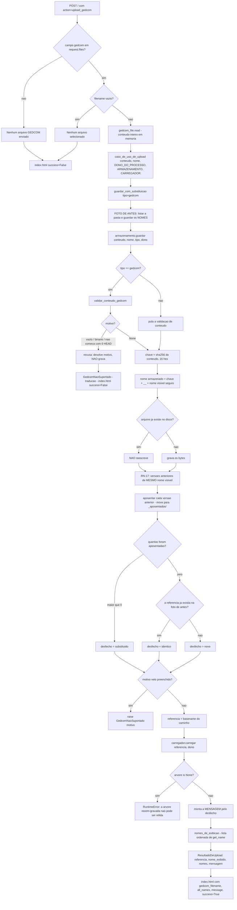
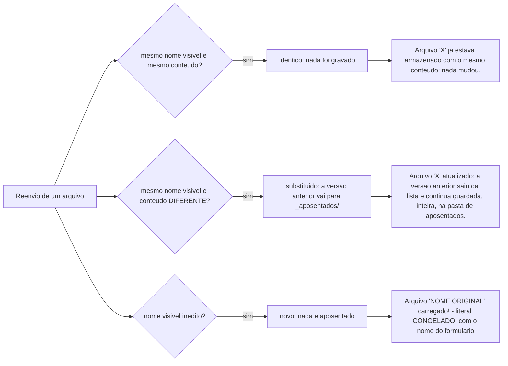
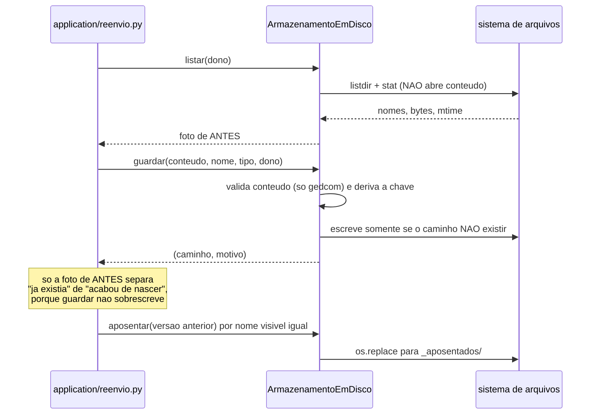
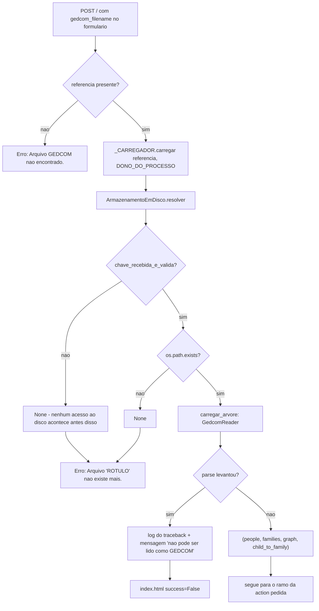

# Fluxograma — módulo `upload-gedcom`

> Gerado pelo Reversa-Archaeologist em 2026-10-10 (re-extração, nível **completo**).
> Fontes: `src/application/upload_gedcom.py`, `src/application/reenvio.py`, `src/utils/validate.py`, `src/parsers/gedcom_parser.py`, `src/utils/text_cleaning.py`, `src/ports/adaptadores.py` (as duas portas de arquivo), `src/core/erros.py`, `src/app.py` (ramo `upload_gedcom`).
> Substitui o fluxograma de 2026-10-05, que descrevia o estado global e a ausência de reenvio.
> Escala de confiança: 🟢 CONFIRMADO | 🟡 INFERIDO | 🔴 LACUNA

## 1. Fluxo do envio (`POST /` com `action=upload_gedcom`)

## 2. As tres mensagens do reenvio (`RN-17`, pedido do operador em 2026-10-10)

## 3. A ordem que a `RN-17` exige: listar ANTES de guardar

## 4. Leitura da referencia em requisicao posterior

## 5. Algoritmos e decisoes nao triviais

| # | Decisao | Onde | Por que |
| --- | --- | --- | --- |
| A1 | Chave de armazenamento derivada do **conteudo** (`sha256` truncado em 16 hex) | `utils/validate.py:chave_de_armazenamento` | O formulario devolve `gedcom_filename` no POST seguinte; um UUID aleatorio quebraria a continuidade entre requisicoes, e a mesma arvore reenviada reencontra o mesmo arquivo |
| A2 | Validacao por **conteudo** (`0 HEAD`), nunca por extensao | `utils/validate.py:validar_conteudo_gedcom` | `RISK-007`: exigir extensao recusaria GEDCOM de exportador legitimo e quebraria a paridade de parsing |
| A3 | Defesa contra escape de pasta por **forma de NOME**, e nao por alfabeto fechado | `utils/validate.py:chave_recebida_e_valida` e `:referencia_de_arquivo_da_pasta` | O alfabeto `^[0-9a-f]{16}__[A-Za-z0-9._-]+$` recusava o acento e o espaco que o gravador **preserva de proposito** (`RF-06`); 3 arquivos com acento e 1 com espaco ficavam inalcancaveis (`BUG-20261009-6RKP`, `RN-20`) |
| A4 | Duas perguntas diferentes, duas funcoes | `_PREFIXO_CHAVE` (tem chave?) vs `chave_recebida_e_valida` (posso resolver?) | Sem a distincao, o arquivo acentuado cairia no mesmo balde do arquivo sem chave, e a tela diria ao operador a coisa errada sobre o proprio arquivo |
| A5 | A extensao e **preservada**, nunca fixada em `.ged` | `utils/validate.py:nome_visivel_seguro` | O mesmo gravador serve ao CSV: fixar `.ged` renomeava o CSV para `<...>.csv.ged` — regressao do proprio `QMLY`, corrigida em 2026-10-02 |
| A6 | `aposentar` move em vez de apagar, com sufixo numerico em vez de sobrescrever | `ports/adaptadores.py:aposentar` | `RN-07` proibe apagar. Para nomes **sem** chave o nome nao carrega conteudo, e sobrescrever apagaria outro arquivo; depois de 99 tentativas a funcao **desiste** (`False`) em vez de sobrescrever |
| A7 | A pasta de aposentados e uma **subpasta** da pasta de upload | `ports/adaptadores.py:PASTA_DE_APOSENTADOS` | `listar` ja ignora subdiretorio: o arquivo sai da lista **sem** nenhum filtro novo, e sem uma lista de excecoes que alguem teria de manter |
| A8 | Pasta ausente devolve lista vazia, e **nao** e criada | `ports/adaptadores.py:listar` | Criar diretorio dentro de uma leitura seria efeito colateral escondido numa operacao que promete nao escrever (`D-07`) |
| A9 | Leitura por atributos (`os.stat`), sem `open` | `ports/adaptadores.py:listar` | A tela de entrada e montada em toda renderizacao; abrir conteudo custaria reler os 29 MB da pasta (`RNF` de desempenho) |
| A10 | Os 18 pares de mojibake e a identidade `Ã -> Ã` | `utils/text_cleaning.py:strip_bad_utf` | Mapa herdado, medido por AST na rodada anterior; a faixa `Á-ú` da expressao de limpeza e **redundante**, porque `\w` ja e Unicode-aware |

## 6. Observações e lacunas

* 🟡 **A mensagem de "novo" usa `nome_original`, e nao o nome visivel seguro.** Os dois divergem quando o operador envia um nome com separador de caminho ou so com pontos. E o literal congelado ("Arquivo '...' carregado!"), preservado de proposito.
* 🟢 **O ramo `identico` só existe porque a foto de antes é tirada.** `guardar` nao sobrescreve, entao depois dele "ja existia" e "acabou de nascer" sao indistinguiveis na pasta.
* 🟢 **`aposentar` pode mover MAIS de uma versao anterior** na mesma operacao (`versoes_anteriores`): o operador ja tinha duas linhas do mesmo rotulo antes de a `RN-17` existir, e o reenvio limpa o acumulo.
* 🔴 **Nao ha validacao de conteudo para o CSV** (`tipo == "csv"` pula `validar_conteudo_gedcom`): a assimetria e divida preservada de proposito (`RF-10`), e o numero da divida segue aberto.
* 🔴 **`dono` nao participa de decisao nenhuma** nas tres portas: dois envios do mesmo conteudo chegam ao MESMO arquivo (`RN-02`), e nenhuma entrega pode ser citada como tendo implementado isolamento (dividas #3 e #4).
* 🔴 **O caso `RuntimeError("a árvore recém-gravada não pôde ser relida")` e inalcancavel em execucao**: `guardar` acabou de gravar o arquivo daquela referencia. Existe para o checador de tipos estreitar a uniao do retorno.

---

*Gerado pelo Reversa-Archaeologist em 2026-10-10 (re-extração).*
