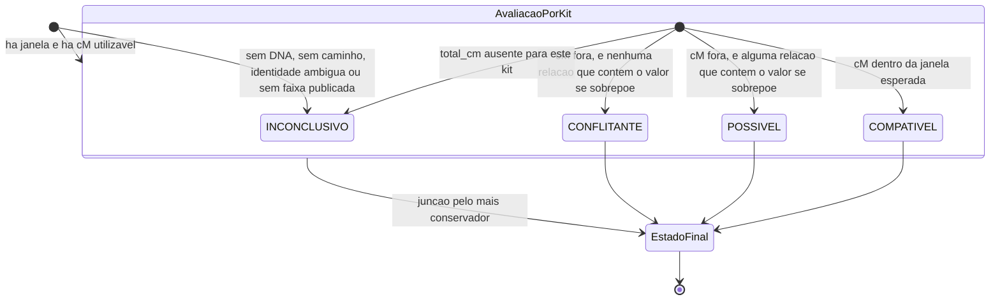
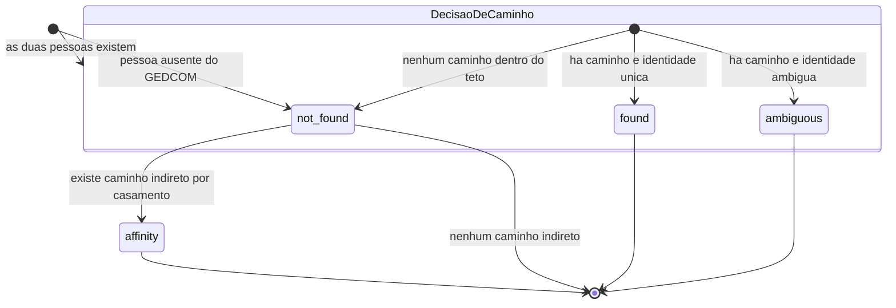
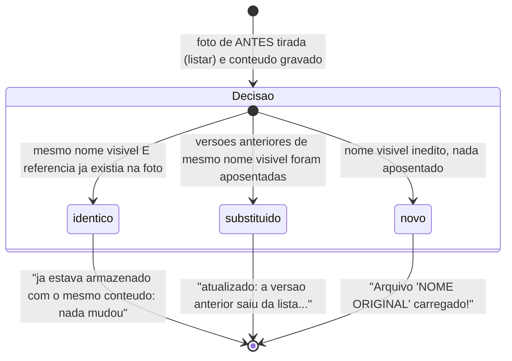
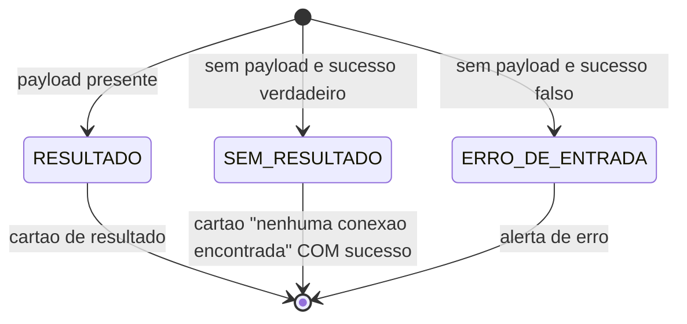
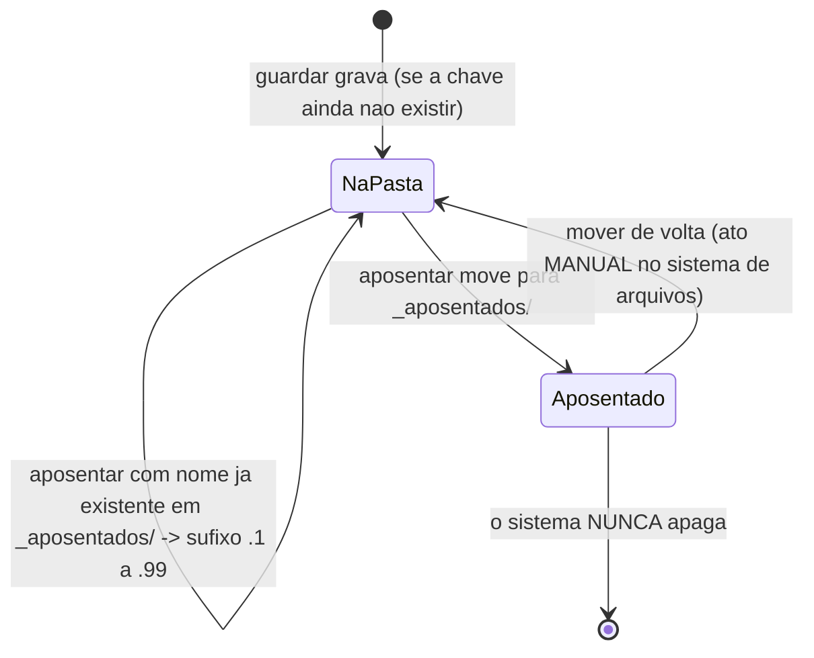
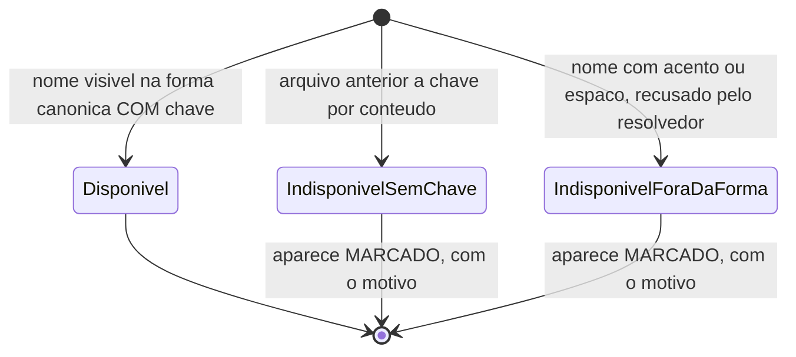
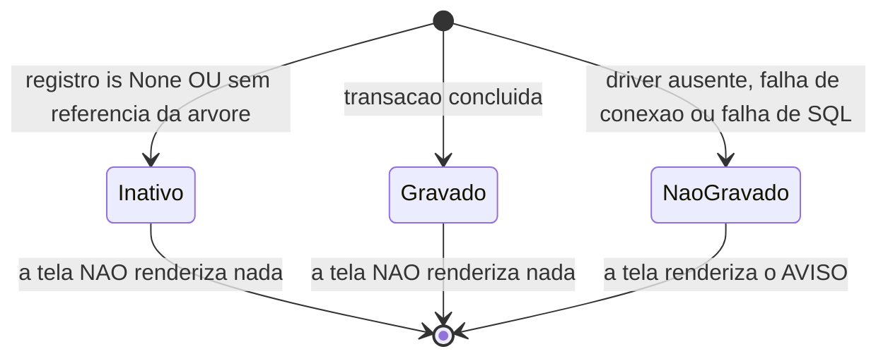

# Máquinas de Estado — analisador-genealogico

> Nível de documentação: **Completo** (`state.json` → `doc_level`)
> Re-extração de **2026-10-10**. Substitui o artefato de 2026-10-05, que descrevia 2 máquinas de decisão, o contador `gedcom_state.versao` entre os campos de estado e a conclusão de que **nenhuma** entidade persistente tinha ciclo de vida.
> Snapshot da versão substituída: `.reversa/snapshots/2026-10-10-pre-reextracao/state-machines.md`
> Escala de confiança: 🟢 CONFIRMADO | 🟡 INFERIDO | 🔴 LACUNA

---

## 1. Resultado da Varredura

**Método.** Varredura de `src/` por todo campo, atributo ou chave nomeado `status`, `state`, `desfecho`, `disponivel`, `motivo`, `aviso`, `flag`, `enabled`, `active` ou equivalente; leitura dos módulos que produzem veredito; cruzamento com o consumo no template (`templates/index.html`) e com o esquema do banco (`init.sql`).

| Campo encontrado | Onde é escrito | Valores | Sobrevive à requisição? | Conf. |
| --- | --- | --- | --- | --- |
| `documentary.status` | `core/documentary_relationship.py` (`documentary_relationship`) e `core/path_search.py` | `not_found`, `found`, `ambiguous`, `affinity` | **Não** — vive no dicionário de resultado da requisição | 🟢 |
| `comparison.status` | `core/evidence_comparison.py` (`compare`, `_avaliar_kit`) | `COMPATIVEL`, `POSSIVEL`, `CONFLITANTE`, `INCONCLUSIVO` | **Não** (e **sim** no banco: `match_result.comparison_status`, gravado e nunca lido) | 🟢 |
| `comparison.per_kit[].status` | `core/evidence_comparison.py` | os mesmos 4, por kit | **Não** (e sim em `match_kit.status`) | 🟢 |
| `Armazenado.desfecho` | `src/application/reenvio.py` (`guardar_com_substituicao`) | `identico`, `substituido`, `novo` | **Não** — nasce e morre na requisição do envio | 🟢 |
| `ResultadoDeBusca.desfecho` | `src/application/path_search.py` (`_desfecho`) | `RESULTADO`, `SEM_RESULTADO`, `ERRO_DE_ENTRADA` | **Não** | 🟢 |
| `ResultadoDeAnalise.aviso_de_persistencia` | `src/application/dna_analysis.py` | `None` (nada a avisar) ou texto | **Não** | 🟢 |
| Item da aba: `disponivel` / `motivo_indisponivel` | `src/reporting/lista_de_arquivos.py` (`_montar_item`) | `True`/`False` e o motivo | **Não** — recalculado a cada renderização | 🟢 |
| `Testemunho` da pasta versus `_aposentados/` | `src/ports/adaptadores.py` (`guardar`, `aposentar`) | "na pasta" / "aposentado" | **SIM** — é o **primeiro** estado durável do sistema | 🟢 |
| `df.attrs[...]` | `src/parsers/csv_ingest.py` | metadados de leitura (`separador`, `encoding`, `linhas_ignoradas`) | **Não** | 🟢 |
| `role="status"`, `role="alert"`, `role="tab"` | `templates/index.html` | atributos **HTML de acessibilidade** | — | 🟢 |

**Não existem** — em nenhum arquivo de `src/` — campos `flag`, `enabled`, `active`, `state`, `stage` ou `phase` de ciclo de vida. 🟢

**Correção contra 2026-10-05:** o campo `core/gedcom_state.versao` **deixou de existir**. O módulo de estado foi apagado (`T023` da feature 005) e o sinal de invalidação do cache de nomes passou a ser derivado do **conteúdo** (`_chave_de`). Ele aparecia na tabela anterior como "contador de invalidação, não estado" — estava corretamente classificado, e agora está corretamente ausente.

---

## 2. O que mudou na natureza do sistema

A rodada anterior concluía que **nenhuma entidade persistente tinha ciclo de vida**, por três razões: não havia banco, nada sobrevivia à requisição e o único estado durável era um arquivo imutável. **Duas das três razões deixaram de valer:**

| Razão de 2026-10-05 | Situação em 2026-10-10 |
| --- | --- |
| "Não há banco de dados" | ❌ **falsa.** A feature 008 introduziu PostgreSQL 16 **opcional**, com 6 tabelas. O histórico da análise é persistido |
| "Nada sobrevive à requisição" | ❌ **falsa.** A análise e as pessoas que ela usou sobrevivem, em `dna_analysis` e `analysis_person` |
| "O único estado durável é um arquivo imutável" | ⚠️ **incompleta.** O arquivo continua imutável **no conteúdo**, mas passou a ter **duas posições mutáveis**: a pasta de upload e a pasta de aposentados |

**Portanto:** o sistema passou a ter **1 ciclo de vida de verdade** (a posição do arquivo), **1 estado durável de produto** (a análise registrada, que não transiciona) e **4 máquinas de decisão** terminais. Chamar as decisões de "ciclo de vida" continuaria sendo impreciso — e agora existe uma entidade para a qual o termo é exato.

---

## 3. Máquina 1 — Veredito do Confronto GEDCOM × DNA 🟢

**Onde:** `core/evidence_comparison.py` · **Consumido em:** `templates/index.html` (seção de confronto) e, desde a feature 008, **gravado** em `match_result` · **Granularidade:** por kit, com junção conservadora.

### 3.1 Diagrama

### 3.2 Tabela de transições

| Estado de origem | Guarda (condição) | Estado de destino |
| --- | --- | --- |
| *(início)* | `not evidence.available` | `INCONCLUSIVO` |
| *(início)* | `documentary.status == "not_found"` **ou** sem `path` | `INCONCLUSIVO` |
| *(início)* | `ambiguous_identity` **ou** `status == "ambiguous"` | `INCONCLUSIVO` |
| *(início)* | sem relação publicada **nem** janela por meioses | `INCONCLUSIVO` |
| *(início)* | nenhum valor de cM utilizável | `INCONCLUSIVO` |
| avaliação por kit | `total_cm is None` | `INCONCLUSIVO` |
| avaliação por kit | `range_low ≤ cM ≤ range_high` | `COMPATIVEL` |
| avaliação por kit | cM fora **e** existe relação candidata cuja faixa se sobrepõe à janela | `POSSIVEL` |
| avaliação por kit | cM fora **e** nenhuma sobreposição | `CONFLITANTE` |
| junção | mais de um kit | **o mais conservador**: `CONFLITANTE > POSSIVEL > COMPATIVEL > INCONCLUSIVO` |

### 3.3 Fatos de contrato

- A ordem de conservadorismo é uma **lista literal**, e o resultado é o primeiro estado dessa lista que aparece entre os kits. Não é média, maioria nem "o pior cM". 🟢
- `INCONCLUSIVO` é o estado **inicial** de todo dicionário de confronto, e os ramos de guarda **retornam sem alterá-lo**: o caminho de falha é o caminho padrão, e é isso que garante que nenhum estado seja afirmado por omissão. 🟢
- O estado carrega três campos acoplados — `status`, `label` e `message` — **mais** um quarto desde esta rodada: **o próprio `status` é nome de classe CSS** no template (`badge estado-{{ status }}`). Renomear um estado muda o texto e **quebra a cor do selo em silêncio**. 🟡
- O estado determina o rol de causas: `CONFLITANTE` → 12; `POSSIVEL` → 9; os outros dois → nenhuma. 🟢
- **O estado não altera o parentesco documental.** Nenhuma transição reescreve caminho, rótulo ou vínculo. 🟢
- **`INCONCLUSIVO` fica por último na ordem de conservadorismo.** Consequência: um kit sem cM utilizável **não** rebaixa o resultado quando outro kit é `COMPATIVEL`. É a ordem declarada no código — escolha, não acidente. 🟡

---

## 4. Máquina 2 — Status do Parentesco Documental 🟢

**Onde:** produzido em `core/documentary_relationship.py` e **completado pelo chamador** em `core/path_search.py` · **Consumido em:** `templates/index.html` (badge do resultado de DNA e badge da busca) e, desde a feature 008, gravado em `match_result.documentary_status`.

### 4.1 Diagrama

### 4.2 Tabela de transições

| Estado | Como se chega | Avisos que acompanham |
| --- | --- | --- |
| `not_found` | `a_id` ou `b_id` **não** existe em `people` | `pessoa_ausente` |
| `not_found` | as duas existem, mas **nenhum caminho** sobe por pais dentro do teto | `sem_caminho` (+ `homonimo`, se ambíguo) |
| `found` | há caminho **e** o dossiê de homônimos não é ambíguo | `data_impossivel`, `caminhos_multiplos`, `colapso_de_pedigree` (conforme o caso) |
| `ambiguous` | há caminho **e** o dossiê de homônimos é ambíguo | os acima + `homonimo` |
| `affinity` | o módulo **não produz este estado** — ele é **atribuído pelo chamador** quando o caminho direto falha e o indireto existe | `afinidade` (acrescentado) |

### 4.3 Fatos de contrato

- **`affinity` é o único estado definido fora do módulo que o calcula.** `documentary_relationship` devolve `not_found` e o chamador **sobrescreve** o status, o rótulo, acrescenta `affinity_path` e o aviso. Quem ler apenas o módulo de parentesco **não** descobre que este estado existe. 🟢
- **`ambiguous` não substitui `not_found` quando não há caminho.** O `status` é **mais grosseiro que a causa** — é por isso que existe a §10. 🟢
- **A escolha de homônimos mudou de mecanismo e continua avisando sem decidir.** Na busca, até **5×5** combinações são testadas e vence a primeira **com caminho**; o resultado ainda sai `ambiguous`, com o operador convidado a conferir as fichas. No fluxo de DNA, mantém-se o primeiro candidato do legado. 🟢
- **`found` não significa "parentesco comprovado"**: significa "o GEDCOM declara um caminho". Os avisos de plausibilidade de data correm **em paralelo** ao estado, e não o rebaixam. 🟢
- **Afinidade nunca é consanguinidade** — rótulo próprio, e a única mensagem do sistema escrita **em maiúsculas**, de propósito. 🟢
- **O banco aceita um valor que o fluxo de DNA não produz.** `ck_documentary_status` admite `affinity`, mas a análise de DNA só produz `found`, `not_found` e `ambiguous` — `afinidade` é do fluxo de busca, e a projeção **nunca** a atribui. O quarto valor fica aceito para reconciliar com o alvo. 🟢

---

## 5. Máquina 3 — Desfecho do Reenvio 🟢 *(nova)*

**Onde:** `src/application/reenvio.py` (`guardar_com_substituicao`) · **Consumido em:** `app.py`, na mensagem do ramo `upload_gedcom` · **Granularidade:** por arquivo enviado, e vale para **GEDCOM e CSV** (a mesma função serve aos dois).

### 5.1 Diagrama

### 5.2 Tabela de transições

| Guarda (na ordem em que o código decide) | Estado | Mensagem de contrato |
| --- | --- | --- |
| aposentou **≥ 1** versão anterior de mesmo nome visível | `substituido` | `"Arquivo 'X' atualizado: a versão anterior saiu da lista e continua guardada, inteira, na pasta de aposentados."` |
| aposentou **zero** **e** a referência já constava da foto de antes | `identico` | `"Arquivo 'X' já estava armazenado com o mesmo conteúdo: nada mudou."` |
| aposentou **zero** **e** a referência **não** constava | `novo` | `"Arquivo 'NOME ORIGINAL' carregado!"` — **literal congelado** |

### 5.3 Fatos de contrato

- **A ordem dos testes é a regra, e a precedência é do `substituido`.** Um reenvio pode ser **simultaneamente** "o conteúdo já existia" e "havia versão anterior": o código decide pelo que foi **movido**, e não pelo que já estava. 🟢
- **O estado só existe porque a foto de antes é tirada.** `guardar` **não sobrescreve** o que já existe; depois dele, "já existia" e "acabou de nascer" são indistinguíveis na pasta. A máquina depende de uma leitura feita **antes** da escrita. 🟢
- **`identico` não é "mesmo nome com mesmo conteúdo" do ponto de vista do usuário** — é "a mesma **referência** já estava na foto". Como a referência carrega a chave de conteúdo **e** o nome visível, os dois critérios coincidem na prática, mas o que o código mede é a referência. 🟢
- **O desfecho não é persistido.** Ele não vai para o banco, não vai para o arquivo e não sobrevive à requisição: existe apenas para escolher a mensagem que o operador lê. 🟢
- **`substituido` é o único estado do sistema que muda o mundo de forma visível ao operador** sem apagar nada: a versão anterior sai da lista e continua no disco. 🟢

---

## 6. Máquina 4 — Desfecho da Busca 🟢 *(nova)*

**Onde:** `src/application/path_search.py` (`_desfecho`) · **Consumido em:** `app.py`, que escolhe o **modo de renderização** por ele · **Granularidade:** por requisição de busca.

### 6.1 Diagrama

### 6.2 Tabela de transições

| Guarda | Estado | `success` na tela |
| --- | --- | --- |
| `dados is not None` — **primeiro teste, e a precedência** | `RESULTADO` | `True` |
| sem payload **e** `sucesso` verdadeiro | `SEM_RESULTADO` | `True` |
| sem payload **e** `sucesso` falso | `ERRO_DE_ENTRADA` | `False` |

### 6.3 Fatos de contrato

- **O desfecho é derivado de dois insumos que o núcleo já sinaliza** — presença de payload e indicador de sucesso da tupla —, e **nunca do texto da mensagem**. Sem ele, o adaptador teria de distinguir "pessoa não encontrada" de "nenhuma conexão encontrada" pelo literal, dando ao texto de tela **autoridade semântica** — o que a `RF-20` proíbe. 🟢
- **Os três estados são alcançáveis**, e a tupla de três elementos do núcleo é **contrato de paridade**: o harness compara o indicador de sucesso contra o oráculo, e nove asserções de teste a desempacotam. A fronteira não a alterou. 🟢
- **A precedência do payload é deliberada:** payload presente é `RESULTADO` mesmo que o indicador viesse falso — e ele não vem, nos três estados que o núcleo produz hoje. 🟢
- **O enum não tem quarto valor para "entrada inválida" em geral.** Toda entrada inválida que **não** vem do núcleo já é exceção de domínio, e exceção interrompe o fluxo em vez de produzir valor de enum — um valor que nenhum caminho preenche seria superfície sem gatilho. 🟢

---

## 7. Máquina 5 — Posição do Arquivo Armazenado 🟢 *(nova — o único ciclo de vida de verdade)*

**Onde:** `src/ports/adaptadores.py` (`guardar`, `aposentar`, `listar`) · **Vocabulário:** "na pasta" e "aposentado" · **Persistência:** a posição **sobrevive ao processo** — é o primeiro estado durável do sistema.

### 7.1 Diagrama

### 7.2 Tabela de transições

| Estado de origem | Gatilho | Estado de destino | Guardas |
| --- | --- | --- | --- |
| *(início)* | envio do operador (GEDCOM ou CSV) | **na pasta** | conteúdo validado (só GEDCOM); chave derivada do conteúdo; **não reescreve** se a chave já existe |
| na pasta | `POST action=aposentar_arquivo` | **aposentado** (`<pasta>/_aposentados/`) | referência é um **nome** válido; `dirname` do caminho resolvido é exatamente a pasta; o arquivo existe; e há nome livre (`.1`…`.99`) |
| na pasta | reenvio com **nome visível igual** e conteúdo diferente | **aposentado** (a versão anterior) **+ na pasta** (a nova) | a substituição é o gatilho da aposentadoria automática (`RN-17`) |
| aposentado | mover de volta à mão | **na pasta** | **não há gatilho no sistema** — desfazer é ato do operador no sistema de arquivos |
| qualquer | qualquer | — | **não existe transição de exclusão.** Nada no sistema apaga arquivo (`RN-07`) |

### 7.3 Fatos de contrato

- **A posição é o estado, e o nome do arquivo não muda ao aposentar.** O mesmo `<chave>__<nome visível>` existe nos dois lugares; o que muda é **em que pasta** ele está. 🟢
- **A pasta de aposentados é uma subpasta da pasta de upload de propósito.** `listar` já ignora subdiretório, então o arquivo sai da lista **sem** que nenhum filtro novo precise ser escrito — e sem uma lista de exceções que alguém teria de manter. 🟢
- **O estado "aposentado" não é consultável pelo sistema.** Não há coluna, campo nem índice que diga que um arquivo foi aposentado: quem sabe disso é o **sistema de arquivos**. Consequência: a tela não tem como oferecer "desaposentar", e um arquivo aposentado é invisível para toda a aplicação. 🟡
- **Colisão de nome em `_aposentados/` não sobrescreve.** Para nomes **sem** chave o nome não carrega conteúdo, e sobrescrever apagaria um arquivo diferente; depois de 99 tentativas a operação **desiste** e devolve `False` — desistir é melhor do que sobrescrever. 🟢
- **O estado terminal é "aposentado", e não "excluído".** Não existe transição de exclusão em lugar nenhum do sistema: nem no adaptador, nem no banco, nem no esquema. 🟢

---

## 8. Máquina 6 — Disponibilidade do Item na Lista 🟢 *(nova)*

**Onde:** `src/reporting/lista_de_arquivos.py` (`_montar_item`) + `src/utils/validate.py` (`pode_ser_usado`, `motivo_de_indisponibilidade`) · **Consumido em:** as duas abas da tela de entrada.

| Estado | Guarda | Por que o item continua na tela |
| --- | --- | --- |
| **disponível** | a referência passa em `chave_recebida_e_valida` | — |
| **indisponível — sem chave** | nome válido, sem os 16 hexadecimais | é **exatamente** o arquivo que o operador mais quer aposentar; escondê-lo tiraria dele a única ação possível |
| **indisponível — fora da forma** | nome com acento, espaço ou separador de caminho | dizer "sem chave" para o acentuado seria **mentir sobre o motivo** |

- **Os dois motivos são distintos de propósito.** O `D-11` existe para o item indisponível **aparecer marcado**, em vez de desaparecer. 🟢
- **A tela pergunta a MESMA função que o resolvedor.** Dois testes equivalentes divergem com o tempo, e a tela passaria a dizer "disponível" para um arquivo que o resolvedor recusa. 🟢
- **O estado é recalculado a cada renderização** e não é persistido: ele é função pura do nome armazenado. 🟢

---

## 9. Máquina 7 — Degradação da Persistência 🟢 *(nova)*

**Onde:** `src/application/dna_analysis.py` e `src/ports/adaptadores.py` (`RegistroDeAnalisesPostgres`) · **Consumido em:** `aviso_de_persistencia` no template.

| Estado | Guarda | Sinal na tela |
| --- | --- | --- |
| **inativo** | `registro is None` **ou** referência da árvore vazia (`D-02`) | **nenhum** — é o comportamento de antes da feature 008 |
| **gravado** | a transação concluiu | **nenhum** — `aviso_de_persistencia` é `None` |
| **não gravado** | `ImportError` do driver, falha de conexão, falha de SQL ou exceção na **projeção** | o aviso `"Histórico não registrado: ..."` |

- **Dois estados diferentes têm a mesma aparência na tela.** "gravado" e "inativo" são ambos `None`, e a tela não renderiza nada nos dois. A distinção existe, mas **não é observável pelo operador** — é observável apenas pelo ambiente (presença de `DATABASE_URL` e do driver). 🟡
- **A falha nunca interrompe a análise** (`RN-13`), e a `RN-13` vale para as **duas metades**: nem a projeção nem a gravação podem impedir o resultado de chegar à tela. 🟢
- **O estado de falha não é registrado em lugar nenhum** além da resposta: não há log, métrica nem retentativa. O aviso é o único sinal que existe, e ele desaparece quando a página é fechada. 🟡

---

## 10. Os Códigos de Aviso São o Estado de Granularidade Fina 🟢

O `status` perde informação de propósito. **A causa vive no código do aviso**, e é ele que carrega o conhecimento de domínio. Um reimplementador que mapear apenas os valores de `status` e descartar os avisos **perderá a maior parte das regras de negócio**.

| Código | Significado de negócio | Produtor |
| --- | --- | --- |
| `pessoa_ausente` | Um dos registros não existe no GEDCOM carregado | `documentary_relationship.py` |
| `sem_caminho` | Nenhum percurso por pais dentro do teto — **não prova** ausência de parentesco | idem |
| `homonimo` | Identidade ambígua; a análise **não é conclusiva** e o operador deve conferir as fichas | idem |
| `data_impossivel` | Idade de genitor fora de 12–70 anos. **O vínculo é mantido** como o GEDCOM o declara | idem |
| `caminhos_multiplos` | Mais de um percurso distinto; nenhum foi descartado | idem |
| `colapso_de_pedigree` | Mesmo ancestral por mais de uma cadeia (teto de 8): infla o cM esperado | idem |
| `afinidade` | O caminho passa por casamento; **não** é consanguinidade | `core/path_search.py` |
| `multiplos_kits` | Mais de um kit para o mesmo nome; **nenhum total foi somado entre kits** | `genetic_evidence.py` |
| `kit_ausente` | Sem coluna de kit e sem e-mail: a chave de agrupamento é a sentinela ` SEM-KIT` | idem |
| `segmento_fraco` | Maior segmento abaixo de 15 cM — **heurística do projeto**, não da fonte | idem |
| `sem_evidencia` | Não há evidência genética para esta pessoa | idem |

> **Aviso não é estado.** Nenhum código de aviso transiciona máquina alguma: eles **acompanham** o estado e qualificam a leitura. O único que muda um estado é `affinity`, e ele não é um aviso — é a atribuição de status pelo chamador.

---

## 11. Estados Deliberadamente NÃO Gerados

| Máquina candidata | Por que não foi gerada | Conf. |
| --- | --- | --- |
| **Ciclo de vida do GEDCOM carregado** | Deixou de existir como entidade: a árvore é um **valor** por requisição, não um estado do processo. Não há estados "carregado", "em uso" ou "substituído" | 🟢 |
| **Ciclo de vida do conteúdo do arquivo enviado** | O conteúdo é imutável após a gravação: a mesma chave não é reescrita. A dimensão que muda é a **posição** (§7), e é lá que o ciclo de vida está modelado | 🟢 |
| **Ciclo de vida da análise persistida** | A análise é gravada uma vez, em uma transação, e **nunca é lida nem atualizada** por código de `src/`. Não há coluna de status, fila nem retomada — não há transições a modelar. Ela é um **fato registrado**, não uma entidade com vida | 🟢 |
| **Ciclo de vida do usuário ou da sessão** | Não existe usuário nem sessão (`permissions.md`) | 🟢 |
| **Ciclo de vida do item da lista** | A disponibilidade é **recalculada** a cada renderização a partir do nome; não é armazenada. É decisão, e está na §8 | 🟢 |
| **Ciclo de vida do bug/oportunidade** | Existe, mas **fora do sistema em runtime** — no registro do Reversa (`_reversa_bugs/`), com `status` e `phase` em front-matter | 🟢 |

---

## 12. Lacunas desta Máquina 🔴

| ID | Lacuna | Conf. |
| --- | --- | --- |
| **M-01** | **O estado `affinity` não sobrevive a uma segunda leitura.** Ele é atribuído a uma **cópia** do dicionário (`documental = dict(documental)` em `core/path_search.py`); o dicionário original continua `not_found`. Nenhum consumidor atual usa o original depois disso, mas a divergência entre duas referências ao "mesmo" resultado é uma armadilha para quem reimplementar. | 🟢 |
| **M-02** | ✅ **DECIDIDA (2026-10-05) — a assimetria é INTENCIONAL e vira contrato.** A ambiguidade rebaixa `found` para `ambiguous`, mas **não** rebaixa `not_found`: quando não há caminho, não existe afirmação de parentesco a qualificar. Quem reimplementar deve **preservar** a assimetria. | 🟢 |
| **M-03** | **ATUALIZADA em 2026-10-10.** A contaminação de árvore entre threads **deixou de existir**: não há mais estado global, e cada requisição carrega a sua árvore. O que permanece é a corrida sobre o **armazenamento em disco** — `aposentar` verifica a existência do destino e depois move, e `guardar` verifica a existência e depois escreve. Mecanismo 🟢; **alcance não medido** 🟡. | 🟡 |
| **M-04** | ✅ **DECIDIDA (2026-10-05) — É REQUISITO, e pertence ao ALVO.** O veredito do operador sobre uma conexão (aceitei / rejeitei / corrigi) precisa ser registrado. **Continua sem existir estado para isso**, e a razão ficou mais interessante nesta rodada: agora **há onde persistir** (as tabelas da análise), mas nenhuma coluna de veredito humano foi criada, porque a feature 008 decidiu gravar **o que esta análise concluiu** e não **o que o operador achou dela**. É uma máquina de estados nova, com transições por ação humana — ver `gaps.md`. | 🟢 |
| **M-05** | 🔴 **NOVA: o estado "aposentado" não é consultável.** Não há coluna, campo nem índice que registre que um arquivo foi aposentado; quem sabe disso é o sistema de arquivos. A aplicação, portanto, não pode oferecer desfazer, nem auditar quem aposentou o quê. | 🟢 |
| **M-06** | 🔴 **NOVA: "gravado" e "inativo" são indistinguíveis na tela.** Os dois produzem `aviso_de_persistencia = None`. Um operador não tem como saber se o histórico está sendo gravado — só descobriria por ausência, olhando o banco. | 🟢 |
| **M-07** | 🔴 **NOVA: o desfecho do reenvio não sobrevive à requisição.** `identico`, `substituido` e `novo` existem apenas para escolher a mensagem. Depois do envio, o sistema **não sabe** dizer se aquele arquivo foi novo ou idêntico — a informação morreu com a resposta. | 🟢 |

---

*Gerado pelo Reversa-Detective em 2026-10-10 (re-extração, nível completo).*
